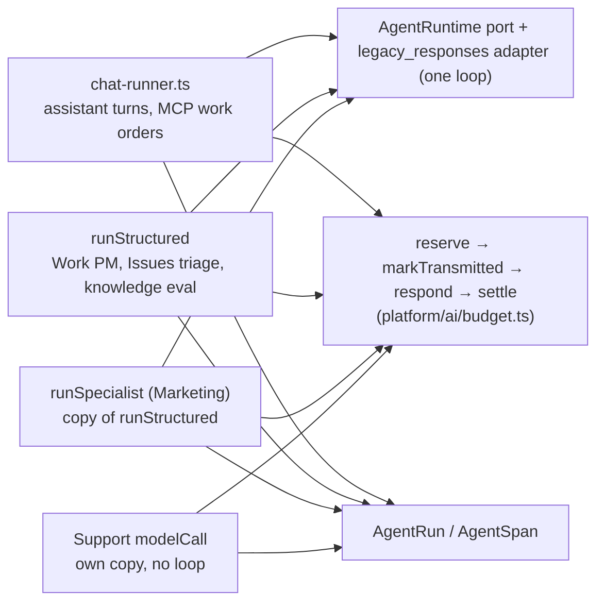
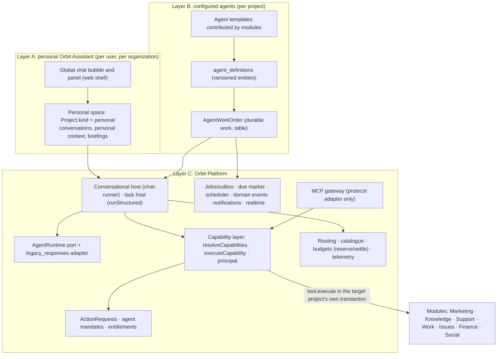
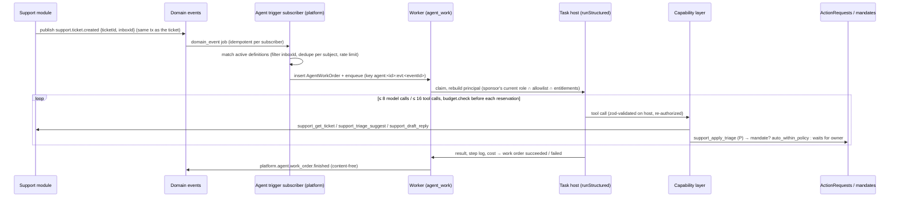
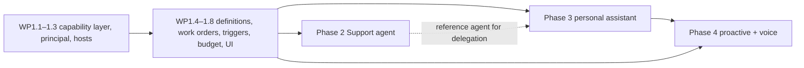

# Agent platform and personal Orbit Assistant: architecture overview

Status: **accepted plan** (2026-11-04; decisions D-01 to D-07 and D-12 to D-14 recorded in [ADR 0021](../adr/0021-agent-platform.md)). Implementation in progress. Nothing here is implemented, migrated, flagged or deployed. Every decision marked **D-nn** (§14) needs Mario's answer before the work package that depends on it starts.

Requested by Mario on 2026-11-04: extend Orbit into a central, modular AI work platform with (A) a personal assistant per user, (B) user-configurable agents and (C) one shared platform underneath, without a second agent runtime, chat backend, MCP stack or approval system.

Phase plans:
- [Phase 1: general agent framework and agent builder](agent-platform-phase-1.md)
- [Phase 2: Support agent as the reference implementation](agent-platform-phase-2.md)
- [Phase 3: personal Orbit Assistant and global chat](agent-platform-phase-3.md)
- [Phase 4: proactive agents and voice](agent-platform-phase-4.md)

**Evidence base.** A static read of `origin/main` at `cc8a14cf` (2026-11-03): code, Prisma schema, migrations, worker, web, ADRs and plans. No tests, database, flag state or production system were inspected. Labels: **[Fact]** is read in code at the cited path; **[Proposal]** is this plan; **[Unverified]** needs a check before it is relied on. Production flag states come from `docs/IMPLEMENTATION_STATUS.md` and are historical checkpoints, not a live reading.

---

## 1. Summary

1. **Orbit already has almost every building block** an agent platform needs. It has one model loop behind the `AgentRuntime` port, a typed tool registry, ActionRequests with risk classes, agent mandates (ADR 0019), durable delegated work orders (MCP 2.0), domain events, a due-marker worker, budgets with reservation and settlement, and per-run telemetry. What is missing is mostly *configuration as data*, a *principal for agents*, *generic triggers* and a *user-scoped home* for the assistant.
2. **The same budgeted call path exists four times:** in the chat runner, `runStructured`, the Marketing `runSpecialist` and Support's own `modelCall`. The tool-filter logic exists twice: in the chat runner and in MCP visibility. Phase 1 consolidates these before anything new is built on them.
3. **Recommended architecture: "one loop, two hosts, one capability layer".**
   - The `AgentRuntime` port with the `legacy_responses` adapter stays the only loop.
   - The conversational host (`chat-runner.ts`) serves the assistant and MCP work orders.
   - The task host (`runStructured`, extended) serves configured agents and module pipelines.
   - Both hosts, and the MCP gateway, resolve and execute tools through one new capability layer with per-call authorization.
4. **Configured agents are versioned data** (`agent_definitions` entities) that reference registry tools, knowledge sources, a model route, limits, a budget and triggers. They never contain code, SQL or free API access. Their work is a durable **work order** (new table `AgentWorkOrder`), executed by the existing worker.
5. **An agent never has rights of its own.** It acts on behalf of a human:
   - triggered runs act for the owner who activated it (the *sponsor*);
   - manual and delegated runs act for the requester as well.

   Effective rights are the intersection of the agent's allowlist, the sponsor's current rights and the requester's current rights. They are re-evaluated on every tool call.
6. **Automation beyond proposals uses the existing agent mandates.** ADR 0019 is extended by one new covered channel, "named agent". External effects (W1, W2, D*, F*, G) stay human-approved; customer replies and publishing are never automatic.
7. **The personal assistant extends Orbit Chat.** It does not replace it. Each user gets a **personal space** per organization: a project of the new kind `personal`, visible only to that user. The assistant's conversations, jobs, realtime stream, budget and personal context live there. Each tool call against a business project carries an explicit `projectId` and is authorized in that project's own transaction, which is the pattern the MCP adapter already uses.
8. **Marketing specialists keep their domain pipeline.** They move onto the shared primitives (`runStructured`, the capability layer, the principal) step by step. Assignments appear read-only in the global agent overview. No forced migration.
9. **SaaS readiness comes from an entitlements port** introduced in Phase 1. It has an "unlimited" default, so the self-hosted installation behaves as today. Plans and billing stay out of scope.
10. **Effort, as a rough estimate:**
    - Phase 1: 20–29 focused development days, 10 PRs.
    - Phase 2: 9–13 days, 6 PRs.
    - Phase 3: 18–26 days, 9 PRs.
    - Phase 4: 13–19 days, 8 PRs, including the voice basics, plus an optional 3–5-day realtime-voice spike.

    The first code package is the **capability layer** (WP1.1). It is a behaviour-preserving refactor with no flag and no migration.

---

## 2. Current state (Ist-Zustand)

### 2.1 Inventory

| Capability | Where (all [Fact]) | State | Reuse verdict |
|---|---|---|---|
| Runtime port and loop | `apps/api/src/platform/agents/runtime/port.ts`, `legacy-responses.ts`, `contract.ts` | merged; the only adapter. ADR 0005's "not merged" note is outdated | **Reuse as-is** |
| Conversational host | `apps/api/src/platform/assistant/chat-runner.ts` (≈880 lines), `chat.ts`, `chat-limits.ts` (8 model calls, 16 tool calls, 128,000 input bytes, 8,000 output chars) | live; project-bound | **Reuse**; extract its tool execution into the capability layer |
| Task host | `apps/api/src/platform/agents/structured-run.ts` (`runStructured`): R0 tools only, `guard`, `budget.check`, `runKey`/`callKey`, schema output | live; used by Work PM, Issues triage, knowledge evaluation | **Reuse and extend** (principal-checked W0/P tools, hosted tools, hooks) |
| Marketing specialist runner | `apps/api/src/modules/marketing/agents/specialists/runner.ts` (`runSpecialist`, ≈90 % copy of `runStructured`); DAG in `assignment-runs.ts` | live behind `ORBIT_AGENTS` | Keep the domain pipeline; **delegate the call path** to `runStructured` |
| Support AI call path | `apps/api/src/modules/support/ai.ts` (own `modelCall`, triage and draft, hard rules, placeholders) | live behind `ORBIT_SUPPORT` | Keep the pipeline and checks; **wrap as agent tools**; later move its call path onto `runStructured` |
| Tool registry | `apps/api/src/platform/agents/tools/registry.ts` (`OrbitTool`, `defineTool`, risk `R0_read`/`W0_internal`/`P_proposal`, `exposure {assistant, mcp}`, closed `ToolFeature` and `ToolNamespace` unions) | live | **Extend** (agent exposure, catalogue metadata, host-side validation, open unions) |
| Operation factories | `apps/api/src/platform/tasks/operation-tools.ts` (`readOperation`, `approvedOperation`; mandates applied for new requests) | live | **Reuse as-is** |
| ActionRequests | `apps/api/src/platform/governance/action-requests.ts` (entity, 11 risk classes, `approval_required` only, hash-bound decisions, `revalidate`, single use) | live | **Reuse as-is** |
| Agent mandates | `apps/api/src/platform/governance/agent-mandates.ts`, `authorization.ts` (`resolveAuthorization`; channels assistant/MCP; delegated tasks and specialists not covered) | live; `ORBIT_AGENT_MANDATES` on in production since 2026-10-30 | **Extend** with a "named agent" channel |
| Delegated work orders | `apps/api/src/platform/tasks/tasks.ts`, `delegation.ts` (entity `orbit_tasks`, frozen delegation snapshot, owner start approval `platform.task.start`, private conversation, per-call re-authorization) | merged; behind `ORBIT_MCP_TASKS` (state in production [Unverified]) | **Generalize** into `AgentWorkOrder` (D-05) |
| MCP gateway | `apps/api/src/platform/mcp/adapter.ts`, `visibility.ts`, `native-tools.ts`, `principal.ts`; separate process `apps/api/src/mcp-main.ts` | live | Keep the protocol adapter; **share the capability layer**; move the native tools into the registry |
| Handoffs | `apps/api/src/platform/handoffs/` (targets `issues.report`, `work.task_from_issue`; event `platform.handoff.status_changed`) | live | **Reuse** for cross-module agent results |
| Domain events | `apps/api/src/platform/events/events.ts` (`DomainEvent` table, per-subscriber idempotent jobs, depth ≤ 5, own-origin skip, content-free ≤ 4 KB, 30-day retention) | live | **Reuse** as the event-trigger source |
| Jobs and worker | `apps/api/src/platform/jobs/` (`enqueue` + outbox, `JobDef`, `SchedulerContribution`, `PeriodicTask`); `apps/worker/src/main.ts`, `due-marker.ts`, `lost-jobs.ts` | live; no cron or BullMQ repeatables; per-project due marker | **Reuse**; add an agent queue class and scheduler contribution |
| Notifications | `apps/api/src/platform/notifications/members.ts` (`notifyMembers`, in-app and e-mail, per-kind preferences), `notify.ts` (Telegram, idempotent key) | live | **Extend** (dedupe key, digest, quiet hours) |
| Attention | `apps/api/src/platform/attention/` (computed on read, stable ids) | live | **Reuse** for proactive summaries |
| Realtime | `apps/api/src/platform/realtime/fanout.ts`, `sse.ts` (Redis wake-up and database replay, project-scoped channels) | merged; `ORBIT_REALTIME` default off | **Reuse**; the personal space gives a user-level channel without new infrastructure |
| AI routing and budgets | `packages/ai/src/routing.ts` (15 fixed task classes), `apps/api/src/platform/ai/budget.ts` (`reserve`/`markTransmitted`/`settle`), `call-plan.ts`, `spend-policy.ts`, `org-budget.ts`, `catalog.ts`; `AiProfile`, `AiModelPrice`, `OrganizationAiBudget` | live | **Reuse**; add one task class and agent attribution |
| Telemetry | `AgentRun`/`AgentSpan` (`packages/db/prisma/schema.prisma`), `apps/api/src/platform/ai/telemetry.ts` (closed `RunKind` with a database CHECK) | live; no retention purge | **Extend** (new kind, retention) |
| Tenancy | `Workspace` (= organization), `Project` (`kind` `project`/`library`), `ProjectMember`, `ProjectMemberModuleRole`; `scoped()` with a per-project advisory lock and FORCE RLS; `Scope` is always one project | live | **Reuse**; add the project kind `personal` |
| Module system | `packages/module-contracts/src/index.ts` (metadata), `apps/api/src/platform/modules/contributions.ts` (≈30 contribution fields), `apps/api/src/modules/registry.ts` | live | **Extend** (agent templates, triggerable events, signals) |
| Privacy helpers | `apps/api/src/platform/privacy/redact.ts`; Support `withPlaceholders`, `hard-rules.ts`, `screenDraft` | live | **Reuse**; apply `redact()` before Support model calls |
| Web chat | `apps/web/src/components/chat.tsx` (722-line monolith); `apps/web/src/platform/assistant/` (`extensions.ts`, `decide.ts`, `tasks.tsx`); mounted inside the project shell (`apps/web/src/components/orbit.tsx`) | live | **Refactor** into a headless hook plus views; add a panel primitive |
| Entitlements, speech, personal memory | — | **absent** | New |

### 2.2 One loop, four call paths



**[Fact]** All four paths implement the same sequence:
1. `requireSpendMandate`
2. route resolution with a route-version pin
3. `planCall`
4. a caller ceiling check
5. `reserve`
6. `markTransmitted`
7. the provider call
8. `settle`, with `settle(null)` for an unknown outcome

Each copy carries its own small deviations:
- strict versus fence-tolerant JSON parsing;
- throwing versus result objects;
- whether tools are re-authorized per call.

A new agent framework built on a fifth copy would make this worse. Phase 1 therefore starts by consolidating the copies.

### 2.3 Tool exposure today

- **[Fact]** There is one `OrbitTool` registry for the assistant and MCP. The MCP adapter and the chat runner both call the same `tool.execute(ToolContext)` in-process. **No internal MCP HTTP call exists today, and none is needed.**
- **[Fact] The visibility filter exists twice.** The feature set, role and module filters are assembled separately in `chat-runner.ts` (≈ lines 480–523) and `platform/mcp/visibility.ts` (≈ 116–154).
- **[Fact] Gateway-native tools are not registry tools.** `orbit_create_task`/`get`/`list`/`cancel`, `orbit_projects`, `orbit_profile`, `search`, `fetch` and `orbit_action_status` are of type `NativeTool` (`platform/mcp/native-tools.ts`). The assistant cannot call them.
- **[Fact] Most operations are reserved for delegated runs.** Operations built with `approvedOperation`/`readOperation` default to `feature: "mcp_tasks"`, which is switched on only for delegated work orders. The in-app chat is offered only `support_insights` from Support, for example, while `docs/SUPPORT_MCP.md` says the Support tools are "registered for the Orbit Assistant".
- **[Fact] Specialists bypass execution-time checks.** Marketing specialists run under the worker scope (`userId: "worker"`, `role: "owner"`, `apps/worker/src/main.ts`) with static per-role tool arrays and no check at execution. `runStructured` checks permissions once, before the run.

### 2.4 Approvals, mandates and work orders today

**ActionRequests**
- **[Fact]** Every consequential action is an ActionRequest. The code models only `approval_required`, plus `auto_within_policy` when a mandate covers the request.
- **[Fact]** `approvedOperation` executes `onApproved` inline in the decision transaction. It re-checks the proposer's *current* membership, module and permission before it runs.

**Mandates**
- **[Fact]** A mandate covers the owner who grants it, through the assistant and/or MCP channel. It never covers delegated work orders (`DELEGATED_TASK_NOT_COVERED`) or specialist tasks.
- **[Fact]** The Support inbox rule `mcpOwnerRepliesWithoutApproval` is separate from mandates. It never applies to delegated work.

**Work orders (MCP 2.0)**
- **[Fact]** A work order is one durable chat turn in a private conversation, with a frozen delegation `{grantId, clientId, userId, scopes, modules, mode read|draft|execute, ceilingMicros}`. It is re-checked before every model call and every tool call.
- **[Fact]** There is no checkpoint or resume inside a turn: a crash after transmission becomes `CHAT_OUTCOME_UNKNOWN`.
- **[Fact]** Delegation chains are prevented only *incidentally*, because `orbit_create_task` is not a registry tool. There is no depth counter.
- **[Fact]** Child proposals of a delegated run bypass the MCP proposal quotas: 20 per hour and 100 per day, enforced only in the adapter.

### 2.5 Platform services relevant to agents

| Service | Facts that matter for the plan |
|---|---|
| Worker | Due marker `Project.workDueAt`; 1.5 s pump, up to 100 projects ordered by due time, 4 in parallel; each project revisited at least every 5 minutes; lease, retry (3 attempts) and lost-job re-dispatch after 10 minutes. Concurrency is per queue class per process (default 1). **No per-tenant fairness.** |
| Events | Transactional; at least once per subscriber; no ordering; project-scoped only; publishers in Work, Issues, Support (`support.contact.erased` only), Social and the platform. **Support publishes no ticket-created or message-received event.** |
| Notifications | In-app plus e-mail through the project's default mailbox; preferences per (project, user, kind). **No dedupe key, digest, rate limit or quiet hours.** The bell polls once a minute. |
| Realtime | SSE plus Redis wake-up, no content in Redis; channels `orbit:rt:<instance>:<projectId>:<stream>`; no user- or org-level channel. |
| AI | Per-project AI configuration over org and system `AiProfile`; org price catalogue `AiModelPrice` (`active` switch per org); budget layers: spend authority, project day and month, per run, provider, grant, connection, org budget. A new AI feature must edit `routing.ts` in four places, the `RunKind` union and the `AgentRun_kind_check` constraint. |
| Tenancy | Org owners are owners of **every** project in the org (`platform/tenancy/member-scope.ts`). Global admin is `user.role = "admin"`. One user can be in several orgs. |

### 2.6 The chat is project-bound everywhere

**[Fact]** `ChatConversation`, `ChatMessage`, `ChatRun` and `ChatProposal` all have NOT NULL `workspaceId`, `projectId` and `userId`, composite foreign keys and the FORCE RLS policy `chat_owner_scope` (workspace, project and user must match).

The routes are `/api/projects/:projectId/chat/*`. The project is also assumed by:
- the job entity and the outbox row;
- the worker scope and the pause check;
- the AI configuration, route version, spend mandate and reservation;
- telemetry and the realtime channel;
- every one of the ≈140 tool definitions;
- the web hooks: `useWorkspace`, the EventSource URL and `useDecideActionRequest`.

The chat runner sends the last 12 messages as text only. Earlier tool results and cards are not replayed.

### 2.7 Missing components

| Missing | Needed by |
|---|---|
| Agent definitions as versioned data; agent templates; builder catalogue | Phase 1 |
| Agent principal (sponsor, requester, allowlist) with per-call re-authorization in the task host | Phase 1 |
| Generic triggers: manual, schedule (local-time rhythm), event (module-declared, filtered) | Phase 1 |
| Work order record usable for agents, the assistant and MCP; delegation depth and fan-out limits | Phase 1, Phase 3 |
| Agent budget (per-agent month and run ceilings) on top of `reserve` | Phase 1 |
| Open task-class, run-kind, tool-feature and card registries (today closed unions plus a database CHECK) | Phase 1 |
| `AgentRun`/`AgentSpan` retention | Phase 1 |
| Entitlements port | Phase 1 |
| Support domain events, agent actor on Support actions, triage-apply and hand-off tools, `redact()` before Support model calls | Phase 2 |
| User-scoped home (personal space), cross-project tool targeting, project tags on cards, a panel primitive, a headless chat hook | Phase 3 |
| Personal context store | Phase 3 |
| Notification dedupe, digest, quiet hours; budget threshold events; cross-project briefing | Phase 4 |
| Speech provider port, audio pricing, recording UI | Phase 4 |

### 2.8 Documentation drift found

These statements are outdated. Each phase updates the documents it touches.

| Document | Statement | Code reality |
|---|---|---|
| `docs/ORBIT_CHAT_V1.md` | UI `/chat`; limits 6/8/64,000; OpenAI only; registry in `modules/agents/tools` | `/p/:id/assistant` (with `/chat` as a legacy path); limits 8/16/128,000; Anthropic supported; registry in `platform/agents/tools` (old path is a shim) |
| `docs/MCP_2_0.md` | "six possible calls" per task | `CHAT_MAX_MODEL_CALLS = 8` |
| `docs/adr/0005-agent-runtime.md` | Port "not merged"; specialists in `modules/agents/specialists/`; per-step cost ceilings | Port merged; specialists in `modules/marketing/agents/specialists/`; pooled run budget (R75) |
| `docs/adr/0007-tool-registry.md` | Registry carries output schemas, cost category, connector requirement; availability re-checked at execution; outputs validated | `outputSchema` optional (MCP only); no cost category; specialists not re-checked; outputs string-sliced at 12,000 characters |
| `docs/adr/0008-action-approvals.md` | Six approval modes; "only `assignment.confirm` is MCP-proposable"; approval queues a job that runs with the decider's role | Only `approval_required` (+ mandate `auto_within_policy`); every `approvedOperation` is proposable while `ORBIT_MCP_TASKS` is on; inline execution with the proposer's role |
| `docs/plans/ORBIT_CORE_JARVIS_PLAN.md` §13 | J1–J3 "local / not merged" | Merged on `main` (behind `ORBIT_CONTENT_PACKAGES`) |
| `docs/SUPPORT_MCP.md` | Support tools "registered for the Orbit Assistant" | Offered only to delegated work orders (`feature: "mcp_tasks"`) |
| `docs/plans/marketing-agent-v2.md` §1 | "Do not introduce another assistant, autonomous agent framework, scheduler…" | Conflicts with this plan; to be superseded explicitly by ADR 0021 (WP1.0) |
| `docs/MODEL_ROUTING.md` | "Three task classes reach a model" | 15 task classes |
| `docs/adr/0017-ai-project-manager.md` | Action type `work.pm.run` | `work.mcp.work_pm_propose_plan` |

---

## 3. Architecture variants

| # | Variant | For | Against | Verdict |
|---|---|---|---|---|
| V1 | **Configured agents as MCP-style work orders in the conversational host** (a private chat conversation per run, an agent profile overlay on `runChat`) | Maximum reuse of the delegation and re-authorization already built; transcripts exist | Chat tables are **user-private by RLS**: other owners could not inspect a sponsor's agent runs. The chat prompt and 12-message context fit dialogue, not tasks. No structured result. Every agent run would be one more hidden chat conversation. | Rejected as the primary host. Kept for the assistant and MCP work orders. |
| V2 | **Configured agents in the task host** (`runStructured` extended with principal-checked tools), one capability layer shared with chat and MCP, work orders as a project table | One loop; structured results; project-visible run history; reuses budgets, guard, telemetry and per-call checks; also absorbs the Marketing and Support copies | Requires a careful refactor of `runStructured` and the chat runner's tool execution | **Recommended** |
| V3 | **Generalize the Marketing DAG engine** (`assignment-runs.ts`) into a generic multi-step workflow engine | Rich orchestration, step budgets | Large extraction from domain code; slot, veto and review logic is welded in; no second module needs a DAG today | Deferred; only if a second module needs multi-step pipelines (D-14) |
| V4 | **A separate agent service** (new runtime, own queue, own approval store) | Clean slate | Violates rules 1, 2 and 9 of the request; duplicates RLS, budgets and approvals | Rejected |
| V5 | **Hosted agent runtimes** (OpenAI Agents API, Anthropic managed agents) | Least runtime code | ADR 0005 §5 still holds: business state and spend would leave Orbit's journal; best-effort usage conflicts with exact settlement | Rejected |

For the personal assistant's storage, see §4.5 (variants P1–P4).

---

## 4. Target architecture

### 4.1 Three layers



### 4.2 Terms

| Term | Meaning | Collision to avoid |
|---|---|---|
| **Agent platform** | The platform capability in `apps/api/src/platform/agents/` (runtime, hosts, capability layer, definitions, work orders, triggers) | Not "Orbit Agents", the 2026-10-09 Marketing design (assignments + specialists) |
| **Agent definition** | A versioned, project-scoped configuration of one agent (entity kind `agent_definitions`) | — |
| **Agent template** | A module-contributed starting point for a definition (e.g. `support.ticket_agent`) with recommended tools, instructions and guard rules | — |
| **Work order** | One durable unit of agent work (`AgentWorkOrder` row): origin, principal, status, cost, result | MCP 2.0 "work orders" (`orbit_tasks`) are the same concept and migrate into it (D-05) |
| **Agent run** | Unchanged: one telemetry record of model work (`AgentRun`). A work order has one or more agent runs. | Do not call a work order a "run" in code |
| **Sponsor** | The owner who activated the agent version; triggered work acts on the sponsor's behalf | — |
| **Requester** | The user (directly, through the assistant or MCP) who asked for a manual or delegated work order | — |
| **Personal space** | A project of kind `personal`, one per (user, organization), visible only to that user | Not a business project; hidden from project lists |
| **Orbit Assistant** | The one conversational agent (ADR 0009 AD-11), now with a personal (user-scoped) mode and the existing project mode | "Orbit Core" keeps its historical meaning |

German UI wording (D-13): *Agenten*, *Ausführungen* (work orders), *Persönlicher Bereich*. Marketing's *Aufträge* (assignments) keep their name.

### 4.3 Layer C: platform building blocks

1. **Capability layer** (new, `apps/api/src/platform/agents/capabilities.ts`). One function decides which tools a principal may see in a project. Another executes one tool call: it validates the arguments with zod on the host, re-authorizes, runs inside `moduleScope`, and caps the output JSON-safely. The chat runner, `runStructured` and the MCP adapter all call it. This removes the duplicated filter in `chat-runner.ts` and `mcp/visibility.ts`.
2. **Principal** (new, `apps/api/src/platform/agents/principal.ts`):

   ```text
   { kind: user | assistant | mcp | agent | delegated, userId, requesterUserId?,
     agentId?, agentVersion?, workOrderId?, rootWorkOrderId?, depth,
     allow {tools, modules, mode, knowledge}, ceilingMicros }
   ```

   It generalizes today's `ToolContext.channel`, the `delegatedExecution` AsyncLocalStorage and `ToolContext.agentTask`. `requestedBy` on ActionRequests gains the agent fields.
3. **Hosts.**
   - The conversational host (`chat-runner.ts`) stays for dialogue: project chat, personal assistant, MCP work orders.
   - The task host (`runStructured`) becomes the host for configured agents and module pipelines. It gains:
     - principal-checked W0/P tools;
     - hosted tools (web search), cancellation, input hooks and an optional output schema;
     - a step log for the work-order history.

     `runSpecialist` and Support's `modelCall` delegate to it.
4. **Work orders and triggers.**
   - `AgentWorkOrder` is a project table with FORCE RLS.
   - A platform queue class `agent_work` and a platform `SchedulerContribution` drive schedule triggers.
   - A generic platform event subscriber drives event triggers.
   - Idempotency keys:
     - `agent:<agentId>:slot:<isoSlot>`
     - `agent:<agentId>:evt:<eventId>`
     - `agent:<agentId>:subject:<type>:<id>` (one open work order per subject)
5. **Budget.**
   - `reserve` stays the single authority.
   - An agent adds a narrower check through the existing `budget.check` hook: its month ceiling and its run ceiling.
   - Its spend is attributed to the agent so a month total can be read cheaply (WP1.4).
   - The org budget and the project spend authority still apply. A mandate never raises a budget.
6. **Routing.**
   - One new task class `agent_custom` with a default tier.
   - An optional per-agent model choice, restricted to the org catalogue's active models (`AiModelPrice.active`) and the project's verified models.
   - The route version is pinned per work order.
7. **Telemetry.** A new run kind `agent_work`; spans unchanged. Retention for `AgentRun`/`AgentSpan` is added: today these rows are never purged.
8. **Entitlements port** (new, `apps/api/src/platform/entitlements/`). `entitlementsFor(workspaceId)` returns limits and switches (§8). The default resolver returns "unlimited", so behaviour is unchanged. Enforcement points call it from Phase 1 on.

### 4.4 Layer B: configured agents

- **What a definition holds** (all validated against the registry and the catalogue at save time and again at run time):
  - name, description, template;
  - instructions (bounded length);
  - modules and tool allowlist (registry names only);
  - knowledge restriction (source ids or audience);
  - autonomy mode `read | draft | execute`, the MCP 2.0 mode vocabulary;
  - model choice;
  - limits (model calls ≤ 8, tool calls ≤ 16, wall time, runs per day, concurrency);
  - budget (month and run ceilings);
  - triggers;
  - outputs (notify whom, which summary card);
  - status `draft | active | paused | disabled`;
  - activation `{sponsorUserId, activatedAt, configHash}`.
- **Versioning** comes from `EntityVersion`. A definition holds an `active` configuration (what runs) and a `draft` working copy. Edits change only the draft, so an active agent keeps running unchanged while it is edited; unlike assignments, there is no coverage gap. Activation is an owner-only, hash-bound web action that copies the draft into `active`. Every work order records `agentVersion` and `configHash`.
- **What a definition can never do:** run code, SQL, HTTP or shell; widen permissions; name tools that are not registry tools with `exposure.agent`; change mandates, budgets, policies or connections.
- **Templates** come from modules (`ModuleContributions.agentTemplates`). They can pin guard rules a user cannot remove. Example: the Support template never allows `support_send_reply` outside proposal mode.
- **Module-managed agents.** Marketing assignments appear in the overview read-only through a `ModuleContributions.agentListings` contribution, which links to Marketing. They are not edited in the builder.

### 4.5 Layer A: personal assistant

**Storage variants**

| # | Variant | Verdict |
|---|---|---|
| P1 | **Personal space**: one project of kind `personal` per (user, organization). Membership is exactly that user, and org owners have **no** implicit access. | **Recommended** (D-08). Chat tables, jobs, outbox, due marker, RLS, realtime channel, telemetry, pause and budget all work unchanged. |
| P2 | Nullable `projectId` on the chat tables plus a user-only RLS branch | Rejected: jobs, outbox, worker pump, realtime and budgets are all keyed by project, so it amounts to a second, project-less data plane |
| P3 | "Home project": personal conversations live in whichever business project is open | Rejected: wrong payer, history lost when access to that project ends, pause semantics mixed |
| P4 | New assistant tables | Rejected: a parallel chat backend |

**How the recommended variant works**
- **One backend.** The assistant is the existing conversational host in the personal space. Its system prompt lists the user's accessible projects: names, ids and active modules only.
- **Cross-project tools.** Tools are reached in two stages:
  - Always loaded: platform core tools such as `my_overview`, `projects_list`, `load_project_tools`, `agents_list`, `agent_delegate` and `work_order_status`.
  - Per target project: project tools, loaded with an explicit `projectId`. Each call is authorized in that project's own `userScoped` transaction with the user's current role there, as the MCP adapter does today.
- **Writes** create ActionRequests in the target project. Cards carry the project.
- **Budget.** The assistant's own model calls are paid by the personal space, whose spend authority is derived from an org-level per-user assistant cap (D-09). Paid work inside a business project, such as a creative preview or an agent work order, is reserved against that project's spend authority and approvals, never against the personal space.
- **Personal context** (Phase 3) is a user-private entity kind in the personal space. The assistant may propose an entry; only the user confirms, edits or deletes one.

---

## 5. Data flows

### 5.1 Event-triggered agent (scenario A)



### 5.2 Assistant answers across two projects (scenario B)

```mermaid
sequenceDiagram
  participant U as User (bubble)
  participant PS as Personal space (chat job)
  participant C as Capability layer
  participant P1 as Project A (own tx)
  participant P2 as Project B (own tx)
  U->>PS: "Which tasks are open in A and B?"
  PS->>C: my_overview(projects:[A,B])
  C->>P1: actorScope(user, A) → work_search_tasks (R0) if the module is enabled and the role allows
  C->>P2: actorScope(user, B) → refused or allowed independently
  C-->>PS: results tagged {projectId, projectName}; refused projects listed by name with the reason code only
  PS-->>U: one answer, every item linked into its own project
```

### 5.3 Delegated task (scenario C)

The user asks the assistant to have the Support agent investigate five tickets.

1. The assistant calls `agent_delegate(projectId, agentId, subjects:[…], goal)`. This is a P tool.
2. The capability layer computes the principal: requester ∩ sponsor ∩ agent allowlist. It creates one parent work order (`origin: assistant`, depth 1) with at most 10 child work orders, one per ticket, and shows a confirmation card with the cost ceiling.
3. On the user's confirmation, or a per-agent start mandate (D-06), the children are enqueued.
4. The worker runs each child in the task host.
5. The `platform.agent.work_order.finished` events update the parent.
6. A platform subscriber writes a *system notice* (no model call) into the personal conversation, plus a result card linked to each work order.
7. The user's next message lets the assistant summarize, using `work_order_status`.

### 5.4 Permission loss during a run (scenario D)

The capability layer re-evaluates the principal before every model call and every tool call. It reads the current role, module role, module activation, entitlement and the agent's status and version.

If the requester or sponsor lost a needed permission:
- the next affected tool call fails with `AGENT_PRINCIPAL_FORBIDDEN`;
- nothing is executed;
- the work order ends `blocked` with the code;
- reserved but untransmitted cost is released (`settle(0)`).

Pending ActionRequests created earlier are revalidated at decision time by the existing `onApproved` re-check of the proposer. The proposer is now the agent principal: sponsor and requester are both re-checked, so the request fails closed.

### 5.5 Proactive failure notice (scenario E)

1. A failed work order publishes `platform.agent.work_order.failed`.
2. A platform signal subscriber computes the fingerprint `agent_failed:<agentId>:<errorCode>:<utcDay>`.
3. It upserts a deduplicated notification for the sponsor and the agent's managers: in-app, plus e-mail where the user opted in.
4. **No model is called.**

An AI summary is produced only when a digest or briefing is due and the user enabled AI summaries. That step is a configured-agent work order with its own budget (Phase 4).

---

## 6. Module boundaries and code placement

| Path | Zone ([Fact] from `scripts/boundaries.json`) | Content ([Proposal]) |
|---|---|---|
| `apps/api/src/platform/agents/` | platform (exists: `runtime/`, `structured-run.ts`, `tools/`) | `capabilities.ts`, `principal.ts`, `definitions/`, `work-orders/`, `triggers/`, `templates.ts`, `catalog.ts`, `routes.ts` |
| `apps/api/src/platform/assistant/` | platform | personal-space conversation support, cross-project core tools, system notices |
| `apps/api/src/platform/entitlements/` | platform (new) | port and default resolver |
| `apps/api/src/platform/signals/` | platform (new, Phase 4) | proactive detectors and digests |
| `apps/api/src/modules/<module>/agent-*.ts` | that module | templates, triggerable events, agent-exposed tools |
| `apps/api/src/modules/agents/` | **re-export shims classified as Marketing** | **Do not add code here.** A new module with this id would inherit Marketing's shims and break `module-cross-boundary`. |
| `apps/web/src/platform/agents/` | web platform (new) | agent overview, builder, work-order history |
| `apps/web/src/platform/assistant/` | web platform (exists) | headless chat hook, panel, bubble |
| `apps/web/src/platform/ui/` | web platform (exists) | non-modal panel/sheet primitive |

**Rules kept**
- The platform never imports modules. Modules contribute through new `ModuleContributions` fields: `agentTemplates`, triggerable event declarations, `agentListings` and `signals`.
- The worker imports only platform code and the registry root.
- Module-to-module calls stay on declared contracts and handoffs.
- The empty boundary baseline stays empty.

---

## 7. Security model

### 7.1 Three layers of rights (question 8)

| Layer | Source | Decides | Changed by |
|---|---|---|---|
| **User rights** | Project membership role, module role, module activation, permission catalogue (`platform/tenancy/permissions.ts`, `module-roles.ts`) | The upper bound of anything done on a user's behalf | Owners, administrators |
| **Agent rights** | The definition's allowlist (tools, modules, knowledge, mode, limits, budget), frozen in the activated version and bounded by the template's guard rules and entitlements | Which subset of the human's rights the agent may use | Owners, by editing and re-activating (hash-bound) |
| **Automation mandates** | ADR 0019 `agent_mandates`, extended with the channel `agents` and named agent ids | Which proposal types may be approved without a click; never a budget, never W1+ | Owners, in the web UI only |

**Effective authorization of one tool call:**

```text
tool ∈ allowlist ∧ tool.exposure.agent
∧ mode permits tool risk (read: R0; draft: R0 + P; execute: R0 + W0 + P)
∧ module enabled ∧ entitlement allows
∧ sponsor's current module role permits tool.permission
∧ (requester ? requester's current module role permits tool.permission : true)
∧ agent status active ∧ version unchanged since the work order started
```

**What happens to a proposal (P tool) afterwards**
- It becomes an ActionRequest with `requestedBy {kind: "agent", userId: sponsor, requesterUserId?, agentId, agentVersion, workOrderId, agentRunId}`.
- `resolveAuthorization` may approve it only if a mandate names this agent, or the agents channel, and every existing mandate condition holds. Otherwise a human decides.

### 7.2 Re-checks at execution time (rule 7)

1. The work-order claim reads the definition's status and version and the entitlements.
2. Before each model call: the principal is rebuilt from the current memberships, the budget is checked, and the spend authority is checked.
3. On each tool call: the capability layer's full check (§7.1).
4. At an ActionRequest decision: the unchanged `decideActionRequest` runs, then `revalidate` and the operation's `onApproved` membership re-check, extended to the agent principal.
5. Before payment in long jobs: `assertMandateStillAuthorizes`, extended from the creative preview to any job that a mandated request starts.

### 7.3 Delegation without uncontrolled chains (question 6)

- **Monotonic narrowing.** A child principal's tools, modules, mode, knowledge and ceiling are each ⊆ the parent's. The ceiling is ≤ the parent's remaining ceiling.
- **Depth.** Root = 0; assistant → agent = 1; agent → agent = 2. The hard maximum is 2 (D-07). Every work order carries `rootWorkOrderId`, `parentId` and `depth`.
- **No cycles.** An agent id may appear only once on a chain.
- **Fan-out.** At most 10 children per work order, at most 3 running per project by default, and one open work order per (agent, subject).
- **Explicit handoff.** An agent can hand work to another agent only through `agent_delegate`, and only if its definition names the target agent. The child is still bounded by the sponsor of the *target* agent (no rights transfer between sponsors).
- **Events do not chain by default.** Event triggers ignore events whose actor is an agent (the origin and actor checks of `publishEvent`). The event depth limit of 5 stays.
- **Delegated requests never inherit standing approvals.** As today with `DELEGATED_TASK_NOT_COVERED`, a mandate must name the agent explicitly. The Support inbox rule never applies to agents.
- **Shared quotas.** MCP proposal quotas move from the adapter into the capability layer, so delegated and agent proposals count too.

### 7.4 Cross-project isolation (question 4)

- **Tenant boundary.** The assistant never crosses organizations. Switching organization switches personal space.
- **Per-call target.** Every project tool call names its target `projectId`. It is authorized and executed in that project's own transaction (`actorScope` for that project). Two project transactions are never nested, which avoids deadlocks on the per-project advisory lock.
- **Labelled results.** Every tool result and card carries `{projectId, projectName}`. Refused projects return only a reason code, never data.
- **Cross-project taint rule** [Proposal]. The run records which projects' data entered its context. A proposal in project B made in a turn that read data from project A (≠ B):
  - can never be auto-approved under a mandate;
  - its card warns "uses information from A".
- **One project per approval.** Every ActionRequest belongs to one project. The approvals summary already loops per project (`GET /api/action-requests/summary`).
- **Personal context entries** carry an optional project scope. They are included only when that project is in focus.

### 7.5 Prompt injection and data minimization

**Untrusted input.** Ticket text, documents, tool outputs and web results are untrusted. The instructions mark them so (Support already does this). They can never raise rights, because tools are fixed by the principal.

**What the model receives**
- Tool outputs are validated against their `outputSchema` where one exists.
- Outputs are capped JSON-safely; the current 12,000-character string slice can cut JSON mid-way.
- Telemetry keeps hashes only (ADR 0006).

**Support data before any model call**
- `screenCustomerText` hard rules on all customer text, the subject included;
- `withPlaceholders`;
- **and** `redact()`.

Support applies the first two today; `redact()` is a gap (Phase 2).

**Provider allow-list per data class** [Proposal]. A tool can declare `dataClass: "customer_personal"`. The host then refuses a route whose provider is not allowed for that class (`AGENT_PROVIDER_NOT_ALLOWED_FOR_DATA`). Q-12a currently covers OpenAI under its DPA only; Anthropic needs a decision (D-11).

### 7.6 What may be automated

| Risk class (ADR 0008) | Examples | Configured agent may | Under a mandate |
|---|---|---|---|
| `R0` read | ticket read, knowledge search | execute in all modes | — |
| `W0` internal | hand-off to a human, store an AI suggestion | execute in `execute` mode only | — |
| `W0`/`C1`/`C2` as ActionRequests | internal note, reply draft, apply triage, creative preview | propose (`draft`/`execute`) | auto-approved only if the type is mandatable **and** a mandate names the agent |
| `W1` external message | customer reply | propose only | **never** |
| `W2` publish, `D*` delete, `F*` money, `G` governance | publish post, delete, budget, mandates, agent activation | propose only (W2, D*, F*) or not at all (G) | **never** |

### 7.7 Audit

- Every work order is a record: origin, principal, version, cost, result and error.
- Every ActionRequest names the agent.
- Mandate auto-approvals keep `action_request.auto_approved`.
- Agent lifecycle events are audited: `agent.created`, `agent.activated`, `agent.paused` and `agent.disabled`.
- Support timeline events by agents use `actorKind = "ai"` (an existing value) with the work order id.
- No payload text goes into audit, events or telemetry.

---

## 8. SaaS readiness

**Mechanism** ([Proposal], D-12). `platform/entitlements/` exposes `entitlementsFor(workspaceId)`, returning:

```text
{ agents.max, agents.automation, agents.triggerKinds, modules.allowed,
  ai.models.allowed, ai.monthlyBudgetMicros, assistant.personal,
  assistant.voice, integrations.advanced, mcp.tasks }
```

- Phase 1 ships a code-default resolver returning "unlimited" for every key, so the self-hosted installation is unchanged.
- A later track adds an `OrganizationEntitlement` table and an administration page. Pricing and billing are out of scope.

**Enforcement points** (each a single call to the port):

| Entitlement | Enforced at |
|---|---|
| Max own agents | Agent create/duplicate (count over the org's projects) |
| Allowed modules | Module `available()` per org (extends today's env-only availability); builder catalogue |
| Available AI models | Catalogue filter (`AiModelPrice.active` ∩ plan list) in routing settings and the builder |
| Monthly AI budget | `OrganizationAiBudget` (exists); the plan sets its ceiling |
| Automatic execution | Activation of schedule/event triggers (`agents.automation`, `agents.triggerKinds`) |
| Advanced integrations | Connection providers (n8n automation, coding dispatch) |
| Personal assistant | Personal space provisioning and the bubble |
| Voice | Speech endpoints and the microphone button |

---

## 9. Technical risks (including question 10)

| # | Risk | Impact | Mitigation | Phase |
|---|---|---|---|---|
| R-01 | Refactoring `chat-runner.ts` and `runStructured` changes behaviour of live chat, PM and Issues runs | high | Behaviour-preserving extraction first (WP1.1) with the existing chat-runner, structured-run, MCP and access-matrix suites; no flag needed; mutation-check the re-authorization | 1 |
| R-02 | Worker throughput: chat and agent classes run at concurrency 1 per process; queues are shared by all tenants | medium | Own queue class `agent_work` with configurable concurrency; per-project and per-agent concurrency claims in the database; backpressure as today (>200 waiting) | 1 |
| R-03 | Per-project advisory lock: frequent agent writes (step logs, snapshots) serialize with interactive work | medium | Step log written at step boundaries, not streamed; no partial-text snapshots for agents; measure with the project-lock measurement harness of modularization WP4.3 Part A (`docs/IMPLEMENTATION_STATUS.md`, "Project lock measurement") | 1 |
| R-04 | `enqueue` idempotency scans all of a project's jobs; `reserve` sums the whole month per call | medium at scale | Unique index for job idempotency; agent month totals from an attributed counter; profile before Phase 2 rollout | 1 |
| R-05 | Event storms (bulk ticket import) start many agent runs | cost, load | Per-agent rate limit and daily cap, subject dedupe, debounce window, entitlement `agents.automation`, budget ceilings | 1, 2 |
| R-06 | Cost runaway through loops | cost | Depth ≤ 2, fan-out ≤ 10, no event chaining by agents, 8/16 call limits, per-run and per-month ceilings, org budget | 1 |
| R-07 | Prompt injection from tickets steering actions | security | Fixed principal; mode limits; W1+ never automatic; taint rule; Support hard rules before any model call | 1, 2, 3 |
| R-08 | Customer data sent to a provider not covered by Q-12a | legal | Data-class provider allow-list (D-11); `redact()`; placeholders; no AI for anonymous visitors | 2 |
| R-09 | Cross-project data mixing in one assistant context | security | Explicit `projectId` per call, labelled results, taint rule, one project per approval, staged tool loading | 3 |
| R-10 | Context growth: Claude receives every tool in full; a union over projects would hit `CHAT_CONTEXT_LIMIT` | reliability, cost | Staged loading (`load_project_tools`), a provider-neutral tool loader, platform core ≤ 8 tools | 3 |
| R-11 | Personal space visible to org owners through implicit ownership | privacy | `projectMembership` excludes implicit org-owner access for kind `personal`; access-matrix rows; user-private entity kinds | 3 |
| R-12 | Telemetry and transcript growth (no retention for `AgentRun`/`AgentSpan`) | storage, privacy | Retention task (WP1.9); work-order results capped and redacted; erasure hooks | 1 |
| R-13 | MCP rate limits are per process | abuse when scaled | Move the quotas into the capability layer with Redis counters before a second API replica | 1, 3 |
| R-14 | Notification fatigue from proactive signals | adoption | Dedupe keys, digests, quiet hours, per-kind preferences | 4 |
| R-15 | Voice adds a new provider, audio personal data and per-minute costs | legal, cost | ADR, provider approval, no audio storage by default, per-minute pricing in the catalogue, entitlement switch | 4 |

---

## 10. Migration strategy and backward compatibility

1. **Nothing existing changes meaning.** Every new capability is behind default-off flags:

   | Flag | Phase | Covers |
   |---|---|---|
   | `ORBIT_AGENT_PLATFORM` | 1 | builder, manual runs |
   | `ORBIT_AGENT_AUTOMATION` | 1 | schedule and event triggers |
   | `ORBIT_PERSONAL_ASSISTANT` | 3 | personal space and the bubble |
   | `ORBIT_PROACTIVE` | 4 | signals and digests |
   | `ORBIT_VOICE` | 4 | speech |

   Existing API URLs, payloads and error codes stay stable (AD-05).
2. **Refactors first, features second.** WP1.1–WP1.3 are behaviour-preserving and flagless.
3. **Marketing.**
   - `runSpecialist` delegates to the extended `runStructured`, keeping its reservation key prefixes (`agent:<taskId>…`) that crash recovery depends on.
   - Its worker scope becomes an on-behalf principal of the assignment's confirming owner. The assignment DAG, slots, veto, review and executor steps stay in Marketing.
   - Assignments appear read-only in the agent overview.
   - A full move onto agent definitions is not planned (question 1).
4. **MCP work orders.** `orbit_tasks` entities stay readable. New work orders are written to `AgentWorkOrder` (`target: assistant`) once Phase 3 lands; the native MCP tools keep their names and shapes (D-05).
5. **Project chat.** `/p/:id/assistant` keeps working unchanged. The bubble opens the personal assistant; a project-mode toggle remains (D-10).
6. **Support.** Inboxes keep `aiMode: off | draft`. An explicit new value `agent` hands automatic triage and drafting to an active Support agent for that inbox (D-15). Without it, nothing changes.
7. **Schema changes.** Each change is additive and needs a Coolify-approved schema hash before the `main` push that deploys it (`docs/deployment/COOLIFY.md`).

   | Change | Phase |
   |---|---|
   | `AgentWorkOrder` table | 1 |
   | `AgentRun_kind_check` widened | 1 |
   | Agent spend attribution | 1 |
   | `SupportInbox_aiMode_check` widened | 2 |
   | `Project.kind` value `personal`, plus a personal-owner column or binding | 3 |
   | `Notification.dedupeKey` with a partial unique index | 4 |
   | Speech pricing units | 4 |

   Entity kinds such as `agent_definitions`, `personal_context` and briefings need no migration.
8. **Rollback per phase.** Switch the flag off; data stays inert. Additive columns and tables stay. Each phase plan has its own rollback section.

---

## 11. Answers to the architecture questions

1. **Marketing specialists: integrate or keep separate?** Keep them **domain-separate**, but on **shared primitives**:
   - The specialist pipeline is a fixed DAG with executor steps (copywriter, visual), deterministic review checks, slots, veto and owner release. Its value is in that domain logic, not in configurability.
   - Phase 1 removes the duplicated call path (`runSpecialist` → `runStructured`), gives specialists a real principal instead of the worker/owner scope, opens the closed unions they depend on, and lists assignments in the overview.
   - A full migration into user-configurable agents is not recommended. It would expose pipeline internals to users and risk the R75 budget and crash-recovery semantics.
2. **Avoiding a parallel configuration of agents, models and tools.** Definitions reference, never copy:
   - tools by registry name, with the catalogue computed from the registry;
   - models through the existing routing (one new task class plus an optional override, validated against the org catalogue);
   - budgets through `reserve` plus a narrower agent check;
   - knowledge through the existing source and audience model;
   - approvals through ActionRequests and mandates.

   The only new configuration is the agent's own: instructions, allowlist, limits, triggers.
3. **Can the existing chat serve the personal assistant?** **Yes**, with a user-scoped home. Durable runs, worker execution, idempotent send, cancel, unknown-outcome handling, SSE replay, module contributions and cards all carry over. What changes:
   - a personal space instead of a business project;
   - cross-project tool targeting;
   - staged tool loading;
   - project tags on cards;
   - a headless web hook and a panel.
4. **Coordinating several projects safely.** Explicit target project per call, an own transaction per project, per-call authorization with the user's current role there, labelled results, the taint rule, one project per approval, staged tool loading, and never across organizations (§7.4).
5. **Durable work orders across restarts.** The work order is a database row, and its job is an outbox row dispatched to BullMQ with a lease. After a restart:
   - expired leases are retried or marked `outcome_unknown`;
   - jobs lost from Redis are re-dispatched after 10 minutes;
   - a turn that never transmitted restarts from scratch;
   - a turn that transmitted is not repeated (`outcome_unknown`; no second paid request).

   Longer work is split into child work orders, which act as checkpoints at step boundaries. After an approval, a work order can continue with a new bounded turn (a continuation), started by the `action_request` decision event. This is how ADR 0008 §6 ("resume after approval") is met without in-turn state.
6. **Agent-to-agent handoff without uncontrolled chains.** Monotonic narrowing, depth ≤ 2, no cycles, fan-out ≤ 10, explicit named targets, no event chaining by agents, and no inherited standing approvals (§7.3).
7. **What the tool registry needs.**
   - `exposure.agent` and a builder catalogue entry (title, user text, module, risk and cost badges, mandatable, data class);
   - required `outputSchema` for agent-exposed tools;
   - host-side zod validation;
   - JSON-safe output caps;
   - `scopeShape` (project, user, workspace) and `delegable`;
   - an idempotency contract for W0 tools (work order + call index);
   - a budget context handed to paid tools (`runKey`, `check`);
   - open `ToolFeature`, `ToolNamespace` and card unions;
   - one shared `resolveCapabilities`;
   - the native MCP tools moved into the registry.
8. **User rights vs agent rights vs mandates.** See §7.1. User rights are the ceiling, agent rights a frozen subset, and mandates the only way to skip a click, for named internal types only.
9. **Directly usable Support functions** (details in the Phase 2 plan, §1):
   - **Reads:** list, detail, messages, customer context, taxonomy, `support_insights`.
   - **The triage and draft pipelines** (`runSupportTask`, with hard rules, placeholders, citation and evidence checks).
   - **Notes and reply drafts:** both mandatable.
   - **Ticket update:** owner approval.
   - **Issue report**, through the `issues.report` handoff.
   - **Inbox rules, SLA automations and notifications.**

   **Missing:**
   - ticket domain events;
   - an agent actor;
   - a triage-apply proposal;
   - a hand-off tool;
   - `redact()`;
   - `screenDraft` on agent-written drafts.
10. **Risks with many concurrent agents.** See §9 R-02 to R-07, R-12 and R-13:
    - queue concurrency and missing tenant fairness;
    - project lock contention;
    - O(n) idempotency scans and month sums;
    - event storms;
    - cost loops;
    - prompt injection;
    - telemetry growth;
    - per-process rate limits.

---

## 12. Acceptance scenarios

| Scenario | Phase | Proof |
|---|---|---|
| **A** Own Support agent: an admin creates it from the template, allows selected tools, triggers on new tickets; the agent stores internal results and a draft; an external send needs authorization | 2 (framework 1) | Integration test with a scripted model: event → work order → tools → proposals; `support_send_reply` refused in `execute` and only proposable; inbox rule not applied; access-matrix rows |
| **B** Personal assistant over two projects | 3 | Integration test: the user is editor in A and has no Work role in B; overview returns A's tasks, B's refusal code and no B data; a viewer of B sees only what viewers may |
| **C** Delegated task via the assistant, durable over the worker, result in chat | 3 (framework 1) | Test with a worker restart between children; parent completes; system notice and cards in the personal conversation; no second paid call for a transmitted child |
| **D** Permission lost mid-run | 1 (Support case in 2) | Test: sponsor demoted between the first and second tool call → `AGENT_PRINCIPAL_FORBIDDEN`, no execution, pending request fails at decision |
| **E** Failed run → deduplicated notification, model only at the processing step | 1 (notice), 4 (digest) | Test: three failures of the same code on one day → one notification; spy on the provider proves zero model calls until the digest work order |

---

## 13. Phases, sizes and dependencies

| Phase | Content | PRs | Estimate (focused days incl. tests) | Depends on |
|---|---|---|---|---|
| 1 | Capability layer, principal, consolidated hosts, definitions, work orders, triggers, budgets, builder UI, entitlements port, Marketing convergence | 10 | 20–29 | Decisions D-01 to D-07, D-12 to D-14 |
| 2 | Support events, agent tools, privacy wrapper, template, inbox `agent` mode, issue handoff, eval | 6 | 9–13 | Phase 1 WP1.1–WP1.7; D-11, D-15, D-16 |
| 3 | Personal space, cross-project capability, staged tools, delegation, personal context, bubble and panel | 9 | 18–26 | Phase 1; D-05, D-08 to D-10, D-17 |
| 4 | Signals, notification dedupe and digest, briefings, voice (STT/TTS); optional realtime voice spike | 8 | 13–19 (+3–5 spike) | Phases 1 and 3; D-18 to D-20 |
| | **Total** | **33** | **60–87** (+3–5) | |

The estimates assume Claude Code sessions with Mario's reviews. They exclude production rollout steps, paid evaluations and waiting time for decisions.



---

## 14. Open decisions for Mario

| # | Question | Recommendation | Needed by |
|---|---|---|---|
| D-01 | Approve the direction (V2 "one loop, two hosts, one capability layer") and supersede `marketing-agent-v2.md` §1 with ADR 0021 | Yes | WP1.0 |
| D-02 | Agent principal: on behalf of the activating owner (sponsor), or service accounts with their own roles | Sponsor model now; service accounts only with SaaS self-service later | WP1.2 |
| D-03 | Who may create, edit, activate and run agents | Create/edit/activate: owner; run manually and view history: editor with the module rights; viewers: none | WP1.5 |
| D-04 | Agent scope: project only, or also organization-level agents | Project only in Phase 1; org-level templates later | WP1.4 |
| D-05 | Work-order storage: new `AgentWorkOrder` table, with MCP `orbit_tasks` folded in during Phase 3 | Yes (table; fold in with read compatibility); verify the `ORBIT_MCP_TASKS` production state first | WP1.4, WP3.6 |
| D-06 | Starting delegated or manual work: always a confirmation, or mandatable per agent | Confirmation by the requester (if editor+ in the agent's modules) within the agent's budget; a per-agent start mandate optional | WP1.6, WP3.6 |
| D-07 | Maximum delegation depth and fan-out | Depth 2, fan-out 10, 3 concurrent per project | WP1.6 |
| D-08 | Personal space as `Project.kind = personal` without implicit org-owner access | Yes | WP3.1 |
| D-09 | Who pays for assistant turns | Personal space with a spend authority derived from an org-level per-user monthly cap set by org owners | WP3.1 |
| D-10 | Bubble scope and the future of `/p/:id/assistant` | The bubble opens the personal assistant with the current project as focus; the project chat stays; re-evaluate after Phase 3 | WP3.8 |
| D-11 | Provider for Support customer data in agent runs (Q-12a covers OpenAI only) | OpenAI only until Anthropic is legally reviewed; enforce with the data-class allow-list | WP2.3 |
| D-12 | Entitlements now as a port with an "unlimited" default, table later | Yes | WP1.4 |
| D-13 | German UI terms | *Agenten*, *Ausführungen*, *Persönlicher Bereich*; keep Marketing's *Aufträge* | WP1.8 |
| D-14 | Generic multi-step workflow engine (V3) | Not now | after Phase 2 |
| D-15 | Support inbox `aiMode = agent` (migration) instead of a `rules` JSON switch | Yes, explicit value | WP2.4 |
| D-16 | Which Support types become mandatable for agents (apply triage with field limits; never close; never reply) | Note, reply draft, apply triage (priority, category, tags only) | WP2.2 |
| D-17 | Personal context: assistant proposes and the user confirms, or automatic memory | Propose and confirm | WP3.7 |
| D-18 | Proactive channels: in-app and e-mail first; Telegram per user later | Yes | WP4.1 |
| D-19 | Voice provider and audio retention | OpenAI transcription and speech behind a port; no audio stored by default; new provider approval needed | WP4.5 |
| D-20 | Bidirectional realtime voice | Spike and ADR only after STT/TTS is in use | WP4.8 |

---

## 15. References

**ADRs**
- [ADR 0005 agent runtime](../adr/0005-agent-runtime.md)
- [ADR 0006 agent state and retention](../adr/0006-agent-state-and-data-retention.md)
- [ADR 0007 tool registry](../adr/0007-tool-registry.md)
- [ADR 0008 action approvals](../adr/0008-action-approvals.md)
- [ADR 0009 modular platform](../adr/0009-modular-platform.md)
- [ADR 0015 AI spend policy](../adr/0015-ai-spend-policy.md)
- [ADR 0017 AI project manager](../adr/0017-ai-project-manager.md)
- [ADR 0018 issue center](../adr/0018-issue-center.md)
- [ADR 0019 agent mandates](../adr/0019-agent-mandates.md)

**Plans and specs**
- [Orbit Agents design](../superpowers/specs/2026-10-09-orbit-agents-design.md)
- [Jarvis plan](ORBIT_CORE_JARVIS_PLAN.md)
- [MCP 2.0](../MCP_2_0.md)
- [Orbit Chat v1](../ORBIT_CHAT_V1.md)
- [Approval UX v2](APPROVAL_UX_V2.md)
- [Central AI management](ai-central-management.md)
- [Module contracts](../../plans/orbit-modularization/03-module-contracts.md)
- [Roadmap](../../plans/orbit-modularization/07-roadmap.md)
- [Risks and decisions](../../plans/orbit-modularization/08-risks-and-decisions.md)
- [MCP gateway](../../plans/orbit-modularization/09-mcp-gateway.md)

**Guides**
- [Support](../SUPPORT.md)
- [Support MCP](../SUPPORT_MCP.md)
- [Module activation](../MODULE_ACTIVATION.md)
- [Model routing](../MODEL_ROUTING.md)
- [Design system](../DESIGN_SYSTEM.md)
- [UI restructure spec](../superpowers/specs/2026-10-18-orbit-ui-restructure-design.md)
