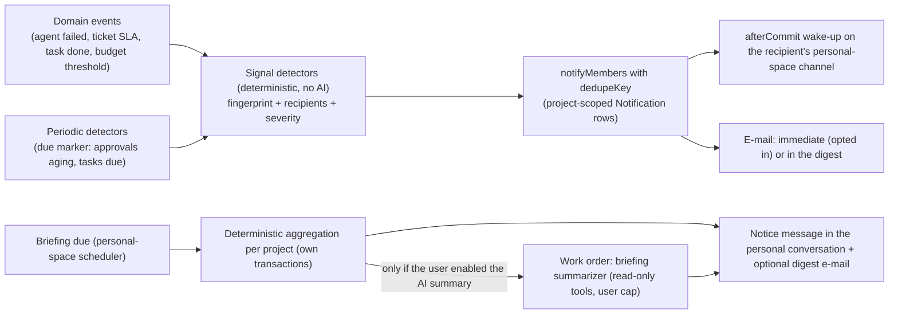

# Agent platform, Phase 4: proactive agents and voice

Status: **proposed plan, documentation only** (2026-11-04). Builds on [Phase 1](agent-platform-phase-1.md) (work orders, events, triggers) and [Phase 3](agent-platform-phase-3.md) (personal space, panel). Overview and decisions: [agent-platform-architecture.md](agent-platform-architecture.md) (§14: D-18 to D-20). Work packages are **WP4.n**.

## 0. Goal and scope

**Goal.** Orbit notices relevant situations and informs the user without being asked:
- urgent tickets;
- failed agent work orders;
- completed delegations;
- pending approvals;
- project reports;
- budget thresholds;
- task reminders.

Proactivity runs on the existing events, due-marker scheduler, worker and notifications.

**Rules for proactivity**
- Detection is deterministic and costs no AI.
- An AI model is called only at a defined processing step, such as an opted-in briefing summary.
- Nothing runs continuously, and no new polling loop is added.

**Voice.** The personal chat gains voice input (speech-to-text) and spoken answers (text-to-speech), with the same tools, rights and approvals as text. Bidirectional realtime voice is only a spike and an ADR.

**Out of scope**
- Telegram or push notifications per user (D-18, later).
- Phone calls.
- Wake words.
- Always-listening microphones.
- Voice for configured agents.

**Classification**
- **Risk: high.** Personal data (voice), a new processing purpose with an existing provider, e-mail sending, background jobs.
- **Environment:** local and preview.
- **App profiles:** primary `ai-agent-app.md`, plus `web-frontend.md`.
- **Workflows:** `feature.md` and `migration.md` (WP4.1, WP4.5).

---

## 1. Starting point

All facts are from `cc8a14cf`; see architecture §2.5.

| Fact | Consequence |
|---|---|
| `DomainEvent` with per-subscriber idempotent jobs, depth ≤ 5, content-free payloads, project scope (`platform/events/events.ts`) | Event-triggered signals need no new bus |
| The due marker `Project.workDueAt`, `SchedulerContribution.nextDueAt`, `PeriodicTask` with `wakeAt` (`platform/jobs/types.ts`); every project revisited at least every 5 minutes | Periodic signals and briefings use these; no cron, no polling loop |
| `notifyMembers` (`platform/notifications/members.ts`): in-app + e-mail through the **project's** default mailbox; preferences per (project, user, kind); **no dedupe key, digest, rate limit or quiet hours**; the bell polls once a minute; routes are project-scoped | Add dedupe, digest and user-level preferences; read across projects |
| Telegram `notify` dedupes by job key `notify:<kind>:<ref>` (owner bot per project) | A pattern only; per-user Telegram stays out of scope |
| Module notification kinds exist already: seven Support kinds (SLA at risk or breached, handoff, …), Work PM escalations, Marketing assignment notices | Signals reuse them; nothing is detected twice |
| `WorkPmFinding.fingerprint` with a partial unique index; the PM monitor buckets scans into 5-minute windows and runs at most one analysis per day | This is the dedupe and AI-on-demand template |
| Realtime SSE with Redis wake-up, channels per (project, stream); `afterCommit` hooks (`platform/realtime/fanout.ts`, `packages/db`) | Channels keyed by the personal space give a user-level push |
| `reserve` checks every budget layer but **emits no threshold events** (`platform/ai/budget.ts`) | Add a once-per-period threshold event |
| No speech, transcription or audio code; prices are per token only (`AiModelPrice`, `packages/ai/src/catalog.ts`) | New speech port, units and task classes |
| System SMTP is used only for auth mail (`docs/EMAIL_AND_NOTIFICATIONS.md`) | Cross-project digest e-mail needs a decision (D-18) |

---

## 2. Target design

### 2.1 Proactive pipeline



**Principles**
1. **No cross-project writes.** Signals write ordinary, project-scoped `Notification` rows in the project where they happen. The personal assistant and the bell **read** across projects with one transaction per project, as the approvals summary does today.
2. **Dedupe by key, not by time windows in memory.** Every signal has a fingerprint that contains its period bucket, for example `agent_failed:<agentId>:<code>:<utcDay>`. A repeat increments `occurrences` on the open row instead of creating a new one.
3. **AI only at the processing step.** Detection and aggregation are SQL plus code. The optional summary is a configured-agent work order with its own budget inside the user's assistant cap (scenario E).

### 2.2 Signals ([Proposal], `platform/signals/`)

**Contribution** (`ModuleContributions.signals`):

```text
{ key, title (en/de), source: {event: pattern} | {periodic: {every: "15m" | "1h" | "1d"}},
  detect(tx, scope, input) → [{ fingerprint, recipients: {userIds?, permission?, roles?},
                                severity: "info" | "attention" | "urgent", titleKey, params (no free text),
                                link: {navKey, params}, dueAt? }] }
```

**Initial signals**

| Signal | Source | Recipients | Fingerprint bucket | Note |
|---|---|---|---|---|
| `platform.agent_work_failed` | `platform.agent.work_order.failed` | Sponsor + users with `platform.agents.manage` | agent + code + UTC day | Replaces the Phase 1 guard |
| `platform.delegation_done` | `platform.agent.work_order.finished` (parent, origin assistant) | Requester | work order | Also the Phase 3 notice; the notification only when the panel is closed |
| `platform.budget_threshold` | New event `platform.ai.budget_threshold_crossed` | Project owners; org owners for org budgets | scope + layer + period + threshold (80 %, 100 %) | Emitted by `reserve` once per period and threshold (idempotent key) |
| `platform.approvals_aging` | Periodic, hourly | Deciders of requests pending > 24 h | request id + day | Counts only; links to approvals |
| `support.urgent_ticket` | Existing Support SLA-at-risk/breach and handoff notifications | As today | ticket + SLA clock | **Mapping only**, no second detector: these notification kinds join the signal feed |
| `work.task_due_soon` | Periodic, hourly | Assignee | task + due date | Reminder 24 h before due (setting) |
| `work.task_completed` | `work.task.*` completion event | Watchers and requester | task | Only for tasks the user created or watches |
| `marketing.assignment_attention` | Existing Marketing exceptions (budget exhausted, review backlog) | As today | existing ref | **Mapping only** |

**Rules**
- Signals carry no free text: title keys and parameters (ids, counts, codes) only.
- Recipients are resolved with current memberships and module roles. A user without access gets nothing.
- Each signal kind is a notification kind, so the existing per-(project, user, kind) preferences apply.
- Signals can be disabled per project in the platform settings.

### 2.3 Notification dedupe, digest and quiet hours

**Migration.** `Notification` gains three columns and an index:
- `dedupeKey` (nullable text);
- `occurrences` (int, default 1);
- `lastOccurredAt` (timestamptz);
- a partial unique index on `(projectId, userId, dedupeKey) WHERE dedupeKey IS NOT NULL`.

**Behaviour.** `notifyMembers(tx, scope, kind, ref, opts {dedupeKey?, delivery?: "immediate" | "digest"})` upserts on the key. A repeat:
- updates `lastOccurredAt` and `occurrences`;
- marks the row unread again only if the severity rises.

**User-level preferences**
- **Storage.** A user-private entity `notification_preferences` in the personal space (no migration).
- **Settings:**
  - quiet hours, for example 20:00–07:00 in the user's time zone;
  - digest time;
  - e-mail mode per severity: `immediate`, `digest` or `off`;
  - in-app on or off per kind; this already exists per project.
- **Rule.** Per-project settings keep precedence for turning a kind off.

**E-mail**
- Immediate e-mail keeps using the project's default mailbox, unchanged.
- The **cross-project digest** e-mail uses the system SMTP channel only if D-18 approves it. Otherwise digests are in-app only.
- Quiet hours defer immediate e-mail into the digest. Urgent signals ignore quiet hours only if the user opts in.

### 2.4 Cross-project inbox and the bubble badge

- **`GET /api/notifications/summary`.** Unread counts and the newest 20 items across the user's projects, read one transaction per project. Personal spaces are included for notices.
- **Bubble badge.** Fed by the summary plus realtime. The notification writer calls `afterCommit` to publish a content-free wake-up on `rt:<recipient's personalSpaceId>:notifications`. The recipient's personal space id is resolved without opening its transaction. If the user has no personal space yet, the badge falls back to polling once a minute (today's bell interval).
- **Bell.** The bell gains an "All projects" tab. The project tab is unchanged.

### 2.5 Briefings

**Settings.** Per user, in the personal space: off by default; daily or weekdays; a local time; included projects (default all); sections:
- pending approvals;
- failed and finished agent work;
- urgent tickets (counts);
- due tasks;
- budget status.

**Scheduling.** A personal-space `SchedulerContribution` computes `nextDueAt` from the setting and the user's time zone (`platform/time/zoned-time.ts`).

**Deterministic aggregation at due time**
- Reads per project in separate transactions.
- Stores the result as a `notice` message ("Briefing Mon 10 Nov") with structured cards in the newest personal conversation, or a dedicated "Briefings" conversation (T4-1).
- Sends a digest e-mail (if allowed by D-18).
- **No model call.**

**Optional AI summary** (per-user opt-in)
- After aggregation, a work order of the platform template `platform.briefing_summarizer` runs in the personal space:
  - read-only user tools only;
  - mode `read`;
  - 2 model calls, 4 tool calls;
  - ceiling USD 0.05 by default;
  - within the user's assistant cap.
- Its summary is appended to the notice.
- If it fails, the deterministic briefing stands and a failure signal is raised.

**Project reports** ("regular project reports"). These are configured agents in business projects (Phase 1) with a schedule trigger and read tools. A Work template `work.weekly_report` reuses the AI PM's reporter role and is added here. Its output is a Work report (module state) plus a `platform.delegation_done`-style signal to subscribers.

### 2.6 Voice ([Proposal], D-19)

**Speech port** (`packages/ai/src/speech.ts`):

```ts
export interface SpeechProvider {
  transcribe(input: { audio: Uint8Array; mime: string; language?: string; model: string },
             signal: AbortSignal): Promise<{ text: string; durationSeconds: number; usage?: unknown }>;
  synthesize(input: { text: string; voice: string; format: "mp3" | "opus"; model: string },
             signal: AbortSignal): Promise<{ audio: Uint8Array; characters: number }>;
}
```

The first adapter is OpenAI. Model ids come from the catalogue, never from code constants. A second adapter can be added behind the same port, which keeps providers exchangeable.

**Routing and cost**
- New task classes `speech_to_text` and `text_to_speech` in `packages/ai/src/routing.ts`.
- New budget categories `speech_stt` and `speech_tts`.
- **Catalogue:** `AiModelPrice` gains `unit` (`token` | `audio_minute` | `character`) and a unit price (migration). The org catalogue UI shows them.
- **Estimate before reservation:**
  - STT is estimated from the server-measured audio duration (container header plus a size cap; refused if unreadable).
  - TTS is estimated from the text's character count.
- **Settlement:** with actual usage; `outcome_unknown` as for text calls; never retried after transmission.

**Privacy**
- Audio is **not stored** by default. It is held in memory for the request only, never written to platform files, never logged.
- Transcripts become the user's chat message: same retention as chat, editable before sending.
- TTS audio is generated on demand and not stored.
- Voice uses the same data-class provider allow-list; voice is personal data.

**Input flow**
1. A push-to-talk microphone button in the panel composer: MediaRecorder; opus/webm, or mp4 on Safari; at most 60 s and 2 MB.
2. `POST /api/assistant/transcriptions` (multipart; personal space).
3. The text goes into the composer for review (default), or is sent automatically (user setting).
4. A normal text turn follows: same tools, rights, approvals and limits.

**Output flow**
- A "Read aloud" button per assistant message calls `POST /api/assistant/speech {messageId}`, which returns streamed audio.
- An optional "read answers aloud" setting.
- Only the visible answer text is read; cards are summarized by their titles.

**Gates**
- Flag `ORBIT_VOICE`.
- Entitlement `assistantVoice`.
- Browser permission prompt handling.
- No microphone access until the user presses the button.

**Realtime voice** (D-20) is a spike only. Its go/no-go criteria:
- **V-G1:** reserve and settle per session minute with a hard stop.
- **V-G2:** every tool call runs through Orbit's capability layer on the server. The provider never calls Orbit data directly, and client-forwarded calls are re-authorized.
- **V-G3:** no audio stored.
- **V-G4:** cancel, timeout and interruption handled.
- **V-G5:** the provider is exchangeable behind a port.
- **V-G6:** cost per active minute is measured and accepted by Mario.

---

## 3. Work packages

### WP4.0 ADRs and decision record (docs)

- **ADR 0023** "Proactive signals and notification dedupe": signals, recipients, AI-only-at-processing, digests.
- **ADR 0024** "Speech port and voice in the assistant": provider, pricing units, no audio storage, the realtime spike criteria.
- **Record** D-18, D-19 and D-20.
- **Effort:** 0.5 day.

### WP4.1 Notification dedupe, user preferences, digest

- **Migration** `…_notification_dedupe` (§2.3): columns and the partial unique index.
- **`notifyMembers`:** the `dedupeKey` and `delivery` options.
- **User preferences:** the user-private entity in the personal space.
- **Delivery rules:** quiet hours and the digest job (a personal-space scheduler contribution). The digest e-mail goes through the system SMTP only with D-18.
- **Replace** the Phase 1 failure-notice guard with `dedupeKey`.
- **Tests:**
  - a repeat in the bucket increments `occurrences`, with no new row and no new e-mail;
  - a severity increase marks the row unread;
  - quiet hours defer e-mail;
  - the digest contains each item once;
  - per-project kind-off overrides the user-level setting;
  - the existing notification suites pass (`support-automations`, Work PM escalations, WP4.7 member notifications).
- **Effort:** 2–3 days. **Schema hash approval.**

### WP4.2 Signals and budget threshold events

- **`platform/signals/`:** the registry, contribution validation, an event adapter (domain-event subscriber per signal) and a periodic adapter (`PeriodicTask`).
- **`platform/ai/budget.ts`:** emit `platform.ai.budget_threshold_crossed` once per (layer, scope, period, threshold) from inside `reserve`, through an idempotent event key. Content-free: layer, scope id, period, threshold, remaining bucket.
- **Initial signals** (§2.2). Support and Marketing are mappings of existing kinds; Work gets `task_due_soon` and `task_completed`.
- **Settings:** per-project signal switches in platform settings.
- **Tests:**
  - scenario E complete: three failures of the same agent and code in one day give one notification (`occurrences: 3`); a provider spy proves no model call;
  - the budget threshold is emitted once at 80 % and once at 100 % per period, including under parallel reservations (a race test);
  - an aging approval goes only to users who may decide it;
  - a user without module access gets no signal;
  - no double Support notifications (the mapping does not re-detect).
- **Effort:** 2–3 days.

### WP4.3 Cross-project notification inbox and realtime badge

- **`GET /api/notifications/summary`** and the bell's "All projects" tab.
- **Realtime:** `afterCommit` wake-up to the personal-space channel, the bubble badge, and the polling fallback.
- **Tests:**
  - per-project isolation: no items from projects the user left;
  - a wake-up carries no content;
  - Redis down falls back to polling;
  - access-matrix rows for the new route.
- **Effort:** 1–1.5 days.

### WP4.4 Briefings and the report template

- **Briefing settings UI** (account → assistant).
- **Scheduler contribution** in the personal space.
- **Deterministic aggregation**, notice cards and the digest e-mail.
- **`platform.briefing_summarizer` template** (personal space, read-only).
- **Work template `work.weekly_report`** (business project, schedule trigger, reuses the Work PM reporter role).
- **Tests:**
  - a briefing at a local time across daylight-saving changes;
  - a briefing with zero items is skipped (setting) or says "nothing new";
  - the AI summary runs only when opted in and within the cap;
  - a failed summary leaves the deterministic briefing and raises a signal;
  - a report template run produces a Work report and a signal;
  - no model call without the opt-in (spy).
- **Effort:** 2–3 days.

### WP4.5 Speech port, pricing units and routing

- **Code:** `packages/ai/src/speech.ts` (port), `packages/ai/src/providers/openai-speech.ts` (adapter).
- **Routing:** the task classes `speech_to_text` and `text_to_speech`, plus the AI settings route section.
- **Migration** `…_ai_price_units`: `AiModelPrice.unit` + `unitPriceMicros`, defaults keeping token pricing.
- **Catalogue:** entries for speech models, dated and editable, with no hard-coded model ids in the call path.
- **Budget:** estimate, reserve and settle helpers for audio.
- **Tests:**
  - estimate versus actual for STT (duration) and TTS (characters);
  - a cut-off or unknown outcome is not retried;
  - an unknown unit is refused;
  - the provider is exchangeable through a fake adapter in contract tests;
  - the allow-list is applied.
- **Effort:** 2–3 days. **Schema hash approval.** **New processing purpose; Mario's approval before any live call.**

### WP4.6 Voice input in the assistant

- **Composer microphone button** (push-to-talk, toggle mode for accessibility).
- **Upload route** `POST /api/assistant/transcriptions`: size and duration caps, MIME allow-list, server-side duration check, in-memory only.
- **Composer handling:** the transcript lands in the composer, with an auto-send setting.
- **Errors:**

  ```text
  SPEECH_TOO_LONG, SPEECH_UNREADABLE, SPEECH_PROVIDER_NOT_ALLOWED, AI_BUDGET_*
  ```

- **Mobile:** Safari mp4 and Android opus.
- **Accessibility:** a visible recording state, an `aria-live` status and keyboard operation.
- **Tests:**
  - the route rejects oversized, invalid or unauthorized input;
  - audio never touches the database or files (assertion on file writes and the database in tests);
  - transcript to turn uses the same tools and rights as typed text (one scripted test runs both paths);
  - component tests for recorder states;
  - a documented manual check on iOS Safari and Android Chrome.
- **Effort:** 2–3 days.

### WP4.7 Voice output and docs

- **"Read aloud"** per message and the auto-read setting.
- **Route** `POST /api/assistant/speech`: streamed audio, character caps, card titles only.
- **Docs:** `docs/ORBIT_ASSISTANT.md` (proactivity, voice), `docs/EMAIL_AND_NOTIFICATIONS.md` (dedupe, digest), `docs/MODEL_ROUTING.md` (speech classes, units), `docs/IMPLEMENTATION_STATUS.md`.
- **Tests:** caps; the cost is reserved before the call; playback component; no storage.
- **Effort:** 1–1.5 days.

### WP4.8 Realtime voice spike (separate, optional)

- **Prototype** on a branch, not merged. It evaluates:
  - a provider realtime session via WebRTC with ephemeral tokens;
  - a server-side tool relay through the capability layer;
  - per-minute budget reservation;
  - interruption handling.
- **Deliverables:** an evidence document against V-G1 to V-G6 and an ADR 0024 addendum with a go or no-go recommendation.
- **Effort:** 3–5 days. Its paid test minutes need Mario's cost approval.

---

## 4. Database changes

| Change | Kind | Migration |
|---|---|---|
| `Notification.dedupeKey`, `occurrences`, `lastOccurredAt` + partial unique index | columns, index | additive (WP4.1) |
| `AiModelPrice.unit`, `unitPriceMicros` | columns | additive (WP4.5) |
| `notification_preferences`, briefing settings | user-private entities in the personal space | none |
| Event `platform.ai.budget_threshold_crossed`, signal kinds | code declarations | none |

---

## 5. API and UI changes

**API**

New routes:
- `GET /api/notifications/summary`;
- `GET/PUT /api/assistant/preferences` (notifications, quiet hours, briefing, voice);
- `POST /api/assistant/transcriptions`;
- `POST /api/assistant/speech`.

Changed routes: `notifyMembers` callers are additive; project notification routes are unchanged.

Regenerate OpenAPI with `pnpm api:generate` and review the diff.

**UI**
- Bell "All projects" tab.
- Bubble badge.
- Account → assistant: notifications, quiet hours, briefing, voice.
- Microphone and read-aloud controls in the panel.
- Briefing notice cards.
- Project and platform settings: signal switches.
- Org catalogue: speech prices.

---

## 6. Permissions and security

- **Recipients.** Signals reach only users with current access to the signal's project and module. Recipients are resolved at detection; the read at display time re-checks through the per-project read path.
- **No content** in signals, events, wake-ups or digests beyond titles and parameters built from ids and codes.
- **AI calls** happen only in opted-in briefing summaries and in voice requests the user started. Both run within the user's assistant cap, and voice is gated by the flag and entitlement.
- **Voice.** No audio storage, no background microphone, explicit user action, the provider allow-list, and the same principal as text.
- **E-mail** from the system SMTP for digests only with D-18. Digests contain no customer data, only counts and links.
- **Quality gates:** `ai-agent-checklist.md`, `security-checklist.md`, `data-safety-checklist.md`, `accessibility-checklist.md`, `performance-checklist.md`, `migration-checklist.md`.

---

## 7. Worker and scheduler

- **Signals:** domain-event subscribers (existing per-subscriber jobs) and `PeriodicTask`s at hourly or 15-minute granularity, inside the existing project pass. There is no new loop: the pump already revisits every project at least every 5 minutes.
- **Briefings and digests:** personal-space scheduler contributions, which move the due marker to the next briefing time.
- **Speech:** synchronous HTTP requests with timeouts (STT ≤ 30 s, TTS streamed). There is no queue, because the user is waiting.
- **Load.** A signal storm, such as 500 failed work orders from a broken connector, must create one notification per bucket per recipient. The test asserts the row count.
- **Cost.** No idle AI. A briefing summary runs at most once per user per briefing slot.

---

## 8. Dependencies

- **Phase 1:**
  - work-order events (`platform.agent.work_order.*`);
  - triggers;
  - templates;
  - entitlements (`assistantVoice`).
- **Phase 3:**
  - personal space (preferences, notices, channel, scheduler home);
  - panel (microphone, read aloud);
  - `notice` role;
  - per-user cap.
- **Phase 2 (optional):** Support signals map existing kinds and work without the Support agent.
- **Decisions:** D-18, D-19, D-20.

---

## 9. Migration and backward compatibility

- **Existing notifications** are unchanged: a missing `dedupeKey` behaves as today. Existing kinds and preferences stay.
- **Mapped Support and Marketing kinds** keep their senders. Signals only add them to the feed and the digest.
- **Existing prices** keep `unit = token` by default, so `reserve` and settlement for text are unchanged.
- **Rollback:**
  - `ORBIT_PROACTIVE=false` stops signals, digests and briefings. Notifications already written stay.
  - `ORBIT_VOICE=false` hides the voice controls and makes the routes return 404.
  - The columns stay.

---

## 10. Tests (summary)

| Level | Content |
|---|---|
| Unit | Fingerprint buckets; recipient resolution; quiet hours and time zones; digest assembly; unit pricing estimates; MIME and duration checks |
| Integration | Scenario E (dedupe + no model call); budget threshold race; aging approvals; briefing with and without the AI opt-in; report template; voice routes (caps, no storage, same principal); cross-project summary isolation |
| Safety nets | Access matrix (new routes); RLS matrix (user-private preferences); queue dispatch (signal subscribers) |
| Regression | Existing notification suites; Support automations; Work PM monitor; realtime suites; budget and reservation suites |
| Web | Bell tabs; badge; preferences; recorder and player components; manual mobile checks |
| Paid | None automated. A live STT/TTS check only with Mario's cost approval |

---

## 11. Acceptance criteria

1. **Scenario E.** A failing agent work order produces one deduplicated notification per agent, error code and day for the sponsor and the agent managers. No AI model is called for detection or notification; the only AI call is an opted-in briefing summary.
2. **Urgent and due items.** Urgent tickets, due tasks, aging approvals, budget thresholds (80 % and 100 % once per period) and completed delegations reach the right users in-app, and by e-mail according to their settings. Quiet hours are respected.
3. **Bell and badge.** The bell's "All projects" tab and the bubble badge show unread items across projects, without data from projects the user cannot access.
4. **Briefing.** A daily briefing at the user's local time lists approvals, agent results, urgent tickets, due tasks and budget status deterministically. The optional AI summary stays within its ceiling and the user's cap.
5. **Voice input.** Pressing the microphone, speaking and releasing puts a transcript in the composer, and sending it runs the same turn as typed text. No audio is stored. Cost is reserved and settled per audio minute.
6. **Read aloud.** "Read aloud" plays the answer and costs per character within the cap.
7. **Off by default.** With the flags off, nothing proactive or voice-related runs, and all existing notification behaviour is unchanged.

---

## 12. Risks and open decisions

**Risks**

| # | Risk | Mitigation |
|---|---|---|
| R4-1 | Notification fatigue | Dedupe keys, digest default for low severity, quiet hours, per-kind switches, no duplicates of existing Support kinds |
| R4-2 | Threshold events race under parallel reservations | Idempotent event key per (layer, scope, period, threshold); race test |
| R4-3 | Voice privacy and legal basis | No storage, explicit action, provider allow-list, ADR 0024, D-19 |
| R4-4 | Browser audio differences (Safari) | Format negotiation; documented device checks |
| R4-5 | Cost of TTS for long answers | Character cap; read-aloud only on request by default |
| R4-6 | System SMTP reputation for digests | Digest only with D-18; low volume (one per user per day); no customer data |

**Phase-local technical decisions**

| # | Decision | Default |
|---|---|---|
| T4-1 | Where briefing notices go | A dedicated "Briefings" conversation in the personal space |
| T4-2 | Periodic detector granularity | Hourly; aging approvals hourly; due tasks hourly |
| T4-3 | Transcript auto-send | Off (review first) |

**Owner decisions:** D-18, D-19, D-20 (architecture §14).

---

## 13. Effort and PR split

| PR | Content | Estimate | Flag | Migration |
|---|---|---|---|---|
| 1 | WP4.0 ADRs 0023/0024 | 0.5 d | — | — |
| 2 | WP4.1 notification dedupe, preferences, digest | 2–3 d | `ORBIT_PROACTIVE` | **yes** |
| 3 | WP4.2 signals + budget threshold events | 2–3 d | same | — |
| 4 | WP4.3 cross-project inbox + badge | 1–1.5 d | same | — |
| 5 | WP4.4 briefings + report template | 2–3 d | same | — |
| 6 | WP4.5 speech port, units, routing | 2–3 d | `ORBIT_VOICE` | **yes** |
| 7 | WP4.6 voice input | 2–3 d | same | — |
| 8 | WP4.7 voice output + docs | 1–1.5 d | same | — |
| | **Total** | **12.5–18.5 d** | | |
| — | WP4.8 realtime voice spike (optional, not merged) | 3–5 d | — | — |

The proactive part (PRs 1–5) and the voice part (PRs 6–8) are independent once Phase 3 is done, so they can run in separate worktrees. Delivery follows the main workflow, with a schema hash for each migration and Mario's approval before any paid speech call.
