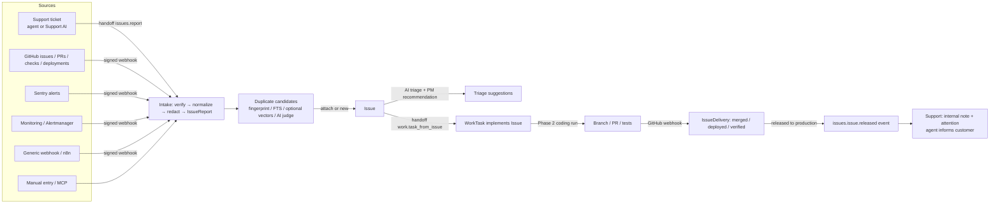
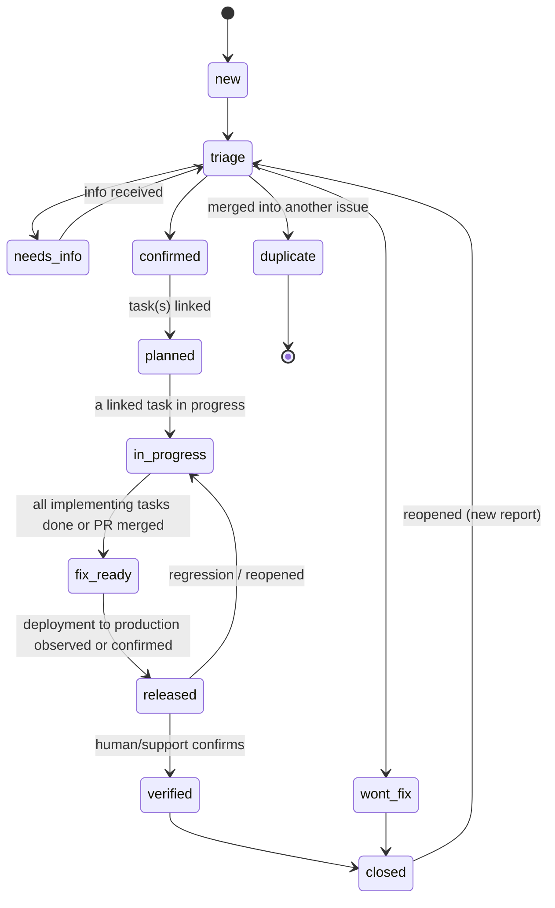

# Issue center — Phase 3 implementation plan

Status: **plan only** (2026-10-25). Nothing in this document is implemented, run or deployed.
Basis: `main` at `c4886cc0` (read-only analysis). Prerequisites: Phase 1 ([`project-management-phase-1.md`](project-management-phase-1.md)) merged; Phase 2 ([`ai-project-manager-phase-2.md`](ai-project-manager-phase-2.md)) merged for the AI triage hand-in and coding work orders (§1.3 lists exactly which parts are needed, and what degrades without them).

Classification under `AGENTS.md`:
- **Risk: high**, bordering critical for the ingestion surface: customer data from Support, public webhooks from external systems, cross-module status propagation, GitHub write access, deployment tracking.
- **Environment:** local and isolated worktree databases; external providers (GitHub, Sentry, n8n) only through test transports. Any live provider connection, GitHub App permission or public webhook needs Mario's separate approval.
- **App profile:** primary `fullstack-saas`; complementary `backend-api`, `ai-agent-app`, `data-pipeline` (ingestion, deduplication) and the privacy rules in `.agentic/compliance/`.
- **Stack:** unchanged; `pg_trgm` is an optional database extension (§3.6).
- **Workflow:** `feature` + `migration`.

Legend: **[Fact]** at `c4886cc0`; **[Phase 1]/[Phase 2]** from the companion plans; **[Proposal]**; **[Unverified]**.

---

## 1. Current state (Ist-Zustand)

### 1.1 Existing building blocks

| Area | State | Location |
|---|---|---|
| Issue / bug model | **None.** No "issue", "bug" or "escalation" concept in code or docs; the nearest is the Support AI handoff (`aiState = handed_off`) and the sensitive-topic hard rules | — |
| Support tickets | `SupportTicket` (number, status `new, open, pending_customer, pending_internal, resolved, closed`, priority, category, tags, assignee, `mergedIntoTicketId`), `SupportMessage` (kinds incl. `internal_note`, `ai_draft`; `searchVector`), `SupportTicketEvent` | `packages/db/prisma/schema.prisma:376-529`, `apps/api/src/modules/support/` |
| Support AI | Triage `support_triage` (language, category, priority, sentiment, summary, sensitive), drafts `support_draft` with citations; `screenCustomerText` hands off sensitive topics (trading, account security, billing, legal) before any model call | `modules/support/{ai,hard-rules}.ts` |
| PII handling | `withPlaceholders(text, contact)` replaces e-mails and contact names with `[customer email]`/`[customer name]`; MCP `safe()` withholds sensitive messages; audits are content-free (canary test); `exportContact`, `eraseContact`; retention: closed tickets 24 months | `modules/support/{ai,mcp-read,privacy}.ts` |
| Support permissions | `support.tickets.read`, `.reply`, `.assign`, `support.notes.read/.write`, `support.contacts.manage`, `support.settings.manage`, `support.stats.read`, `support.customer_context.read` | `modules/support/permissions.ts` |
| Signed public webhooks | `POST /api/hooks/:provider/:workspaceId/:projectId/:connectionId` (`ORBIT_PUBLIC_INGRESS`, 256 KB, per-address limits); module contributes `webhooks: {name: SignedWebhookProvider{connectionProvider, verify, messageId, queueClass}}`; stored as `inbound_webhooks` and queued, idempotent by provider message id | `apps/api/src/platform/http/webhooks.ts`, `platform/modules/contributions.ts:109, 207-224` |
| Automation (n8n) | Outbound `automation.v1` + signed callbacks; per-project grant of a central n8n connection | `apps/api/src/platform/automation/workflows.ts` |
| Central connections | `Connection`, `ConnectionSecret` (AES-GCM, versioned), `ConnectionGrant` (purposes, modules, budget); providers contributed via `connections.providers` (email, openai, anthropic, n8n, customer-context) | ADR 0014, `platform/connections/` |
| GitHub | Read-only knowledge source (`contents: read`, `metadata: read`); **no GitHub provider in central connections, no issue/PR API use** | `modules/knowledge/github.ts` |
| Sentry / monitoring | **None** | — |
| Similarity | Postgres FTS (`simple` config) on Support messages; Jaccard `draftSimilarity` (0.8) in marketing; pgvector `ChunkEmbedding` only inside the knowledge index; `embed(texts, reservationId, modelUse, profile?)` in `packages/ai` | `modules/marketing/pipeline/draft-similarity.ts`, `packages/ai/src/index.ts` |
| `pg_trgm` | **Not installed** (only `vector` in `202609170001_foundation`) | migrations |

### 1.2 What Phase 1/2 provide

| Contract | Used for | Without it |
|---|---|---|
| [Phase 1] `ObjectLink` (`reported_in`, `duplicates`, `implements`, `relates_to`), link-type resolvers with permission redaction | Ticket ↔ issue ↔ task traceability | Required |
| [Phase 1] Domain events with `origin`, `causationId`, `depth ≤ 5` | Status synchronization without loops | Required |
| [Phase 1] `WorkTask`, status categories | Implementation tasks for issues | Issue center works standalone; task features hidden when `work` is off |
| [Phase 2] Handoff registry | `issues.report` (from Support), `work.task_from_issue` | Required for the Support hand-in (the registry is small; it can be pulled forward if Phase 2 is delayed) |
| [Phase 2] `runStructured`, task classes | AI triage and duplicate judging | AI features off; manual triage works |
| [Phase 2] AI project manager | Triage recommendations, dev-task suggestions | Recommendations off; humans triage |
| [Phase 2] Coding work orders, sanitizer | Coding agent path for fixes | Developers work manually |

---

## 2. Target architecture (Zielarchitektur)

### 2.1 Module and ownership (decision I-1)

**[Proposal]** A separate module **`issues`** (`displayName {en: "Issues", de: "Issues"}`, table prefix `Issue`, routes `/api/projects/:projectId/issues/…`, web `/p/:projectId/issues/…`, installation flag `ORBIT_ISSUES`, `defaultEnabled: false`, `dependsOn: []`, optional cooperation with `work` and `support` through links, handoffs and events).

| Alternative | Assessment |
|---|---|
| Issues as a status/type of `WorkTask` | Rejected: an issue aggregates many reports and may need several tasks (or none: won't fix); mixing them breaks requirement "ein Issue mehrere Quellmeldungen und mehrere Umsetzungsaufgaben", and support staff would need PM permissions. |
| Issues inside Support | Rejected: issues also come from Sentry, GitHub, monitoring and webhooks; development must see them without customer data. |
| **Separate module (chosen)** | Clear data ownership (principle D): tickets stay in Support, development tasks in `work`, issues in `issues`; separately enable-able (Support + Issues without PM is valid). |

Ownership rule: **each object owns its status.** Ticket status is changed only by Support code, task status only by `work` code, issue status only by `issues` code. Cross-object effects are domain-event subscriptions with explicit rules (§2.6).

### 2.2 Data flow overview



### 2.3 Issue model (requirement 1)

- **Type:** `bug`, `feature_request`, `improvement`, `technical_problem`.
- **Severity** (impact, set by triage): `s1_critical` (outage, data loss, security, money at risk), `s2_major` (core function broken, no workaround), `s3_minor` (workaround exists), `s4_trivial`.
- **Priority** (scheduling, set by humans/PM): `urgent`, `high`, `medium`, `low`.
- **Components:** module-settings taxonomy (key, label, optional repository key from `work` settings, owner team), multi-valued.
- **Status machine:**



- `fix_ready` explicitly means **merged or done, not deployed** (requirement 6: a merged PR is not a production fix). Only `released` carries "in production".
- Transitions are validated in `issues/status.ts`. Automatic transitions (§2.6) only move **forward** along `planned → in_progress → fix_ready → released`; every backward move, `wont_fix`, `duplicate`, `verified` and `closed` are human (or a human-approved proposal).

### 2.4 Intake and source reports (requirements 2 and 4)

**`IssueReport`** is one inbound signal: a support ticket hand-in, a Sentry alert, a GitHub issue, a monitoring alert, a webhook payload or a manual entry. An issue has **1..n reports**; reports are never deleted when issues merge (they move to the surviving issue and keep their origin).

**Source adapter interface** (module-internal, `modules/issues/sources/types.ts`):

```ts
export type IssueSourceAdapter = {
  kind: "support" | "manual" | "webhook" | "n8n" | "sentry" | "github" | "monitoring";
  normalize(input: unknown, config: SourceConfig): NormalizedReport;  // pure, strict zod, no I/O
};
export type NormalizedReport = {
  externalRef?: { system: string; id: string; url?: string };   // validated URL allow-list per kind
  fingerprint?: string;              // stable error signature (Sentry issue id, alert name+labels hash, exception type+top frame)
  title: string;                     // ≤ 200, redacted
  symptoms: string;                  // ≤ 4000, redacted, untrusted
  severityHint?: Severity; typeHint?: IssueType; componentHints?: string[];
  occurredAt: Date; environment?: string; release?: string;
  diagnostics?: Record<string, string | number | boolean>;  // allow-listed keys only, ≤ 4 KB, redacted
};
```

Ingestion pipeline (`modules/issues/intake.ts`), identical for every source:
1. **Authenticate**: platform signed webhook (`verify`) or an authenticated Orbit actor; unauthenticated input is impossible.
2. **Bound**: 256 KB body (platform), per-source rate limit (`ceilingPerKey`), per-project daily report cap (setting, default 500) → excess counted and dropped with an attention item.
3. **Normalize** with the adapter (strict schema; unknown fields ignored, never stored raw).
4. **Redact** with `platform/privacy/redact.ts` (§2.8); store the redaction counts.
5. **Deduplicate** (§2.5) and attach or create.
6. Write `IssueEvent`, audit (content-free), domain event `issues.report.received`.
7. Raw payloads are **not** persisted (decision I-5); only the normalized, redacted report. For debugging, the platform's `inbound_webhooks` row retention applies as today [Unverified: its content retention — verify `platform/http/ingress-retention.ts`; if it keeps raw bodies, set the issues providers' retention to the minimum].

Sources:

| Source | Mechanism | Adapter details | Phase 3 scope |
|---|---|---|---|
| Orbit Support | Handoff `issues.report` from a ticket (button "Report as product issue", Support assistant tool) | Title/symptoms written or confirmed by the agent; customer text passed through `withPlaceholders` + redaction; ticket link `reported_in`; customer identity never copied | MVP |
| Manual / MCP | UI form, `issues_propose_report` | | MVP |
| Generic webhook | New connection provider `issues_webhook` (per-project connection holding an HMAC secret); `verify`: `X-Orbit-Signature: v1=HMAC-SHA256(secret, timestamp + "." + rawBody)` like the customer-context contract | Contract `issues.report.v1` (documented JSON schema) | MVP |
| n8n | Uses the generic webhook contract `issues.report.v1` (n8n signs with the same scheme) | Same | MVP |
| Sentry | Connection provider `sentry` (client secret); `verify` `Sentry-Hook-Signature` (HMAC-SHA256 of the body) | Issue alerts / `issue.created`; fingerprint = Sentry issue id; diagnostics allow-list: `level`, `culprit`, `platform`, `release`, `environment`, `count`, `userCount` | Extension (E) |
| Monitoring / Alertmanager | Generic webhook with a mapping preset (alertname, labels hash → fingerprint) | Resolved alerts close nothing automatically; they add an event | E |
| GitHub issues | GitHub App connection (§2.7) webhook `issues` | Inbound only for repositories in the allow-list; label filter (e.g. `bug`) | E (after WP3.10) |

### 2.5 Duplicate detection (requirement 3) (decision I-3)

Candidate generation, cheapest first; AI only on a short list:

| Stage | Method | Cost | Result |
|---|---|---|---|
| 1 | **Exact fingerprint** match on open/recent issues (same project) | free | Auto-attach when the setting `autoAttachFingerprint` is on (default on) |
| 2 | **External ref** match (same Sentry issue, same GitHub issue) | free | Auto-attach |
| 3 | **Lexical**: FTS `ts_rank_cd` over `Issue.searchVector` (title A, symptoms summary B, component keys C) + component overlap bonus + recency decay; optional `pg_trgm` title similarity | free | Top 10 candidates with score |
| 4 | **Semantic (opt-in)**: `IssueEmbedding` (pgvector, module-owned, **not** the knowledge corpus) of title + redacted symptoms; cosine top 10 | embedding cost, reserved via the ledger | merged candidate list |
| 5 | **AI judge (opt-in)**: structured run `issue_dedupe` on the top 5, input redacted texts only, output per candidate `{same_issue: yes|no|unsure, confidence 0..1, reasons: codes[]}` | small, daily ceiling | `IssueDuplicateCandidate` rows |

Decision rules:
- **Never auto-merge two issues.** Merging is human (or an approved proposal).
- **Auto-attach a report** to an existing issue only for stages 1–2.
- Stage 3–5 results create `IssueDuplicateCandidate` rows (`pending`); the triage queue shows them with score and reasons; the triager confirms (attach/merge) or rejects; rejected pairs are remembered (`rejected`) and not proposed again.
- Thresholds are settings (`suggestThreshold`, default 0.35 lexical; 0.82 cosine), calibrated with a fixture set (WP3.7).

Merge semantics (`mergeIssue(source, target)`): reports, attachments and links move to the target (links re-pointed, old `ObjectLink` rows `removedAt` + new rows, all audited); `source.status = duplicate`, `mergedIntoIssueId = target`; `ObjectLink(source → target, "duplicates")`; subscribers notified; the original Support tickets keep their link (now to the target issue) — **no ticket is lost or changed**.

### 2.6 Project management integration and loop-free sync (requirement 5) (decision I-4)

Operations:
- **Create task from issue**: handoff `work.task_from_issue` (contributed by `work`): creates a `WorkTask` (source `issue`, description from the redacted issue summary and acceptance criteria; never customer text), `ObjectLink(task → issue, "implements")`; issue → `planned`.
- **Link existing task**: `ObjectLink(task → issue, "implements")` from either side (needs `work.write` and `issues.triage`).
- **Multiple tasks**: allowed; progress = categories of all `implements` tasks.
- **Ownership**: issue `assigneeUserId` (triage owner) is independent of task assignees.

**Synchronization rules** (all as domain-event subscribers; each rule is idempotent and forward-only):

| # | Trigger event | Condition | Effect | Mode |
|---|---|---|---|---|
| S1 | `work.task.status_changed` (category `in_progress`) | task `implements` issue in `planned` | issue → `in_progress` | auto |
| S2 | `work.task.status_changed` (category `done`) | **all** `implements` tasks `done`/`canceled` and ≥ 1 `done` | issue → `fix_ready` | auto (setting `autoFixReady`, default on) |
| S3 | `issues.delivery.recorded` (`pr_merged`) | PR linked to all open implementing work | issue → `fix_ready` | auto |
| S4 | `issues.delivery.recorded` (`deployed`, environment = production) | the fix commit is contained in the deployed commit | issue → `released` | auto if detection is exact (§2.7), else attention item "confirm release" |
| S5 | `issues.issue.released` | issue has `reported_in` tickets | Support subscriber adds an internal note to each ticket and an attention item for the ticket's assignee ("fix released — inform customer") | auto; **customer message is human** |
| S6 | `issues.issue.status_changed` → `wont_fix`/`duplicate` | open implementing tasks | proposal to cancel/relink tasks (ActionRequest) | proposal |
| S7 | `work.task.status_changed` leaves `done` (reopened) | issue in `fix_ready` | issue → `in_progress` | auto |

Loop prevention (requirement "keine unendlichen Schleifen"):
1. **Unidirectional authority:** tasks → issues (S1–S3, S7); deliveries → issues (S3, S4); issues → tickets only as notes/attention (S5); issues → tasks only as **proposals** (S6). No rule writes back to its own trigger's object type.
2. **Origin tag:** subscriber writes publish events with `origin: "issues.sync"`; the `issues.sync` subscribers ignore events with that origin.
3. **Causation depth:** platform refuses depth > 5 ([Phase 1]); the sync never needs more than 3.
4. **Monotonic transitions:** automatic rules only move forward in the order `planned < in_progress < fix_ready < released`; S7 is the single explicit, human-originated exception.
5. **Idempotency:** subscriber job key `evt:<eventId>:<subscriber>`; a rule re-checks the current state and no-ops if already satisfied.

### 2.7 GitHub and delivery workflow (requirement 6)

End-to-end flow and the component responsible for each step:

| Step | What happens | Component | Human gate |
|---|---|---|---|
| 1 | Error reported | Support hand-in, webhook, Sentry, manual | Support agent decides to hand in |
| 2 | AI analyses and classifies | `issue_triage` structured run (type, severity, components, missing information questions) + PM recommendation | Suggestions only |
| 3 | Issue created or linked | Intake + duplicate pipeline | Merge/attach confirmation below fingerprint certainty |
| 4 | Development task prepared | Handoff `work.task_from_issue` | ActionRequest when proposed by AI/MCP; direct when a human clicks |
| 5 | GitHub issue created or linked | GitHub App connection, `issues: write` on allow-listed repos; body from the redacted summary only | ActionRequest `issues.github.create` (owner or editor with `issues.github`) |
| 6 | Developer or coding agent takes over | Human assignee or [Phase 2] coding work order | Owner approval per dispatch |
| 7 | PR and tests linked | GitHub webhooks `pull_request`, `check_suite`/`check_run`; matching by `Fixes ISS-123` / `Orbit-Issue: ISS-123` / `TASK-45` in PR body or branch name `iss-123-*`, plus the coding run's PR | — |
| 8 | Fix reviewed and approved | GitHub review state recorded; merge → `IssueDelivery(pr_merged)` → `fix_ready` | Code review in GitHub |
| 9 | Deployment traced | `deployment_status` webhooks (GitHub Environments) or a deployment webhook from Coolify via n8n (`issues.delivery.v1`) or manual confirmation; release detection: merge commit is an ancestor of the deployed SHA (GitHub compare API `GET /repos/{o}/{r}/compare/{merge}...{deployed}` → `status` `behind`/`identical`) | Manual confirm when no exact signal |
| 10 | Support informed | S5 → internal note + attention; agent replies to the customer | Customer reply stays human (Support AI draft optional, Support rules unchanged) |

**GitHub connection provider** (platform, ADR 0014 pattern, new): `github_app` connection (system or workspace scope) holding App id, private key, webhook secret; grant to projects with purpose `issues` (and later `coding`). Installation tokens requested **per call with the minimum permission set**: `issues: write` (create/comment), `pull_requests: read`, `checks: read`, `deployments: read`, `metadata: read`; never `contents: write` in Phase 3. Repository allow-list per project (`work` settings repositories [Phase 2] or `issues` settings if `work` is off). Webhook provider `github` verifies `X-Hub-Signature-256`. The existing knowledge GitHub integration stays unchanged (separate App credentials) — convergence is a later decision.

### 2.8 Privacy and permissions (requirement 8)

**Platform redaction utility** (decision I-5), `apps/api/src/platform/privacy/redact.ts`:
- Detectors: e-mail, phone (E.164 and common national formats), IBAN, credit-card numbers (Luhn), IPv4/IPv6, JWT/API-key/token patterns (reuse the credential patterns used by the knowledge GitHub reader [Unverified function]), URLs with credentials or query tokens, wallet addresses and transaction hashes (pseudonymous personal data; redacted by default in `strict`, Q-P3-4), plus caller-supplied names (contact name tokens as in `withPlaceholders`).
- API: `redact(text, {names?: string[], profile: "strict" | "standard"}) → { text, counts: Record<detector, number> }`; deterministic, no AI, unit-tested with fixtures.
- Support's `withPlaceholders` stays as is (no behaviour change); a later refactor may delegate to it.

Rules:
- Reports and issues store **redacted** text only. Customer identity (contact id, e-mail, name) is never stored on issue rows; the only bridge is the `reported_in` link to the ticket, resolved with Support permissions.
- `issues.read` never reveals linked ticket subjects; the resolver marks `support.ticket` `sensitive` ([Phase 1]); developers see "Support ticket (restricted)" unless they hold `support.tickets.read`.
- **Coding-agent export gate**: a coding brief derived from an issue requires `issue.shareReviewedAt` (an editor/owner confirms "no personal data, reviewed") and is built only from issue fields (title, redacted summary, components, diagnostics allow-list, acceptance criteria). [Phase 2] sanitizer runs again on the brief.
- External text is **untrusted data**: never interpreted as instructions; AI runs quote it as data; outputs are validated; links from external payloads are not auto-fetched.
- Erasure: Support's `eraseContact` publishes `support.contact.erased` (new, content-free event with ticket ids); the issues subscriber re-redacts reports from those tickets (symptoms replaced by "[removed on erasure]", counts kept) and audits `issues.report.erased`.
- Retention: closed issues and their reports per setting (default 36 months; diagnostics 12 months); `IssueEmbedding` deleted with the issue.

Permissions (module `issues`):

| Key | Default roles | Sensitive | Covers |
|---|---|---|---|
| `issues.read` | owner, editor, viewer | no | read issues, reports (redacted), dashboard |
| `issues.report` | owner, editor | no | create reports/issues (manual, Support hand-in) |
| `issues.triage` | owner, editor | no | edit fields, status, assign, attach/merge duplicates, link tasks |
| `issues.diagnostics.read` | owner, editor | yes | diagnostics block and source details |
| `issues.github` | owner | yes | create GitHub issues, configure repositories |
| `issues.settings` | owner | no | components, sources, thresholds, automation toggles |

Typical role setup (with module roles, `ORBIT_MODULE_ROLES`): support staff `support: editor`, `issues: editor` (report, triage), `work: viewer|none`; developers `support: none|viewer`, `issues: editor`, `work: editor`. The plan relies on module roles being enabled in production for this separation (Q-P3-1, decided 2026-10-25: yes, after the `docs/SECURITY_REVIEW.md` review that `docs/MODULE_ACTIVATION.md` requires).

### 2.9 Dashboard (requirement 7)

Overview `/p/:projectId/issues`:
- Metrics strip: open, critical (`s1`), new last 7 days, awaiting triage, fix ready (not released), released last 30 days.
- Lists: critical bugs; "most reported" (reports count, distinct tickets); duplicate candidates pending.
- Breakdowns: by component, by source, by status (counts + age buckets).
- Lead times: median time `new → confirmed`, `confirmed → fix_ready`, `fix_ready → released`, `new → released` (from `IssueEvent`), last 90 days.
- Each issue row shows linked task count/progress and linked ticket count (titles only per permission).
- No invented metrics: a metric without data shows "—" (design system rule).

---

## 3. Database

Conventions as in Phase 1 §3.1 (composite tenant FKs, FORCE RLS `project_scope`, `@@unique([projectId, id])`, grants, RLS matrix). Migrations `<date>0001_issues_core`, `<date>0002_issues_github` (GitHub/delivery tables, may ship later), optional `<date>0003_issues_vectors`.

**`IssueCounter`**: `projectId` PK, `workspaceId`, `lastNumber` (display `ISS-<n>`).

**`Issue`**

| Column | Notes |
|---|---|
| `number` | UNIQUE `(projectId, number)` |
| `type` | CHECK `bug, feature_request, improvement, technical_problem` |
| `title` | 1–200, redacted |
| `summary` | ≤ 10 000 markdown, redacted (curated by triage) |
| `status` | CHECK per §2.3 |
| `severity` | CHECK `s1_critical, s2_major, s3_minor, s4_trivial` null until triaged |
| `priority` | CHECK `urgent, high, medium, low` null |
| `category` | settings key null |
| `components` | text[] (settings keys) |
| `assigneeUserId` | null |
| `fingerprint` | text null; index `(projectId, fingerprint)` |
| `environment`, `firstSeenAt`, `lastSeenAt` | |
| `reportCount`, `ticketCount` | denormalized counters (updated in the same transaction) |
| `mergedIntoIssueId` | composite FK to `Issue`, CHECK `status = 'duplicate'` when set |
| `acceptanceCriteria` | text[] ≤ 10 |
| `shareReviewedAt`, `shareReviewedBy` | coding-agent export gate |
| `searchVector` | generated tsvector (title A, summary B, components C) |
| `version` | |
| `createdBy`, `createdAt`, `updatedAt`, `closedAt` | |

Indexes: `(projectId, status, severity)`, `(projectId, assigneeUserId, status)`, `(projectId, lastSeenAt)`, GIN `searchVector`, GIN `components`.

**`IssueReport`**

| Column | Notes |
|---|---|
| `issueId` | composite FK, NO ACTION (merge moves reports; delete only with the issue) |
| `sourceKind` | CHECK `support, manual, webhook, n8n, sentry, github, monitoring` |
| `sourceConnectionId` | uuid null (connection entity for webhook sources) |
| `externalSystem`, `externalId`, `externalUrl` | UNIQUE `(projectId, sourceKind, externalSystem, externalId)` where not null (idempotent re-delivery) |
| `fingerprint` | |
| `title`, `symptoms` | redacted |
| `diagnostics` | jsonb allow-listed, ≤ 4 KB |
| `redaction` | jsonb counts by detector |
| `severityHint`, `typeHint`, `componentHints` | |
| `occurredAt`, `receivedAt` | |
| `reportedByKind`, `reportedById` | `user`, `integration`, `agent` |
| `erasedAt` | erasure marker |

Index `(projectId, issueId, receivedAt)`.

**`IssueEvent`**: like `SupportTicketEvent`: `issueId` (CASCADE), `type` (`created, status, severity, priority, type, components, assignee, report_attached, merged, duplicate_candidate, link_added, link_removed, delivery, ai_triage, github, erased`), `actorKind` (`user, agent, system, mcp, integration`), `actorId`, `before`, `after` (content-free), `createdAt`.

**`IssueAttachment`**: `issueId`, `fileId` (composite FK to `File`; files with `moduleId: "issues"`, `files.privateToModule: false`), `name`, `mime`, `size`, `scanState`, `addedBy`, `createdAt`. Attachments from external sources are **not** downloaded automatically (screenshots in Sentry/GitHub stay external links).

**`IssueDuplicateCandidate`**: `issueId` (the new/report side) or `reportId`, `candidateIssueId`, `method` (`fingerprint, external_ref, lexical, vector, ai`), `score` numeric(5,4), `reasons` text[] (codes), `status` CHECK `pending, confirmed, rejected`, `decidedBy`, `decidedAt`. UNIQUE `(projectId, issueId, candidateIssueId)`.

**`IssueExternalRef`**: `issueId`, `system` (`github`, `sentry`, …), `externalId`, `url`, `state` (open/closed as last seen), `syncedAt`. UNIQUE `(projectId, system, externalId)`.

**`IssueDelivery`** (migration 0002): `issueId`, `kind` CHECK `pr_opened, pr_merged, checks, deployed, verified`, `repository`, `prNumber`, `commitSha`, `environment`, `source` CHECK `github, automation, manual`, `status` (for checks: `success`/`failure`), `observedAt`, `recordedBy`. Index `(projectId, issueId, observedAt)`.

**`IssueEmbedding`** (optional migration 0003): `issueId` UNIQUE, `profile`, `embedding vector(1536)`, `textHash`, `createdAt`; HNSW or IVFFlat index per project volume [decide at implementation; `ChunkEmbedding` pattern].

Settings (`ProjectModule.settings` for `issues`): `components[]`, `categories[]`, `dedupe { autoAttachFingerprint, suggestThreshold, vectorEnabled, aiJudgeEnabled, aiDailyCeilingMicros }`, `triage { aiEnabled, aiDailyCeilingMicros }`, `sync { autoFixReady, autoRelease }`, `intake { dailyReportCap }`, `retention { closedIssueMonths, diagnosticsMonths }`, `productionEnvironments[]`, `repositories[]` (when `work` is off).

### 3.6 Extension `pg_trgm`

Optional: `CREATE EXTENSION IF NOT EXISTS pg_trgm;` in `0001_issues_core`. `pg_trgm` is a trusted extension in PostgreSQL ≥ 13, but the migrator role's rights on the production database must be verified first ([Unverified]). If unavailable, stage 3 uses FTS only.

---

## 4. Backend

### 4.1 Files ([Proposal])

```
apps/api/src/platform/privacy/redact.ts                      (+ tests, fixtures)
apps/api/src/platform/connections/providers/github-app.ts    (GitHub App connection provider; token minting with minimal permissions)
apps/api/src/modules/issues/
  manifest.ts permissions.ts gate.ts contributions.ts settings.ts common.ts
  status.ts intake.ts issues.ts reports.ts merge.ts duplicates.ts triage.ts
  sync.ts (event subscribers S1–S7) deliveries.ts github.ts links.ts handoffs.ts
  sources/{types,support,manual,webhook,sentry,monitoring,github}.ts
  queries.ts stats.ts attention.ts notifications.ts retention.ts
  routes.ts tools.ts mcp-tools.ts action-types.ts jobs.ts
apps/api/src/modules/support/
  issues-handoff.ts (button/tool → handoff issues.report), links.ts (ticket resolver from Phase 1),
  events: publish support.contact.erased; subscriber issues.issue.released → note + attention
apps/api/src/modules/work/
  handoffs: work.task_from_issue
```

### 4.2 Routes (base `/api/projects/:projectId/issues`)

| Route | Permission | Purpose |
|---|---|---|
| `GET /overview` | read | Dashboard aggregates (§2.9) |
| `GET /` is **not** used (generic collection shape); list is `GET /list` | read | Filters: `q`, `status`, `type`, `severity`, `priority`, `component`, `source`, `assignee`, `hasTasks`, `duplicates=pending`; sort `lastSeen`, `reports`, `severity`, `created`, `number`; cursor |
| `POST /issues` | report | Manual issue + first report |
| `GET /issues/:issueId` | read | Detail: fields, reports (redacted; diagnostics with `issues.diagnostics.read`), duplicate candidates, links (resolved), deliveries, external refs, timeline |
| `PATCH /issues/:issueId` | triage | Fields, `expectedVersion` |
| `POST /issues/:issueId/status` | triage | `{status, expectedVersion, reason?}` validated by the machine |
| `POST /issues/:issueId/merge` | triage | `{targetIssueId}` |
| `POST /duplicates/:candidateId/confirm`, `/reject` | triage | |
| `POST /issues/:issueId/reports` | report | Attach a manual report |
| `POST /issues/:issueId/tasks` | triage + `work.write` | Create a task via handoff `work.task_from_issue` |
| `POST /issues/:issueId/links`, `DELETE /links/:linkId` | triage (+ target `linkPermission`) | Link existing tasks, tickets |
| `POST /issues/:issueId/share-review` | triage | Set/clear the coding export gate |
| `POST /issues/:issueId/github` | github | Proposal to create/link a GitHub issue |
| `POST /issues/:issueId/deliveries` | triage | Manual delivery record (merged/deployed/verified) |
| `POST /issues/:issueId/attachments`, `DELETE /attachments/:id` | report | |
| `GET/PUT /settings` | read / settings | |
| `GET/POST/DELETE /sources` | settings | Configured inbound sources (connection references, mapping presets); secrets via the connections UI, never returned |

Public ingress (no session): the platform route `/api/hooks/:provider/:workspaceId/:projectId/:connectionId` with module providers `issues_webhook`, `sentry`, `github` (`SignedWebhookProvider`, `queueClass: "issues_intake"`), only with `ORBIT_PUBLIC_INGRESS` and `ORBIT_ISSUES` on.

### 4.3 Jobs, events, periodic

- Queues: `issues_intake` (normalize → redact → dedupe → attach/create), `issues_ai` (triage, AI judge, embeddings; never retried after transmission), `issues_github` (create issue, compare commits; idempotent by delivery id).
- Published events: `issues.report.received`, `issues.issue.{created,updated,status_changed,merged,released,closed}`, `issues.delivery.recorded`, `support.contact.erased` (Support).
- Subscribed: `work.task.status_changed`, `work.task.deleted`, `platform.link.{created,removed}`, `work.coding_run.succeeded` [Phase 2] (PR from coding runs), `support.contact.erased`.
- `periodic`: retention (daily), stale `needs_info` reminder (daily), GitHub reconciliation for deliveries missing a webhook (hourly, bounded).

### 4.4 AI

- Task classes `issue_triage`, `issue_dedupe` added to `packages/ai/src/routing.ts`; runs through [Phase 2] `runStructured` with **no tools** (single structured call, the finance pattern), input redacted, `store: false`.
- Triage output: `{type, severity, components[] (from the configured list only), missingInformation[] ≤ 5 questions, reproductionSteps?[] ≤ 10, confidence}`; stored as `IssueEvent(ai_triage)` with field suggestions; applied only by a human or an approved proposal.
- PM recommendation ([Phase 2]): on `issues.issue.created` with severity ≥ `s2` the PM produces a recommendation (existing similar issues, priority, create task yes/no, suggested component owner) as an `IssueEvent(ai_triage)` + optional ActionRequest `work.handoff` (task from issue). Budget from the PM daily ceiling.
- Support side: no change to Support's triage or draft task classes; the hand-in is a human action or a Support assistant **proposal**.

---

## 5. Frontend

`apps/web/src/modules/issues/manifest.tsx`: `optIn: true`, `minAccess: "viewer"`, `groupOrder: 25` (after Support), views:

| Key | Path | Content |
|---|---|---|
| `issues` | `""` | Dashboard (§2.9) |
| `issues-list` | `list` | Filterable list; `?issue=<id>` opens the detail split panel |
| `issues-triage` | `triage` | Queue: `new`/`triage`/`needs_info` + pending duplicate candidates side by side (compare view) |
| `issues-releases` | `releases` | `fix_ready` and `released` (not verified) with delivery state per environment |

Components: `issue-detail.tsx` (header with type/severity/status controls; reports list with source badges and redaction counts; duplicates panel; linked tasks with progress and "Create task"; linked tickets (restricted placeholders); deliveries timeline; GitHub panel; share-review toggle; timeline), `report-form.tsx`, `merge-dialog.tsx`, `source-settings.tsx`, `component-settings.tsx`, `issues-home.tsx` (home card: critical open, awaiting triage, fix ready), attention renderers (`issues_critical`, `issues_triage_backlog`, `issues_release_unconfirmed`, `issues_duplicates_pending`).

Support UI additions (Support web module): ticket action "Report as product issue" (dialog: title, symptoms prefilled from the selected messages after redaction preview, type hint), linked-issue chip with status in the ticket header, and the "fix released" attention item.

Work UI additions: task detail shows `implements` issues with severity/status; board card badge for linked critical issues.

Settings sections (group "Issues"): components, categories, sources (webhook URL display, provider status), duplicate thresholds, automation toggles, retention, production environments, repositories (if `work` is off).

---

## 6. AI and MCP

| Tool | Risk | Permission | Scopes | Notes |
|---|---|---|---|---|
| `issues_search` | R0 | `issues.read` | read, `orbit:issues` | Redacted fields only |
| `issues_get` | R0 | `issues.read` | read, `orbit:issues` | Diagnostics never exposed via MCP |
| `issues_stats` | R0 | `issues.read` | read, `orbit:issues` | Aggregates |
| `issues_duplicates` | R0 | `issues.read` | read, `orbit:issues` | Pending candidates for an issue |
| `issues_propose_report` | P | `issues.report` | propose, `orbit:issues` | New issue or attach |
| `issues_propose_update` | P | `issues.triage` | propose, `orbit:issues` | Fields/status (machine-validated) |
| `issues_propose_merge` | P | `issues.triage` | propose, `orbit:issues` | |
| `issues_propose_task` | P | `issues.triage` + `work.write` | propose, `orbit:issues`, `orbit:work` | Handoff to `work` |
| `support_report_issue` (Support module) | P | `support.tickets.read` + `issues.report` | propose, `orbit:support`, `orbit:issues` | Ticket hand-in; customer content redacted before it leaves Support |

- New content scope `orbit:issues` registered in the six places (Phase 1 §6.2).
- Assistant: same tools (`ToolFeature "issues"` provided while the module is enabled), `deferLoading: true`.
- Delegated MCP 2.0 work orders may read issues; proposals follow existing delegation rules.

---

## 7. Work packages

### WP3.0 ADR 0018 (issue center) and privacy review
- **Goal:** decisions I-1 … I-5, status machine, sync rules, data-protection assessment (what customer data enters, legal basis per Q-12 decision of 2026-10-17, retention).
- **Files:** `docs/adr/0018-issue-center.md`, `docs/ISSUES.md`, `docs/SECURITY_REVIEW.md` (new section), `docs/REQUIREMENTS_TRACEABILITY.md`.
- **Acceptance:** Mario accepts the ADR; it records the decisions of §11.
- **Effort:** 1–2 PT.

### WP3.1 Module skeleton
- **Files:** `modules/issues/{manifest,permissions,gate,contributions,settings}.ts`, both registries, `ORBIT_ISSUES` in config/`.env.example`/`docker-compose.yml`/`check-coolify-compose.mjs`, `scripts/boundaries.json` zones, web manifest, registry tests.
- **Tests:** flag off → 404 `ISSUES_DISABLED`; activation; module roles; boundaries.
- **Effort:** 1.5–2 PT.

### WP3.2 Schema and migration (core)
- **Files:** `schema.prisma`, `<date>0001_issues_core` (incl. optional `pg_trgm` after verification), `db-deploy.ts`, RLS matrix, manifest `tables`.
- **Tests:** RLS, cross-project FKs, idempotent external report unique key, merge FK check, generated search vector.
- **Effort:** 2–3 PT.

### WP3.3 Platform redaction
- **Files:** `platform/privacy/redact.ts`, fixtures (multi-language, uLiquid wallet/tx examples, tokens).
- **Tests:** precision/recall on fixtures (no false negatives on the fixture PII set; documented false positives); deterministic output; performance (100 KB < 20 ms).
- **Acceptance:** Support behaviour unchanged (Support suites green).
- **Effort:** 2–3 PT.

### WP3.4 Core services and status machine
- **Files:** `issues/{common,status,issues,reports,merge,queries,stats,links}.ts`.
- **Tests:** transitions allowed/forbidden; counters; merge moves reports/links and keeps tickets linked; audit/event canary (no text); version conflicts.
- **Effort:** 4–5 PT.

### WP3.5 Intake framework, manual and generic webhook/n8n sources
- **Files:** `issues/intake.ts`, `sources/{types,manual,webhook}.ts`, connection provider `issues_webhook`, webhook provider, `issues_intake` job, contract doc `docs/integrations/issues-report-v1.md`.
- **Dependencies:** WP3.3, WP3.4, `ORBIT_PUBLIC_INGRESS` path.
- **Tests:** forged signature/replay/unknown key rejected and audited (platform behaviour); oversize; unknown fields dropped; redaction applied before storage; per-project cap; re-delivery idempotent.
- **Effort:** 3–4 PT.

### WP3.6 Support integration
- **Files:** `modules/support/issues-handoff.ts`, Support contributions (handoff use, `support.contact.erased` event, `issues.issue.released` subscriber), `issues/handoffs.ts` (`issues.report` target), Support web (ticket action, chip, attention), `docs/SUPPORT.md`.
- **Dependencies:** Phase 2 handoff registry (or pulled-forward registry), WP3.5.
- **Tests:** hand-in from a ticket creates report + `reported_in` link; ticket unchanged otherwise; customer e-mail/name never in issue rows (canary); sensitive tickets (hard-rule hits) require an explicit "contains sensitive topic" acknowledgement and are redacted strictly; release → internal note + attention, no customer message; erasure re-redacts reports; Support retention removes links (`removeLinksFor`).
- **Acceptance:** Support suites (incl. MCP inbox rule tests) green; access matrix diff reviewed.
- **Effort:** 4–5 PT.

### WP3.7 Duplicate detection
- **Files:** `issues/duplicates.ts`, optional `0003_issues_vectors`, `issue_dedupe` task class, fixture set `evals/issues-dedupe/` (≥ 60 labelled pairs incl. German/English mixes).
- **Tests:** fingerprint auto-attach; lexical candidates ranked; rejected pairs not re-proposed; vector/AI stages only when enabled and within ceiling; no auto-merge path exists (test asserts it).
- **Acceptance:** on the fixture set, stage 1–3 recall@5 ≥ 0.8 for true duplicates; AI judge (if enabled in an approved eval run) precision ≥ 0.9 on `same_issue: yes`.
- **Effort:** 4–6 PT.

### WP3.8 AI triage and PM recommendation
- **Files:** `issues/triage.ts`, task class `issue_triage`, PM subscriber in `work/pm` [Phase 2].
- **Tests:** scripted runs; components restricted to the configured list; suggestions not applied automatically; budget ceiling; injection fixtures.
- **Effort:** 2–3 PT.

### WP3.9 Work integration and sync rules
- **Files:** `work` handoff `work.task_from_issue`, `issues/sync.ts` (S1–S7), work task detail UI additions.
- **Tests:** each rule; forward-only; origin filter; depth; idempotent replays; a full chain task done → issue fix_ready → (delivery) released → support note runs once; reopen path S7; S6 creates a proposal, not a change; no rule writes to its own trigger type (static test over the rule table).
- **Effort:** 3–4 PT.

### WP3.10 GitHub App connection, webhooks, issue creation, PR/check linking
- **Files:** `platform/connections/providers/github-app.ts`, `issues/github.ts`, `sources/github.ts`, migration `0002_issues_github`, admin connections UI entry (ADR 0014 UI), a new integration page docs/integrations/github-app.md (to be written).
- **Dependencies:** WP3.4; Mario's approval of a GitHub App with the listed permissions (**new external integration**).
- **Tests:** signature verification; token minting with the minimal permission set (asserted); repository allow-list; issue body contains only redacted fields; PR matching by body/branch/coding run; checks recorded; idempotent webhook replays.
- **Effort:** 5–7 PT.

### WP3.11 Delivery and release tracking
- **Files:** `issues/deliveries.ts`, automation contract `issues.delivery.v1` (for Coolify/n8n), compare-commit check, releases view.
- **Tests:** merged ≠ released; production deployment with ancestor commit → released; non-production → recorded only; ambiguous → attention "confirm release"; manual confirmation audited.
- **Effort:** 3–4 PT.

### WP3.12 Web: dashboard, list, detail, triage, releases, settings
- **Files:** §5.
- **Tests:** view states, permission redaction (restricted ticket placeholder), compare view, filters.
- **Effort:** 7–9 PT.

### WP3.13 Assistant and MCP tools
- **Files:** `issues/{tools,mcp-tools,action-types}.ts`, Support `support_report_issue`, scope `orbit:issues` registration, docs.
- **Tests:** `issues-mcp.unit/integration` (pattern `finance-mcp.*`); diagnostics never in MCP output; delegated orders; editor vs owner decisions.
- **Effort:** 2–3 PT.

### WP3.14 Sentry and monitoring sources (extension)
- **Files:** `sources/{sentry,monitoring}.ts`, connection provider `sentry`, presets, docs.
- **Tests:** signature, mapping, fingerprint, diagnostics allow-list, alert storms (cap), resolved alerts add events only.
- **Effort:** 3–4 PT.

### WP3.15 Retention, E2E, documentation, rollout
- **Files:** `issues/retention.ts`, `apps/web/tests/issues.spec.ts` (`E2E_ISSUES=1`), `docs/ISSUES.md`, `docs/MODULE_ACTIVATION.md`, `docs/IMPLEMENTATION_STATUS.md`, `docs/REQUIREMENTS_TRACEABILITY.md`, rollout runbook (flags, GitHub App, webhook URLs, approvals).
- **E2E:** Support ticket → report as issue → duplicate suggestion confirmed → task created → task done → manual deployment record → issue released → ticket shows attention.
- **Effort:** 3–4 PT.

---

## 8. Quality assurance

| Level | Content |
|---|---|
| Unit | redaction detectors, normalizers per source, status machine, sync rule table invariants, dedupe scoring, settings schemas |
| Integration | intake end-to-end per source (test transport), merge, sync chains, deliveries, GitHub API via test transport, retention, erasure |
| Permissions | support-only staff vs developers (module roles), viewer, outsider, module disabled, `ORBIT_PUBLIC_INGRESS` off, MCP scopes incl. `orbit:support` + `orbit:issues` for the hand-in |
| Privacy | canary tests: customer e-mail/name/wallet in a ticket never appear in `Issue`, `IssueReport`, `IssueEvent`, `AuditEvent`, `DomainEvent`, GitHub request bodies or coding briefs |
| Security | forged/replayed/oversized webhooks; SSRF (no fetching of URLs from payloads); injection text in symptoms does not change AI output schema or trigger actions; URL allow-lists for PR/GitHub links |
| Loops | randomized event replay test (1 000 events in random order) ends in a stable state with bounded jobs |
| E2E | §WP3.15 scenario |
| Error cases | GitHub outage (job retries before any external write; `outcome_unknown` after an unclear create — never duplicate GitHub issues: idempotency via an Orbit marker in the issue body and a search before retry), Sentry flood, merge of an issue that has deliveries, deleted task with `implements` link, ticket deleted by retention |

---

## 9. Risks

| ID | Risk | Mitigation |
|---|---|---|
| R-P3-1 | Customer PII leaks to developers, GitHub or coding agents | Redaction at intake, restricted ticket resolver, share-review gate, canary tests, diagnostics permission, MCP never returns diagnostics |
| R-P3-2 | Public webhook abuse (spam, floods, injection) | Platform signed ingress, per-key limits, daily caps, strict schemas, no raw storage, untrusted-text handling |
| R-P3-3 | Wrong automatic duplicate merges | No auto-merge; auto-attach only on exact fingerprint/external ref; human confirmation; rejected pairs remembered |
| R-P3-4 | Status ping-pong between ticket, issue and task | Unidirectional rules, origin filter, depth limit, forward-only automation, static rule-table test |
| R-P3-5 | "Merged" mistaken for "fixed in production" | Distinct statuses `fix_ready` vs `released`; release only on production deployment evidence or explicit confirmation |
| R-P3-6 | GitHub App over-privileged | Minimal per-call permission sets; no `contents: write`; repository allow-list; approval for the App; secrets only in central connections |
| R-P3-7 | Duplicate GitHub issues after crashes | Idempotency marker + search before retry; `outcome_unknown` handling |
| R-P3-8 | Module-role separation not enabled in production | Q-P3-1: enable `ORBIT_MODULE_ROLES` after its security review before inviting developers who must not see Support |
| R-P3-9 | Costs of embeddings/AI judge | Off by default; daily ceilings; lexical stages first |
| R-P3-10 | Cross-project reality (Support in the product project, development elsewhere) | Same-project assumption documented; a separate cross-project bridge is out of scope and needs its own ADR |
| R-P3-11 | `pg_trgm` not installable in production | Feature-detect; FTS-only fallback |

---

## 10. Effort and prioritization

| Block | WPs | Effort (PT) |
|---|---|---|
| Decisions, skeleton, schema, redaction | WP3.0–WP3.3 | 6.5–10 |
| Core, intake, Support integration | WP3.4–WP3.6 | 11–14 |
| Dedupe, triage, work sync | WP3.7–WP3.9 | 9–13 |
| GitHub, deliveries | WP3.10–WP3.11 | 8–11 |
| Web, MCP | WP3.12–WP3.13 | 9–12 |
| Sentry/monitoring, retention, E2E, docs | WP3.14–WP3.15 | 6–8 |
| **Total** | | **≈ 50–68 PT** |

**MVP (≈ 32–42 PT):** WP3.0–WP3.9, WP3.11 (manual delivery records), WP3.12–WP3.13, WP3.15 — Support hand-in, manual and generic webhook/n8n sources, lexical duplicates, task linking with sync, manual release confirmation, dashboard.
**Extensions:** GitHub App (WP3.10), automatic deployment detection, Sentry/monitoring (WP3.14), vector duplicates and AI judge, inbound GitHub issues, cross-project bridge, customer-facing status page, SLA targets per severity.

---

## 11. Decisions by Mario (2026-10-25)

All Phase 3 questions were answered in the planning session; no Phase 3 question is open.

| ID | Question | Decision |
|---|---|---|
| Q-P3-1 | Enable `ORBIT_MODULE_ROLES` in production so developers can be kept out of Support? | **Yes, after its security review** (`docs/SECURITY_REVIEW.md`) and before inviting developers who must not see Support. Switching the flag stays its own approved production step. |
| Q-P3-2 | Issue center per product project or a central development project? | **Per product project** (uLiquid, FamilyPlan), in the same Orbit project as Support; a central portfolio view later |
| Q-P3-3 | GitHub App (issues write; PR, checks, deployments read) | **After the MVP, as its own approval step.** WP3.10 is not part of the MVP; creating the App and granting repositories need Mario's separate approval then. |
| Q-P3-4 | Wallet addresses and transaction hashes | **Personal data, redacted by default** (`profile: "strict"`) |
| Q-P3-5 | Retention | **Closed issues 36 months, diagnostics 12 months** |
| Q-P3-6 | Automatic status | **`fix_ready` automatic** when all implementing tasks are done (`autoFixReady` on); **`released` only with production evidence** or explicit confirmation |

---

## 12. Definition of Done (Phase 3)

1. ADR 0018 and `docs/ISSUES.md` accepted/published; privacy section added to `docs/SECURITY_REVIEW.md`.
2. `issues` module registered (server/web), opt-in behind `ORBIT_ISSUES`, obeying activation, module roles, installation switch and public-ingress flag on every entry point.
3. Intake works for Support hand-in, manual entry, generic webhook and n8n; every stored text is redacted; raw payloads are not persisted; caps and signatures enforced.
4. One issue aggregates many reports and many tasks; merges keep every report and ticket link; no automatic merge path exists.
5. Duplicate detection stages 1–3 live with measured recall on the fixture set; optional stages behind settings and ceilings.
6. Tasks can be created from or linked to issues; sync rules S1–S7 implemented, forward-only, loop-tested; Support receives a note and attention on production release, never an automatic customer message.
7. Delivery records distinguish `pr_merged`, `deployed` (per environment) and `verified`; an issue becomes `released` only on production evidence or explicit confirmation.
8. Dashboard shows open, critical, duplicate, by component, by source, status, lead times and linked tasks/tickets with permission redaction.
9. MCP/assistant tools with scope `orbit:issues`; diagnostics never exposed via MCP; Support hand-in tool requires both scopes.
10. Privacy canary, security, loop and permission tests green; `pnpm lint`, `typecheck`, `test`, `build`, `test:e2e`, `test:coolify-compose` green; access- and RLS-matrix diffs reviewed.
11. GitHub App, live webhooks, flags and production migration enabled only after Mario's separate approvals, each recorded in `docs/IMPLEMENTATION_STATUS.md` with implemented/merged/deployed/enabled kept distinct.
