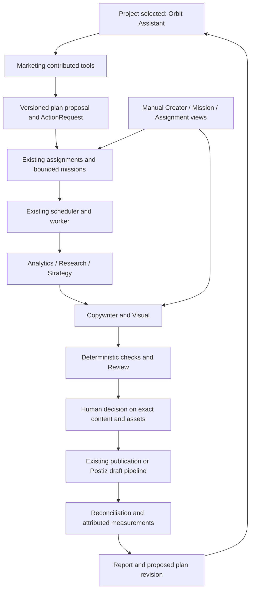

# Marketing Agent v2 — connect the existing Orbit system

Status: proposed implementation plan; documentation only. Date: 2026-10-20 (Europe/Berlin).

## 1. Decision and evidence boundary

Make the existing **Orbit Assistant** the entry point for organic marketing. Extend Marketing's contributed capabilities and connect its existing assignments, specialist DAG, missions, content, approvals, publishing and measurement. Do not introduce another assistant, autonomous agent framework, scheduler, publishing queue or content store.

Repository examined: `eds-labs/eds-orbit`, upstream `main` at **dd902d88af2012eaddd0d974a257aff18a81763d**, fetched and compared with the remote on the date above. Analysis and document live on `codex/marketing-agent-v2-plan` in an isolated worktree. The primary checkout was on `codex/orbit-phase9-postiz-draft` at `c577ba1`; using it would have missed the modular platform and later agent work. Other worktrees and unmerged branches are not evidence of merged capabilities.

This is a static source and test-source audit across the relevant server, worker, schemas, UI and connector paths. Existing tests were inspected, not executed for this documentation change. No production database, flags, accounts, worker health or paid/external provider operation was exercised. Consequently:

- **Implemented** below means a concrete service and callers exist in this revision.
- **Test coverage present** means test source exists, not that it passed during this audit.
- **Partial/prepared** identifies missing connections or explicitly rejected functionality.
- **Live acceptance unverified** applies to every marketing capability in this document. Merged code and historical test reports do not establish current production usability.

Read together with `docs/IMPLEMENTATION_STATUS.md`, `docs/REQUIREMENTS_TRACEABILITY.md`, the original `docs/EDS_ORBIT_UNIFIED_CODEX_MASTER_v3.md`, accepted `docs/adr/0009-modular-platform.md`, and `plans/orbit-modularization/{03-module-contracts,07-roadmap,08-risks-and-decisions}.md`. Older checkpoints and design sketches are subordinate to actual current code for implementation status. Some manifest comments still describe moves as future work although the implementation has moved.

Scope: organic social marketing first; manual Creator, bounded campaigns and standing assignments remain supported. Google Ads and Meta Ads are explicitly excluded. Existing generic content types are not removed. Future paid-channel adapters can use module contributions and separate permissions without being implemented here.

Governance: this change is low-risk local documentation. The planned implementation is high-risk because it touches authorization, persistent execution, budgets and external writes. Primary profile: `ai-agent-app`; complementary profile: `fullstack-saas`. Retain the existing `web-next-custom-postgres` modular monolith and documentation workflow. No new platform or production action is authorized by this plan.

## 2. Current implementation inventory

Paths below are repository-relative; symbols identify the relevant implementation rather than historical flat compatibility paths.

| Area | Source evidence and current behavior | Assessment / boundary |
| --- | --- | --- |
| Main assistant | `apps/api/src/modules/chat-runner.ts` (`runChat`, `runChatJob`) assembles module contributions, checks enabled modules/delegation, uses a bounded runtime (six model calls, eight tool calls), budgets and persisted chat runs. `apps/api/src/modules/chat.ts` supplies conversation persistence. | Implemented shared assistant, not a missing foundation. A broad marketing objective is not yet a durable strategic plan. |
| Marketing contribution | `apps/api/src/modules/marketing/contributions.ts`, `assistant/prompt.ts`, `tools/index.ts` contribute tools, instructions, cards, actions, queues and scheduler. `assignment_propose`, `assignment_change`, package and campaign tools already exist. | Implemented, feature gated. Prompt still begins with a marketing-operator identity; revise only through evaluated module prompt changes, preserving the shared assistant. |
| Assignments | `marketing/agents/assignments.ts`: validated one-off/standing assignments; owner confirmation through ActionRequests, change/pause/resume/end, reserved monthly capacity, channel/policy/format/image checks. `tools/assignment-tools.ts` exposes proposals and status. | Implemented. Not necessary to ask users to create specialist agents manually. `report` is in the schema but rejected by `REPORT_NOT_AVAILABLE`. |
| Recurring execution | `marketing/agents/assignment-runs.ts`: one run per assignment/local date, deterministic dedupe key, quota-aware slots, DST handling, DAG and pooled run budget. `marketing/scheduler.ts` invokes planning; `marketing/jobs.ts` registers the agent queue. | Implemented worker execution independent of an open chat. `ORBIT_AGENTS` is required. No confirmed high-level plan links multiple assignments today. |
| Specialist orchestration | `marketing/agents/specialists/index.ts` registers analytics, research, strategy, copywriter, visual and review. `assignment-runs.ts::buildWorkPlan` connects them; analytics/research are optional inputs, required deliverables depend on strategy and review. | Implemented fixed bounded DAG, not merely agent names. Do not replace with free-form recursive delegation. |
| Research | `specialists/research.ts`: hosted web search and knowledge search; bounded findings whose URLs must occur in observed search sources. | Implemented research leads, deliberately not verified product facts. Live paid search/provider compatibility requires proof. |
| Strategy | `specialists/strategy.ts`: `withContext`, `checkBriefs`; channel history, usable fact keys and optional analytics/research produce one brief per allocated slot. | Implemented **run-level editorial strategy**. No persisted cross-run strategy revision, objective/KPI contract or approval of a whole marketing plan. |
| Copy and visuals | `specialists/copywriter.ts` creates draft-only missions and calls `pipeline/generation.ts::generateMissionLive`; language comes from the marketing profile. `specialists/visual.ts` uses `brand/image-generation.ts`, confirmed image rights and stable request identity; can compose brand banners. | Implemented reuse of existing generation. Visual is normally one image per run, reused across drafts; distinct creative per post must not be promised. Banner handling has additional review restrictions. |
| Review | `specialists/review.ts` combines deterministic checks and model decisions, bounded revision and re-review. `agents/agent-review.ts::agentReviewAccepted` validates exact body/banner/assignment authority, feature flag and Telegram linkage. | Implemented quality and authority checks. Automated quality approval is not always human publication approval; this distinction must become explicit in the new flow. |
| Manual owner release | `agents/owner-release.ts::releaseAssignmentDraft` releases `needs_review` content with exact body/version checks, records human review and uses existing publishing or Postiz-draft booking. | Implemented and reusable. Waiting for the owner is partly a fallback for absent agent authority/bot, not a first-class per-assignment requirement. |
| Campaign missions | `pipeline/workflow.ts`, `pipeline/planning.ts`: finite work quota, draft generation, work packages, follow-up after outcomes, measured context. `assistant/proposals.ts` supports draft-only chat proposals. | Implemented parallel entry surface over shared generation. Assignment-owned missions are excluded from independent generation in `scheduler.ts`; preserve that important anti-double-run guard. |
| Creator / Studio | `apps/web/src/modules/marketing/work.tsx::ContentStudio`, `editorial.tsx`; `marketing/pipeline/editorial.ts`, `draft-batch.ts`; `agents/content-packages.ts` implements multi-channel package preparation, confirmation and advancement. | Implemented manual and chat package creation. Packages and assignments share content/missions but retain distinct orchestration and confirmation contracts. |
| Calendar and delivery | `publishing/calendar.ts`, `publishing/posting-slots.ts`, `agents/scheduling.ts`, `agents/package-schedule.ts`, `agents/veto.ts`; calendar UI in `work.tsx`. | Implemented shared quotas/spacing/quiet hours/blackouts. Multiple orchestration entry points still require parity tests. |
| Postiz | `publishing/publisher.ts`, `postiz-verification.ts`, `postiz-assignment.ts`, `agents/draft-delivery.ts`, `packages/connectors/src/postiz.ts`. Existing publication preflight, dispatch, reconciliation and unknown-outcome handling. | Implemented live-capable adapter, conditional on account/channel/media verification, policy and flags. Postiz draft handoff is an external write, not local approval or proof of publication. |
| Brand, knowledge and assets | `brand/marketing-profile.ts`, `asset-tools.ts`, `image-generation.ts`, `drive-assets.ts`; `apps/api/src/platform/knowledge/`; profile/version tables in Prisma. Fact usability and source rights feed generation and invalidation. | Implemented. Project language, official links, usable facts and approved image rights must be read, not guessed. An existing project is not evidence that its setup is ready. |
| Analytics | `analytics/matomo.ts`, `matomo-schedule.ts`; `marketing/periodic.ts` schedules aggregate imports every 12 hours. `tools/agent-tools.ts` provides `metrics_summary` and bounded `postiz_analytics`; `specialists/analytics.ts` returns measured findings or `noData`. | Implemented collection and specialist feedback. Postiz analytics window/task limits and missing attribution constrain interpretation. No claim of complete cross-channel campaign attribution. |
| Learning | `pipeline/workflow.ts::analyze` persists reproducible metric snapshots; small samples are hypotheses, mismatched dimensions are rejected. `pipeline/planning.ts::prepareFollowup`, `analytics/lifecycle.ts` and preferences support measured follow-up/experiments. | Implemented local feedback mechanisms. Missing an explicit strategy revision proposal and durable delivery of a periodic plan report. |
| Budgets and observability | `platform/ai/budget.ts`, `provider-budget.ts`; `agents/specialists/runner.ts` enforces assignment-month/run/task budgets; `AgentRun`, `AgentSpan`, `BudgetReservation`, audit, jobs and outbox are persistent. | Implemented safeguards. Unknown costs remain held; do not replace with token estimates in the UI. No need for another spend ledger. |
| Permissions and modules | `modules/registry.ts`, `marketing/permissions.ts`, `platform/modules/`, `platform/tenancy/`; scoped DB transactions, RLS and module roles. `scripts/boundaries.json` defines ownership, including some historical flat platform files. | Implemented shared boundaries. Project, module enablement and module role checks must all survive a plan's long lifetime. |
| MCP | `platform/mcp/`, `platform/mcp/native/tasks.ts`, `marketing/mcp-tools.ts`, contributed assignment tools, `modules/action-requests.ts`; rollout in `docs/deployment/MCP_ROLLOUT.md`. | Implemented protocol adapter with separate flags and delegated tasks. MCP confirmation is not Orbit approval. No separate marketing runtime is needed. |

### Coverage already present

Relevant API integration tests include `chat-runner.integration.test.ts`, `assignment-tools.integration.test.ts`, `assignments.integration.test.ts`, `assignment-runs.integration.test.ts`, `agent-runner.integration.test.ts`, `specialists-analytics-research.integration.test.ts`, `specialist-strategy.integration.test.ts`, `assignment-copywriter-visual.integration.test.ts`, `agent-review.integration.test.ts`, `assignment-owner-release.integration.test.ts`, `assignment-veto.integration.test.ts`, `assignment-postiz-drafts.integration.test.ts`, `assignment-run-budget.integration.test.ts`, `content-packages.integration.test.ts`, `package-schedule.integration.test.ts`, `paid.integration.test.ts`, and `safety.integration.test.ts` under `apps/api/tests/`.

`apps/web/tests/chat.spec.ts` covers the existing chat surface; Marketing component tests cover assignments, approval lists, chat cards and navigation. These are valuable regression assets, but their existence does not demonstrate the full requested natural-language → recurring plan → approval → publication → next-cycle improvement scenario.

## 3. Concrete gaps and overlap

### P0 — explicit human approval is not a durable assignment contract

`assignmentFields` currently offers `delivery: publish | postiz_draft`. `deliveryOf` intentionally treats absent legacy delivery as `publish`. Agent review authority plus a confirmed assignment and linked Telegram bot can enable veto-window publishing. Therefore “prepare everything for my approval” must not be implemented by choosing `publish` and hoping the deployment flag remains off. `postiz_draft` also does not mean “wait locally in Orbit”: it writes to Postiz.

Add an explicit human-approval requirement orthogonal to delivery, defaulted safely for newly created v2 work. Check it at planning, scheduling and final publication/draft handoff. Reuse owner release; never treat plan approval as approval of unseen future posts. Keep existing legacy mandates unchanged until explicitly converted.

### P0 — no durable project-level marketing plan

The assistant can propose a campaign, package or assignment. None of those records represents a reviewed strategy spanning objectives, content pillars, a finite planning horizon, explicit approval mode, KPI baselines and links to existing work. A prose answer is not an executable plan. The current strategy specialist is a slot-brief writer, so simply renaming it “Marketing Manager” would hide this gap.

### P1 — three orchestration entry paths, not three unrelated generation engines

Campaign proposals use `ChatProposal`; packages have `content_packages` and ActionRequests; assignments have runs/tasks and ActionRequests. Their validation, scheduling and lifecycle differ while generation, content, facts and publishing are substantially shared. Consolidate **small domain services and projections where behavior is the same**. Do not rewrite all three into a universal workflow engine or migrate all legacy approvals at once.

Flat files such as `apps/api/src/modules/agents/assignments.ts` are re-export compatibility shims. They are not duplicated implementations and must not become a second place for new business logic.

### P1 — feedback exists, but plan-level learning/delivery is incomplete

Analytics can feed the next run's brief, and missions can consume insights. `analyze` produces an observation and a generic recommendation; it does not manage strategy revisions. Report assignments are explicitly refused because no usable delivery path exists. Preserve that refusal until report persistence, owner visibility and deduplicated notification are implemented and tested.

### P1 — repetition prevention is bounded and inconsistent across entry points

`agents/content-history.ts` exposes five recent items per channel, bounded scans and excerpts. Strategy uses 14 days of history and ten posts per channel; remote history refresh can fail and keep cached data. `pipeline/draft-similarity.ts` is lexical Jaccard at 0.8, not semantic novelty detection. A model's `notARepeatBecause` is an explanation, not a uniqueness guarantee. Concurrent assignments also need a shared reservation/check of proposed topics; slot uniqueness alone does not prevent two different slots repeating a topic.

### P1 — plan budget and runtime readiness need an honest projection

Assignment budgets, shared run reservations and project/provider ceilings already exist. A strategic overview must include planning/chat, research, text, review and images without double-counting their reservations. Assigned monthly capacity is not actual spend; unused capacity is not permission to raise a mandate. Default flags in `packages/config/src/index.ts` include disabled `ORBIT_AGENTS`, `ORBIT_TOOL_SEARCH`, `ORBIT_CONTENT_PACKAGES` and `ORBIT_AGENT_REVIEW_AUTHORITY`. Readiness must report exact blockers per operation rather than imply every installed function is enabled.

### P2 — UI exposes mechanisms before the user's objective

`apps/web/src/modules/marketing/manifest.tsx` currently exposes overview, missions, assignments, content, calendar, assets, analytics and memory. The platform already has the shared chat and attention system. Lead with the active plan and assistant; keep these existing views as inspection/editing surfaces and preserve deep links. Do not build a second Marketing chat.

## 4. Target architecture

The diagram is a target flow, not a claim that these links all exist today. Manual content generation keeps its current narrower path; every path reaches the same quality, budget and delivery gates.

### 4.1 Ownership and minimal persisted additions

**Platform owns:** assistant runtime/conversations, tenancy and module authorization, ActionRequests, AI reservations, queue/outbox/leases, notifications, files and shared knowledge services. Marketing contributes tools/cards/action types/jobs through its registry. Worker code calls registry contracts only. Follow `scripts/boundaries.json`; no new boundary exceptions.

**Marketing owns:** interpretation of an organic-marketing goal, strategy proposal, assignments, content production rules, calendar/delivery and measurement interpretation.

Proposed minimal addition: a registered Marketing-owned `marketing_plans` Entity kind (and EntityVersion history), not a new relational plan/run/content database. It adds missing strategic meaning only. Persist:

- goal, audience, product scope, organic channels as actual integration IDs;
- language, content pillars, CTA/official link references, facts/profile version;
- finite review/planning horizon, proposed cadence and explicit timezone;
- KPI definitions, measured baseline references, missing-data state; no invented growth targets;
- references to existing assignments/missions and proposed changes with expected versions;
- approval requirement, delivery target and allowed creative treatment;
- budget projection referencing existing mandates/reservations, never a second spend authority;
- current revision/hash, provenance and strategy assumptions, report/review timestamps;
- status: proposed, active, paused, completed, superseded or blocked, with typed reasons.

Register ownership, schema validation, scoped collection access, retention/export behavior and API contracts. Existing runs/tasks/content/publications continue to own execution state. A plan status is a projection plus its lifecycle, not another copy of every job state.

Add optional `marketingPlanId` / `marketingPlanVersion` references to newly linked assignment and mission payloads; preserve missing fields and existing hashes. Runs capture the approved revision they began under. Exact names are proposed and must be validated against schema/ownership conventions during implementation.

**First pilot can precede this addition:** one explicit-approval standing assignment plus a reviewable strategy summary is enough to validate the production path. Label it a pilot assignment, not a completed v2 strategy manager. Add durable multi-assignment plan management only after that path works.

### 4.2 Capability design

Reuse `project_status`, `knowledge_search`, `assignment_list`, `run_status`, `recent_content`, channel history, `analytics_memory`, campaign/package tools and ActionRequests. Add narrow Marketing contributions (proposed names):

- `marketing_plan_context`: current facts/profile, channel/readiness state, budget capacity, existing work, history coverage and measured baselines. Bounded output and explicit freshness/truncation.
- `marketing_plan_propose`: validated durable proposal, no execution; returns plan revision and exact ActionRequest/card.
- `marketing_plan_status`: aggregate progress and actionable blockers with links to actual records.
- `marketing_plan_change`: proposes a delta with expected versions; it cannot silently increase channels, budget, cadence or publication authority.

The main assistant composes the strategic recommendation; existing strategy specialist keeps its bounded run-brief role and receives the approved plan context. Avoid a second persistent “manager agent”. Manual plan UI and MCP use the same services; no platform import of Marketing implementation and no MCP-specific duplicate workflow.

Plan confirmation is one owner action showing the bounded scope and all child deltas. Its handler must revalidate and call shared assignment/mission validation in a scoped transaction with idempotency. Record the plan action as the authorization origin of each child; do not programmatically impersonate independent human clicks on existing cards. If a child cannot be activated, roll back the activation transaction or return an explicitly unactivated proposal with blockers; never show full success for partial hidden activation.

### 4.3 Approval and policy semantics

Propose an additive `approvalMode: human_each | delegated_review` on v2 assignments/plans, separate from `delivery: publish | postiz_draft`.

- New v2 work defaults to `human_each`, including the reference scenario.
- Quality review may mark a draft suitable; it cannot release human-gated content.
- Publication and external draft handoff both require their appropriate exact human authorization. Local preparation itself creates no external content write.
- Bind decisions to body, media versions, channel, delivery type, schedule, relevant facts/profile/policy and plan/assignment revision using existing hash/version mechanisms.
- Changed copy or image invalidates approval. Changed sources/policy/module role are checked again before dispatch. Expired/changed schedules return a visible rescheduling decision rather than silently publishing late.
- Preserve `agentReviewAccepted` and legacy veto semantics for explicitly delegated legacy work. Never infer delegation from silence, prior plan approval, bot presence or a deployment flag.
- Pause/end stops future runs and withdraws unsent work through existing services. A provider-owned or ambiguous item is shown as unresolved until reconciled; do not promise remote cancellation that is unproven.

For the pilot, `human_each` must be enforced even if agent review authority is enabled and Telegram is connected. This is the decisive regression case.

### 4.4 Execution, budget and recovery invariants

1. Plan activation reuses existing assignment/month budget validation and shared project/provider limits. A plan cannot spend on behalf of a different project or bypass module permissions.
2. Each recurring execution uses the existing assignment/date key and version snapshot. Replayed confirmation, duplicate scheduler sweep and simultaneous workers cannot create a second run or publication.
3. Required text/visual/review work retains the existing run-pool reserve; optional analytics/research failures are visible and may degrade the run. Required knowledge/rights failures block it.
4. Keep paid-call transmission identity and reservation settlement; unknown outcomes remain counted. Automatic retry is permitted only where the existing code proves no ambiguous paid call or external write occurred.
5. Reuse completed drafts/assets after safe restart. Recovery must show remaining work, prior spend and decisions, not regenerate the whole campaign.
6. Plan-level status links `assignment_runs`, `agent_tasks`, content, approvals and publications; distinguish ready for review, approved, scheduled, handed off, published, failed and unknown. A `done` run is not a published campaign.
7. Fetch current role, module activation, mandate, source rights and account scope at each consequential boundary, not just when the conversation started.
8. Limit unresolved review backlog per assignment. Pause or skip the next cycle with an explanation when the configured bound is reached; do not accumulate paid drafts indefinitely. The exact bound is an owner-visible setting, not an invented product default in the prompt.

### 4.5 Novelty and measured improvements

Create one bounded history/novelty projection for packages, manual mission batches and assignments. Include current drafts, pending approvals, held briefs, scheduled/published Orbit posts and observed external Postiz history. Report incomplete history. Keep existing lexical checks and fact checks; add structured topic/pillar/angle keys and atomic within-project brief reservation before generation. Semantic comparison is optional later only if measured false positives/negatives justify its cost.

Attach measurement references using existing mission/content/publication IDs and existing tracking conventions; extend missing mappings after an attribution audit. Do not append tracking to an approved URL without revalidation. Preserve source/account/timezone/window distinctions and nulls. Show source freshness and coverage, including the current Postiz seven-day post window and five-post task cap; never sell this as full-history analytics.

Persist a periodic report from measured snapshots, deliver it to the existing attention/notification surface, and let the assistant explain it. Recommendations propose a strategy revision. Automatic changes may select topic/angle within an approved envelope; changing spend, audience, channel, frequency ceiling, claims or publication permissions always requires a new decision. Insufficient samples remain hypotheses; generated marketing content never becomes independent verified knowledge.

## 5. User experience and reference flow

Primary journey: **select project → speak with Orbit → confirm strategy/work plan → worker prepares content → decide on content → inspect delivery and results**.

1. Mario selects uLiquid Desk and gives the reference English-content/weekly-organic request. The assistant reads current context and existing assignments before creating anything.
2. It returns a concise proposal: objective, content pillars justified by facts, actual connected and policy-allowed channels, weekly cadence, English language, visual approach, delivery target, human review requirement, cost ceiling and first review date. Missing budget/authority is requested specifically; connected channels or budgets are not invented. Existing matching work is proposed for reuse/update.
3. Owner confirms the exact plan/start mandate. This authorizes bounded preparation, not unseen posts. The assistant returns actual assignment/plan IDs and expected next run time.
4. The worker executes specialists and saves English copy, image and review findings. If the profile language is not English, resolve it explicitly through validated configuration/plan semantics; do not silently overwrite global language or assume the prompt changes it.
5. The shared attention surface and chat card show draft previews, factual sources, costs, image, channel and planned time. Mario can request a revision, reject, approve selected items or pause work. Revisions reuse existing bounded paths and invalidate affected approvals.
6. Only approved items use the existing Postiz pipeline. Cards distinguish “scheduled”, “Postiz draft created” and “published”; unknown results remain visible and are not resent blindly.
7. Subsequent weekly cycles run within the accepted envelope. Repeated goals do not create duplicate assignments. A missed approval or exhausted budget yields one actionable exception.
8. A periodic measured report proposes a revision and explains uncertainty. No data produces a setup/freshness message, not a fabricated successful campaign.

### Navigation changes

| Existing surface | Proposed treatment |
| --- | --- |
| Platform Orbit Assistant | Keep the single primary conversational entry. Marketing overview links/focuses it with project context. |
| Marketing overview | Active plan summary, next preparation, waiting decisions, measured outcome and concise readiness blockers. |
| Content / Creator | One manual creation and content inspection area, with filters for drafts/review/scheduled; keep full manual control. |
| Assignments | Keep dedicated route for one-off/recurring work and pause/status/budget editing. No need to expose specialist setup as onboarding. |
| Missions | Keep campaign view for finite objectives and periods, showing linked assignments/content when applicable. |
| Calendar | Projection of existing slots, drafts and publications; no independent calendar scheduler. |
| Analytics and Memory | Show results together with evidence-backed recommendations; retain old memory URL as a deep link/tab. |
| Assets and specialist diagnostics | Assets remain reachable under brand/resources; run traces and advanced settings move behind details/advanced links. |
| Platform approvals/attention | Reuse across modules; do not recreate a Marketing-only inbox that hides Support decisions. |

Implement through `apps/web/src/modules/marketing/manifest.tsx`, `overview.tsx`, `chat-extension.tsx`, assignment cards, existing content views and platform extension contracts. Preserve legacy redirects, module roles, mobile navigation and shared design tokens. A later UI implementation must read `docs/DESIGN_SYSTEM.md` and the applicable EDS Labs UI skill; this plan does not redesign components.

## 6. Prioritized implementation tasks

Estimates are relative engineering sizes, not promises: S = a narrow change; M = several cooperating components; L = cross-cutting work split into independently reviewable tasks. Each task should remain usable behind a default-off v2 feature gate where needed. Existing workflows remain available.

### Phase 0 — reproducible baseline and scenario fixture (P0, S/M)

**MA-00 — characterize the current end-to-end path.**

- Components: existing tests listed in §2, `apps/web/tests/chat.spec.ts`, test support fixtures and the Marketing readiness projection.
- Work: synthetic project with two connected mock social channels, verified English facts/profile, approved brand asset, finite budget and a fake clock. Drive the existing assistant tool path into an assignment, worker DAG, pending owner release, publication and metrics. Capture current guard behavior without changing production services.
- Dependencies: none; isolated PostgreSQL/Redis test environment and supported repository toolchain.
- Acceptance: repeatable test evidence identifies which steps work and which fail; no live provider calls; flags and fixture versions explicit. Keep expected future behavior in clearly identified scenario coverage rather than merging permanently failing CI tests.

### Phase 1 — first useful approval-first recurring pilot (P0, M)

**MA-01 — enforce explicit per-item approval for new recurring work.** This is the first production-code task.

- Components: `marketing/agents/assignments.ts`, `agent-review.ts`, `veto.ts`, `owner-release.ts`, `draft-delivery.ts`, `marketing/policy/policy.ts`, `tools/assignment-tools.ts`, `assistant/prompt.ts`, assignment confirmation UI and API schemas/client as applicable.
- Work: additive approval mode, safe v2 default, confirmation hash binding, projections and every delivery preflight. Reuse human release and publication services. Legacy absent-field semantics remain explicit and tested.
- Dependencies: MA-00 characterization. No production migration is assumed for Entity JSON additions; any required DB change needs a separate reviewed migration.
- Acceptance: with review authority **on** and bot linked, `human_each` never schedules/sends before exact owner approval; agent quality review still runs. Text/media change revokes approval; stale/concurrent owner decisions create at most one intent. Postiz-draft mode cannot bypass the requirement. Legacy veto flow still passes unchanged.

**MA-02 — connect the reference request to one bounded assignment and a useful result card.**

- Components: `assistant/prompt.ts`, `tools/assignment-tools.ts`, `tools/read-tools.ts`, `agents/assignment-overview.ts`, `apps/web/src/modules/marketing/chat-extension.tsx`, `assignment-card.tsx`, overview/attention extensions.
- Work: context-first intake, reuse matching existing work, English/profile mismatch handling, concrete cadence/budget proposal and explicit human review; show actual run/output IDs, cost and blockers. Keep existing tool search rather than stuffing all schemas into every prompt.
- Dependencies: MA-01.
- Acceptance: the reference request produces a reviewable proposal, confirms once, prepares text and image with fake providers, exposes owner review and safely publishes only approved content. A second equivalent request shows/revises the existing assignment. Reloading/closing chat does not stop the worker. Missing budget produces one focused question and no paid execution.

**Exit:** a usable single-assignment pilot from the main assistant. This has higher value than first rebuilding navigation or introducing a general planning engine.

### Phase 2 — durable strategy and multi-work coordination (P1, M/L)

**MA-03 — persist the minimum plan contract and proposal tools.**

- Components: proposed `marketing/plans/` services, Marketing manifest/contributions/action types, `packages/schemas/`, shared Entity/EntityVersion APIs, assistant cards and generated API client.
- Work: implement §4.1 plan, bounded context projection and propose/status/change capabilities; store sources, assumptions, revisions and links, not duplicate content/jobs/budgets.
- Dependencies: MA-02.
- Acceptance: plan survives chat deletion/reload; cross-project reads/writes fail; disabled module hides/blocks tools; invalid channel, expired fact, stale profile, impossible budget or unbounded horizon cannot activate. Plans are exportable/auditable and no content runs from a draft plan.

**MA-04 — idempotent plan activation and existing-work linking.**

- Components: new plan activation handler, assignments/mission shared services, `assignment-runs.ts`, ActionRequest integration, plan status projection.
- Work: one exact owner decision applies bounded child deltas with version checks and recorded authorization origin. Link existing work without generating copies; provide pause and proposed revision behavior.
- Dependencies: MA-03 and approval semantics from MA-01.
- Acceptance: replay/concurrent confirmation yields one child set; stale child versions stop activation; failed validation creates no partially active plan. Existing assignments continue independently unless explicitly linked. A paused/disabled plan cannot keep starting new owned work; already handed-off remote work is reported accurately.

### Phase 3 — consistent production quality and recovery (P1, M)

**MA-05 — share novelty/context and bounded backlog handling.**

- Components: `agents/content-history.ts`, `channel-posts.ts`, `specialists/strategy.ts`, `pipeline/draft-similarity.ts`, package/batch entry points and `assignment-runs.ts`.
- Work: shared bounded history projection, structured topic reservations, current draft inclusion, uncertainty on stale remote history, configurable pending-review limit.
- Dependencies: MA-02; plan pillars integrate after MA-03.
- Acceptance: concurrent assignments cannot book the same constrained topic/angle; creator/batch/assignment outputs participate in one check; legitimate different angles are not rejected solely for sharing product facts. Unavailable Postiz history is visible. A full review backlog incurs no further generation costs.

**MA-06 — unify operational status and recovery actions.**

- Components: run/task status services, publisher reconciliation, plan projection, notification/attention contributions and chat cards.
- Work: present exact failure/degraded/unknown states with targeted recovery; expose existing cost ledger totals and held amounts. Reuse current safe resume logic; do not globally retry completed paid work.
- Dependencies: MA-02; full plan projection after MA-04.
- Acceptance: crash after image persistence reuses the image; ambiguous publish never duplicates the post; optional research failure permits a labeled degraded run; required review failure prevents delivery; permission revocation at dispatch blocks sends. One event yields one actionable notification.

### Phase 4 — measurable feedback and plan improvement (P1, M)

**MA-07 — persist and deliver useful periodic reports.**

- Components: `analytics/matomo-schedule.ts`, `tools/agent-tools.ts`, `specialists/analytics.ts`, `pipeline/workflow.ts::analyze`, plan services, existing notifications/attention and scheduler contributions.
- Work: audit/add attribution links; persist period/source-aware reports; deduplicated delivery to owner; generate a proposed plan revision. Only enable `report` assignments after their lifecycle and owner-visible delivery are complete.
- Dependencies: MA-04 and actual measured publication IDs; may start with synthetic metrics before live pilot.
- Acceptance: repeat imports do not inflate totals; corrected metrics invalidate/revise reports; noData is explicit; four-channel plans expose current specialist sampling limits instead of silently claiming all channels were analyzed. Cross-source totals are not conflated. Report delivery occurs once per period. Budget/channel/cadence increases remain pending approval.

### Phase 5 — simplify navigation and controlled pilot acceptance (P2/P0 release gate, M)

**MA-08 — make the assistant-led flow the obvious path.**

- Components: Marketing web manifest/overview/chat extension/content/insights and shell contracts; no new assistant route or state store.
- Dependencies: MA-02 for first useful cards, MA-04/07 for full plan/results UI.
- Acceptance: project selection → assistant → plan → pending review is accessible on desktop/mobile; manual missions, assignments and Creator remain direct; legacy links resolve; Marketing-disabled projects and role-restricted users see correct navigation. Pending approvals for other modules remain visible.

**MA-09 — gated uLiquid Desk pilot.**

- Components: deployment/runbook evidence and existing readiness/telemetry; application changes only for demonstrated defects.
- Dependencies: minimum pilot MA-00–02 plus targeted recovery tests; full v2 acceptance also needs MA-03–08.
- Acceptance: satisfy §9 with exact source revision, current flags, bounded paid spend and one explicitly approved channel publication first; then observe at least two weekly cycles and a measured/no-data report. Live rollout is separately authorized, never implied by this planning task.

Recommended order: **MA-00 → MA-01 → MA-02 → limited pilot evidence → MA-03 → MA-04 → MA-05/06 → MA-07 → MA-08 → full MA-09 acceptance**. Address observed safety/recovery defects before expanding the pilot. Do not make a complete dashboard redesign a prerequisite for the first usable cycle.

## 7. Test and evaluation strategy

### Deterministic end-to-end acceptance

Add a named `marketing-agent-v2` scenario using the real assistant tool registry, API, scoped DB and worker, with deterministic model/image/Postiz/Matomo fakes. A scripted tool-response fixture verifies orchestration; a separate bounded model evaluation verifies that natural language actually selects the correct tools. Neither substitutes for the other.

1. Select synthetic uLiquid Desk; send the reference request with an established finite budget and English profile.
2. Assert context reads and a proposal before any generation/delivery. Compare proposed channels to connection assignment and policy intersection.
3. Confirm once (also replay/concurrently); advance fake time; execute recurring DAG.
4. Assert English drafts, approved facts, image provenance, paid-call ledger and quality result.
5. Assert **zero Postiz writes before human approval**, including with delegated review flag enabled.
6. Change one draft, reject another; assert new hash/approval only for changed artifacts, unchanged assets reused.
7. Approve one exact artifact; assert one publication intent and one external handoff; reconcile to published with remote ID. Scheduled acceptance alone is not publication.
8. Import attributed synthetic metrics, generate a report, propose a strategy revision; assert no extra authority before confirmation.
9. Advance to the next week; assert recurrence without reopening chat and no duplicate content/run or unauthorized budget increase.

### Negative and recovery matrix

| Test | Required result |
| --- | --- |
| Different workspace/project IDs in a plan/tool/action | Scoped denial; no foreign content, asset, metrics or cost visibility. |
| Module disabled or member demoted after confirmation | Future execution/dispatch blocked through current guards. |
| Replayed MCP request, revoked grant or client “approved” text | Dedupe/reject; existing server ActionRequest rules remain authoritative. |
| Budget exhausted during parallel text/image/review calls | Atomic cap; unknown spend held; no secondary unreserved retry. |
| Source revoked or profile/policy changed after draft approval | Invalidation and final preflight block; visible re-review requirement. |
| Prompt injection in research/knowledge/metrics | No permission expansion, tool bypass or promotion into verified facts. |
| Failed optional analytics/research | Degraded run with no fabricated data; required generation/review remains governed. |
| Empty report/no metrics or mismatched dimensions | No invented conversion uplift, winner or combined total. |
| Worker crash after paid call or provider handoff | Reuse proven saved results; unknown outcomes need reconciliation, no blind resend. |
| DST/month rollover, missed slot, duplicate sweeps | Correct local cadence, existing UTC budget-month semantics, bounded missed-slot behavior. |
| Many unresolved approvals | Visible backlog pause/skip with no uncontrolled paid accumulation. |
| Manual creator and assignment run collide | Shared calendar/novelty checks; neither silently overwrites the other. |
| Legacy absent approval/delivery fields | Preserve old validated hashes/mandates; conversion requires explicit decision. |

Use Vitest unit tests for new schemas/projections, real isolated PostgreSQL integration for transactions/RLS/idempotency, existing Redis worker restart patterns, and Playwright for cards/reload/approval/mobile. Extend current tests rather than duplicate every existing safeguard.

Before merging implementation: repository `pnpm lint`, `pnpm typecheck`, relevant integration tests, full required suite and `pnpm build`; run applicable browser tests and boundary/source checks. Record exact commands, runtime versions and results. Provider fakes must be visibly test-mode and never generate live readiness receipts. Any authorized real-model evaluation uses its own explicit cost cap and records actual cost. Never reuse historical test counts as fresh evidence.

## 8. Migration, rollout and risks

No destructive replacement or schema migration is part of this document.

- Add optional plan links and approval fields; retain old records, entity IDs, assignment schedules, body/media hashes, publications and audit history. Adding defaults must not alter legacy confirmation hashes inadvertently.
- Do not bulk-enroll existing missions/assignments. Offer a read-only adoption preview with current authority, delivery and linked content; owner confirms exact changes.
- New v2 work is approval-first. Existing delegated workflows preserve their authorization until explicitly converted; no global toggle silently changes every project.
- Adopt a bounded v2 feature gate for new capabilities. Enable per-project only after the role/readiness matrix is verified. Flags do not grant external-write permission.
- Pause before conversion where running work could straddle versions. Keep completed work readable; pending decisions tied to old changed payloads are canceled/reissued through existing services. Remote-owned/unknown publications require reconciliation before retry or conversion.
- Prefer JSON/entity additions within current storage. If relational constraints/indexes become necessary, plan a separate additive migration, synthetic legacy-row preservation test, RLS/grants checks and explicit production approval.
- Rollback: disable new plan entry points and stop new v2 runs; preserve existing manual paths and records. Maintain the `human_each` dispatch guard even if UI/plan features are disabled. Do not roll back to a binary that ignores the new guard while those assignments are active; pause them first. Never delete publications to “roll back”.
- Performance: current services use bounded history but also `list()` scans. Before a larger rollout, measure run/plan projection cost with realistic row counts; add scoped queries/indexes only where needed. Keep payload limits and history truncation visible.
- Authorization risk: composite plan activation can accidentally bypass child decisions. Test actor identity, module roles, version checks and authorization origin explicitly.
- Cost risk: background weekly preparation can accumulate without review; backlog limits, end/review horizon and finite budget are required.
- Quality risk: shared run images and short history do not imply diverse campaign creatives. State limitations in the plan; validate novelty without turning product facts into forbidden repeated words.
- Feedback risk: correlation/attribution gaps must not silently redirect strategy. Keep report sources and recommendations inspectable and reversible.

No new service is necessary. PostgreSQL, Redis/BullMQ, the existing AI runtime, Postiz and Matomo remain the operating stack. Self-hosting and tenant separation are preserved. A later ads module/adapter would need its own explicit permissions, cost model and acceptance; it is excluded here.

## 9. uLiquid Desk productivity and live-readiness checklist

Current conclusion: substantial implementation exists, but this audit does **not** certify a production-ready autonomous marketing manager. The first internal approval-first loop requires MA-01/02; the complete requested strategic feedback loop also needs plan persistence and report/revision delivery. The following are acceptance requirements, not claims that the live project is misconfigured.

| Gate | Evidence required before calling the pilot usable |
| --- | --- |
| Revision/runtime | Deployed commit, API/worker health, queue progress and relevant module/tool flags match the tested revision. |
| Project authority | uLiquid Desk scope, Marketing/Knowledge enabled, intended member roles and owner confirmation verified. No reliance on Support MCP inbox exceptions. |
| Knowledge/profile | Current usable product facts, official CTA/link, English content language, brand rules and rights-approved assets. Conflicts/staleness resolved or deliberately excluded. |
| Channels | Actual Postiz account and assigned integration IDs, allowed policy channels, per-channel text/media capability proof and chosen delivery mode. |
| Cost | Owner-approved daily/monthly/run limits, assignment allocation, text/image routes and price ceilings; planning/review/research/unknown costs visible. No invented numeric budget in this plan. |
| First cycle | One bounded approved assignment from chat produces usable English text and image; human-required state remains enforced with all automation flags on. |
| Publication | Exact owner-approved item goes through preflight; one remote ID and reconciliation show publication. Draft creation or scheduling is insufficient. |
| Recovery | Tested pause, denied/stale approval, worker restart, exhausted budget, missing source rights and ambiguous-provider response. |
| Feedback | Matomo configuration and/or Postiz measurements scoped and timestamped; report delivered, even if correctly no-data; improvement is a reviewable delta. |
| Recurrence | At least two weekly cycles without manually creating agent tasks; no duplicate post, review bypass or unexplained cost. |

Keep an evidence table per pilot run: source SHA, timestamps/timezone, project-scoped test identifiers, plan/assignment/run/content/publication IDs, model/connector versions, reserved/settled/unknown cost, approval events, external receipt, measurement period and unresolved blockers. Do not place credentials, private customer data or raw secrets in repository evidence.

Go/no-go: any unexpected external write, exceeded authorized spend, tenant leakage or ignored review requirement stops the pilot. Missing analytics can allow a clearly labeled content pilot, but cannot pass the complete improvement-loop acceptance. Real paid calls, publication, production configuration and deployment require their respective explicit authorization.

## 10. First executable development task

**Start MA-00 characterization, then implement MA-01: explicit approval-first recurring assignments.**

Suggested Codex instruction:

> On a fresh branch from current main, characterize existing assignment owner-release and veto behavior with synthetic fixtures. Add an explicit approval mode for newly created v2 assignments so “prepare posts for my approval” cannot schedule or hand content to Postiz before a human decides on the exact content and media. Reuse assignment confirmation, owner-release, policy preflight, ActionRequests and existing publishing/draft delivery. Preserve legacy hashes and delegated veto behavior. Cover agent review authority enabled plus linked Telegram, stale/edited content, concurrent approval, both delivery targets and module/role revocation. Extend the existing chat tool and confirmation card. Run the repository checks and focused API/browser tests. Do not deploy, enable production flags, call paid providers or publish real content.

This task is small enough to review, removes the most important mismatch with the reference scenario, and unlocks a useful recurring pilot without first building an additional orchestration system.

## 11. Validation of this planning change

Only this Markdown document is added. Source references and key symbols were inspected on the revision stated in §1; relative paths were checked against the worktree and `git diff --check` is part of completion. No application code, schema, lockfile, settings, secrets or provider state changed. No commit, push or deployment is included.

Tests/typecheck/build are not run for this documentation-only change, using the explicit docs-only exception in `.agentic/project-profile.yaml`. The EDS Labs Website checkout is not modified; its npm build is not a validation of this separate pnpm Orbit repository. Existing test sources and historical status documents are evidence of coverage/design only, not newly executed verification.
