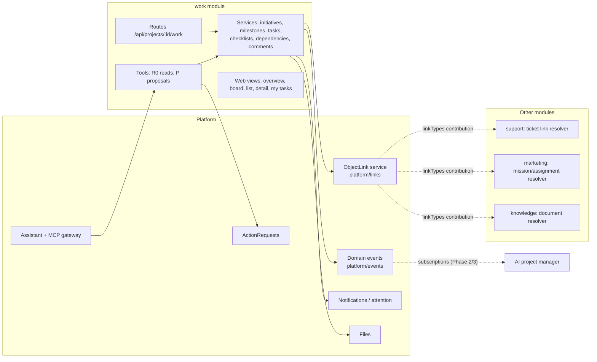

# Project management module — Phase 1 implementation plan

Status: **plan only** (2026-10-25). Nothing in this document is implemented. It contains no migration that has been run, no code change and no production action.
Basis: `main` at `c4886cc0` (read-only analysis of the repository; production data and flags were not read).
Companion plans: [`ai-project-manager-phase-2.md`](ai-project-manager-phase-2.md) (Phase 2) and [`issue-center-phase-3.md`](issue-center-phase-3.md) (Phase 3). This plan is self-contained; §2.6 lists the decisions the later phases rely on.

Classification under `AGENTS.md`:
- **Risk: high.** New tenant tables with FORCE RLS, new permissions, new MCP scope, two new platform services (object links, domain events) and a production migration on delivery.
- **Environment:** local and isolated worktree test databases. Every production step (merge to `main` = deploy, flag switch) needs Mario's separate approval (`docs/MODULE_ACTIVATION.md`, memory: pushes to `main` auto-deploy).
- **App profile:** primary `fullstack-saas` (tenants, roles, module activation); complementary `web-frontend` (board, lists) and `backend-api`.
- **Stack preset:** unchanged existing stack (TypeScript/pnpm monorepo, Fastify, Next.js, BullMQ, Prisma/PostgreSQL). No stack change.
- **Workflow:** `feature` plus `migration` for WP1.4.

Legend: **[Fact]** observed in the code at `c4886cc0`; **[Proposal]** target of this plan; **[Unverified]** needs a check during the work package.

---

## 1. Current state (Ist-Zustand)

### 1.1 What does not exist

- **[Fact]** There is no project-management model anywhere: no `Task`, `Issue`, `Milestone`, `WorkItem`, `Todo` or checklist model in `packages/db/prisma/schema.prisma`, and no code. `docs/MCP_2_0.md` says "There is no project-management task board."
- **[Fact]** ADR 0009 names "Projects" as a later module, and `plans/orbit-modularization/02-target-architecture.md` §5.1 lists `projects` as "Later — Tasks, milestones". `07-roadmap.md` contains **no** work package for it.
- **[Fact]** There is no generic link table between objects of different modules and no domain-event bus. The only polymorphic columns are `AgentRun.subjectType/subjectId`, `SystemAuditEvent.targetType/targetId`, `FinanceJournalEntry.sourceType/sourceId` and `Outbox.topic/entityId`.
- **[Fact]** No drag-and-drop dependency exists in any `package.json`.

### 1.2 Name collisions to avoid

| Name | Existing meaning | Location |
|---|---|---|
| Project | The tenant container (`Project`, `ProjectMember`, `ProjectModule`, URL `/p/:projectId`) | `schema.prisma`, `apps/web/src/platform/shell/routes.ts` |
| `tasks` | Test-only fixture module (`tasks.read`, `tasks.manage`) | `apps/api/tests/fixtures/modules/tasks/` |
| `orbit_tasks` | MCP 2.0 delegated work orders | `apps/api/src/platform/tasks/` |
| `agent_tasks` | Marketing specialist steps | `apps/api/src/modules/marketing/agents/` |
| `work_packages` | Marketing entity kind (mission work packages) | `apps/api/src/modules/marketing/manifest.ts:81` |
| `taskClass` | AI route class | `packages/ai/src/routing.ts` |

### 1.3 Reusable infrastructure (all [Fact])

| Need | Existing mechanism | Location |
|---|---|---|
| Module manifest and registry | `ServerModule` (strict zod: `id`, `version`, `displayName`, `dependsOn`, `defaultEnabled`, `entityKinds`, `tables`, `permissions`), `validateRegistry` | `packages/module-contracts/src/index.ts`, `apps/api/src/modules/registry.ts` |
| Contributions | `ModuleContributions`: `routes`, `tools`, `actionTypes`, `jobs`, `periodic`, `scheduler`, `attention`, `userNotifications`, `files`, `assistant`, `available`, `unavailableCode`, `knowledgeImpact`, `retention`, `hooks`, `configurationSections` | `apps/api/src/platform/modules/contributions.ts` |
| Activation | `ProjectModule` + `enabledModules()`; opt-in modules count only with an explicit row; `ORBIT_MODULES`; installation switch `available()` | `platform/modules/activation.ts`, `enforcement.ts`, `docs/MODULE_ACTIVATION.md` |
| Module roles | `ProjectMemberModuleRole` (`editor`/`viewer`/`none`), `effectiveRole`, `moduleScope` | `platform/tenancy/module-roles.ts` |
| Route guard | `scopeFor(auth, req, projectId, permission)`; the platform wraps each module's routes in a `preHandler` that sets `req.orbitModule` and checks activation | `platform/tenancy/auth.ts:147`, `server.ts:930-945` |
| Module settings | `readModuleSettings` / `writeModuleSettings` (versioned, `SETTINGS_VERSION_CONFLICT`) in `ProjectModule.settings` | `platform/modules/settings.ts` |
| Tenant isolation | `scoped(workspaceId, projectId, fn)` sets `app.workspace_id`/`app.project_id`, takes a per-project advisory lock; composite `("workspaceId","projectId")` and `("projectId", id)` FKs in SQL; FORCE RLS policy `project_scope` per table | `packages/db/src/index.ts`, migration `202610230002_finance_core` |
| Grants | Hand-listed arrays in `scripts/db-deploy.ts` | `scripts/db-deploy.ts` |
| Audit | `audit(tx, scope, action, resourceId, metadata)`, append-only, content-free | `platform/shared.ts:157` |
| Per-object history | `SupportTicketEvent` + `ticketEvent()` (one event per changed field, `before`/`after`) | `modules/support/common.ts` |
| Numbering | `SupportTicketCounter` (per project, never reused) | `schema.prisma` |
| Full-text search | `SupportMessage.searchVector tsvector` (`simple` config) | migration `202610180001_support_core` |
| Files | `storeFile/readFile/deleteFile`, `File.moduleId`; module link table pattern `SupportAttachment(messageId, fileId)` | `platform/files/files.ts`, `docs/PLATFORM_FILES.md` |
| Notifications | `notifyMembers(tx, scope, {kind, userIds, title, body?, link?})`; kinds declared in `userNotifications` | `platform/notifications/members.ts` |
| Attention / badges | `attention(tx, scope, now) => AttentionItem[]` keyed by `navKey`; `GET /api/projects/:id/attention` | `platform/attention/types.ts`, spec `2026-10-18-orbit-ui-restructure-design.md` U6 |
| Realtime | `publishChange(projectId, stream)` via `afterCommit`, content-free wake-ups, `ORBIT_REALTIME` | `platform/realtime/fanout.ts` |
| Jobs | `enqueue(tx, scope, topic, resourceId, idempotencyKey, availableAt?)` → `jobs` entity + `Outbox`; `JobDef`, `PeriodicTask`, `SchedulerContribution`; worker `pump()` dispatches by `queueClass` | `platform/jobs/enqueue.ts`, `platform/jobs/types.ts`, `apps/worker/src/main.ts` |
| Assistant / MCP tools | `OrbitTool` (`risk: R0_read | W0_internal | P_proposal`, `exposure`, `mcpScopes`), `readOperation` / `approvedOperation` helpers | `platform/agents/tools/registry.ts`, `platform/tasks/operation-tools.ts` |
| Approvals | `ActionRequest` (`createActionRequest`, `decideActionRequest`, hash-bound `packageHash`, single-use `consumeActionRequest`) | `platform/governance/action-requests.ts`, ADR 0008 |
| Web shell | `WebModule` (`optIn`, `minAccess`, `groupOrder`, `views`, `home`, `attention`, `settings`, `actionRequests`), catch-all routing, query-param detail views (`?ticket=`) | `apps/web/src/platform/shell/types.ts`, `apps/web/src/modules/registry.ts` |
| UI primitives | `Button`, `Input`, `Badge`, `Status`, `Tabs`, `Modal`, `Empty`, `Skeleton`; `PageHead`, `HomeCard`, `DataForm`; data hooks `useResource` / `useMutation` | `apps/web/src/components/ui/primitives.tsx`, `apps/web/src/platform/ui/*`, `apps/web/src/lib/api.ts` |
| Template module | Finance: manifest, permissions, gate, contributions, MCP tools, web manifest, 29 commits touching every registration point | `apps/api/src/modules/finance/`, `apps/web/src/modules/finance/`, ADR 0012 |

### 1.4 Integration points and their actual state

| Integration | State | Consequence for Phase 1 |
|---|---|---|
| Orbit project administration | Owners enable modules in Settings → Modules | Module is opt-in (`defaultEnabled: false`) |
| Global administration (ADR 0013) | Admins manage memberships and module roles; **they cannot enable modules** (`orbit_auth` has no grant on `ProjectModule`) and never read project content | Nothing to build beyond module-role support, which is generic. [Unverified] that the admin module-role editor lists all registry modules automatically |
| Users and roles | `owner`/`editor`/`viewer` + module roles | Permission catalogue in §4.2 |
| Module activation | Implemented | Installation switch `ORBIT_WORK` + project row |
| Knowledge / RAG | Platform services; `knowledgeSearch(..., purpose)` | Phase 1 links knowledge documents; **tasks are not indexed into the RAG corpus** (D-9) |
| Notifications | In-app + e-mail per kind; Telegram owner bot | Kinds in §4.6 |
| Main assistant | One assistant, module-contributed tools; chat limits 8 model / 16 tool calls / 128 KB (`platform/assistant/chat-limits.ts`) | Tools in §6 |
| Missions, assignments, recurring jobs | Marketing-owned `Entity` kinds; scheduling via `Project.workDueAt` sweep and `periodic` tasks, no BullMQ repeatables | Links to missions/assignments (read-only resolvers); no duplication |
| Support | Own ticket system; tickets are `SupportTicket` rows | Links to tickets via resolver; tickets are never copied |

---

## 2. Target architecture (Zielarchitektur)

### 2.1 Terms

| German (UI) | English (code/docs) | Meaning |
|---|---|---|
| Orbit-Projekt | project | Tenant/work area. Unchanged. |
| Vorhaben | **initiative** | A planned undertaking inside one Orbit project (e.g. "uLiquid Marketplace launch") |
| Meilenstein | milestone | A dated checkpoint of one initiative |
| Aufgabe | task | A unit of work; optionally in an initiative and a milestone |
| Unteraufgabe | subtask | A task with `parentTaskId` (one level) |
| Checkliste | checklist item | A lightweight tick-box inside a task, not a task |

### 2.2 Module identity (decision D-1)

**[Proposal]** Module id **`work`**, display name `{ en: "Project management", de: "Projektmanagement" }`, table prefix `Work`, permission prefix `work.`, routes `/api/projects/:projectId/work/…`, web `/p/:projectId/work/…`, installation flag `ORBIT_WORK`.

| Alternative | Why rejected |
|---|---|
| `projects` (name in ADR 0009 / `02` §5.1) | Collides with the tenant `Project` everywhere: `/api/projects/:id/projects/…`, "Projekt" sidebar group, admin "Projects" section. ADR 0009 used the name before the tenant term was fixed in the UI. |
| `tasks` | Collides with the fixture module and `orbit_tasks`. |
| `pm` | Opaque in permission keys and URLs. |

ADR 0016 (WP1.0) records this as a deviation from the ADR 0009 module name.

### 2.3 Building blocks



- The `work` module owns initiatives, milestones, tasks and everything attached to tasks.
- Two **new domain-neutral platform services** are introduced in Phase 1 because Phases 2 and 3 depend on them and retrofitting them would force a data migration:
  - **Object links** (`platform/links/`): bidirectional, auditable references between objects of any module in the same Orbit project. No module copies another module's records.
  - **Domain events** (`platform/events/`): content-free, durable events with subscriber jobs on the existing outbox/BullMQ path, carrying causation data for loop protection.
- Modules never import each other. Cross-module behaviour runs through the link-type registry and events (boundaries rule `module-cross-boundary`, `scripts/boundaries.mjs`).

### 2.4 Data flow examples

**Create a task from the UI**
1. `POST /api/projects/:id/work/tasks` → platform `preHandler` (installation switch, activation) → `scopeFor(..., WORK_WRITE)` → `scoped()` transaction.
2. Service validates (zod, workflow status, assignee membership, initiative/milestone consistency), allocates the number from `WorkTaskCounter`, computes `rank`, inserts `WorkTask`, writes `WorkEvent(created)`, `audit("work.task.created")`, `publishEvent("work.task.created")`, `notifyMembers(work_task_assigned)` if assigned, `afterCommit(publishChange)`.
3. Commit. The board refreshes through the realtime wake-up (or on the next fetch when `ORBIT_REALTIME` is off).

**Link a support ticket to a task**
1. `POST /work/tasks/:id/links {targetType: "support.ticket", targetId, relation: "relates_to"}`.
2. The link service checks that the type is registered, that the target module is enabled and visible for the actor, that the actor holds the target's `linkPermission`, and that the target exists (resolver `exists`).
3. Insert `ObjectLink`, write `WorkEvent(link_added)`, audit, `publishEvent("platform.link.created")`.
4. Reading either side (`GET /work/tasks/:id` or the ticket view) calls `listLinks()`; each target is rendered by its own module's resolver, and objects the reader may not see are shown as "restricted object" without title.

**Assistant proposes tasks**
1. The user asks the assistant; the model calls `work_propose_tasks` (P) with a validated batch.
2. The tool creates an `ActionRequest` (`work.mcp.work_propose_tasks`, decider `editor`), returns `{actionRequestId, deduplicated}` and a link card to the decision.
3. On approval, the deterministic executor creates the tasks in one transaction (single use, `consumeActionRequest`).

### 2.5 Generic task and link architecture (requirement 5)

**Decision D-2: tasks are owned by the `work` module and are the only task store for human/agent development work.** Support tickets, marketing missions/assignments, MCP work orders (`orbit_tasks`) and specialist steps (`agent_tasks`) stay where they are. A task never mirrors their fields. It references them through `ObjectLink`.

| Alternative | Assessment |
|---|---|
| A platform-wide generic `Task` table that every module writes into (tickets, missions, issues as "tasks") | Rejected: duplicates or replaces module records, breaks module ownership (AD-03, "data stays where it is"), merges incompatible state machines (ticket SLA, mission publishing, ledger-like approvals), and makes module disable/role rules unenforceable per row. |
| Per-module-pair link tables (`WorkTaskTicketLink`, `IssueTaskLink`, …) | Real FKs, but n² tables, no common UI or MCP surface, and every new module pair needs a migration. |
| **Platform `ObjectLink` + module-contributed link types (chosen)** | One table, one service, one UI component; each module keeps authority over its objects (existence, title, status, visibility). Integrity without FKs is handled by resolvers and delete hooks (§3.3). |

**Object reference type** (`packages/module-contracts`, [Proposal]):

```ts
export type ObjectType = `${ModuleId}.${string}`;    // "work.task", "support.ticket", "issues.issue"
export type ObjectRef = { type: ObjectType; id: string }; // id: uuid in the same Orbit project
export type LinkRelation =
  | "relates_to"      // neutral, symmetric in the UI
  | "implements"      // source (task) implements target (issue / initiative goal)
  | "reported_in"     // source (issue) was reported in target (ticket)  — Phase 3
  | "duplicates"      // source duplicates target                      — Phase 3
  | "delegated_to"    // source (task) handed off to target (mission, coding run) — Phase 2
  | "documents";      // source is documented by target (knowledge document)
```

The relation list is a closed union in the platform (validated at registry start) so that Phases 2 and 3 have stable semantics; new values need a contract change and review.

**Link-type contribution** ([Proposal], new field of `ModuleContributions`):

```ts
linkTypes?: Record<string /* local type, e.g. "ticket" */, {
  label: { en: string; de: string };
  linkPermission: PermissionDef;          // needed to create/remove a link to this type and see its details
  resolve(tx: DbTx, scope: Scope, ids: string[]): Promise<Array<{
    id: string; title: string; status?: string; statusCategory?: string;
    href: string;                         // must match ORBIT_PATH (/p/:projectId/…)
    sensitive?: boolean;                  // true → title replaced unless the reader holds linkPermission
  } | null>>;                             // null = gone
  search?(tx: DbTx, scope: Scope, q: string, limit: number): Promise<Array<{ id: string; title: string }>>; // link picker
}>;
```

**Status and transitions.** Tasks carry a module-configurable status key plus a fixed **status category** (§3.2). All engine logic (progress, overdue, AI analysis, issue sync in Phase 3) works on categories only, so custom workflows never break automation.

**Events on change.** Every task mutation writes exactly one `WorkEvent` per changed field (history), one content-free `audit`, and one domain event per mutation (§2.6). Events carry ids, field names and status/category keys, never titles or descriptions.

**Extensibility for Phases 2 and 3.**
- `WorkTask.assigneeAgentKey` is created now (nullable, CHECK: not both user and agent) so that Phase 2 can assign tasks to the AI project manager or a handoff target without a migration of existing rows.
- `WorkTask.source` records the origin (`manual`, `assistant`, `mcp`, `pm_agent`, `issue`, `import`).
- Domain events are published from day one, so the Phase 2 monitor and the Phase 3 sync subscribe without touching task services.
- Relations `implements`, `reported_in`, `duplicates`, `delegated_to` are reserved now.

### 2.6 Decisions Phase 1 must fix for Phases 2 and 3

| ID | Decision | Why now |
|---|---|---|
| D-1 | Module id `work`; initiatives/milestones/tasks as dedicated tables | Every later table, scope and permission is named after it |
| D-2 | Tasks are the single store for development work; other modules are referenced, never copied | Phase 3 issues and Phase 2 delegations depend on it |
| D-3 | Platform `ObjectLink` with module resolvers, same-project only | Phase 3 links ticket↔issue↔task; cross-project links are out of scope (tenant isolation) |
| D-4 | Platform domain events on the outbox with `causationId`, `correlationId`, `depth`, `origin` | Phase 2 event-driven monitoring; Phase 3 loop-free status sync |
| D-5 | Fixed status categories `backlog, todo, in_progress, blocked, in_review, done, canceled` under configurable status keys | Automation and AI read categories, never custom keys |
| D-6 | Agent assignee column and `source` column exist from the start | Avoids a migration on populated tables in Phase 2 |
| D-7 | All MCP writes are ActionRequest proposals; `approvedOperation` gains an optional `deciderRole` so editors can decide work proposals | Phase 2 governance levels build on the same path |
| D-8 | MCP content scope `orbit:work` | ChatGPT consent must list the module before Phase 2 adds PM tools |
| D-9 | Tasks are not ingested into the knowledge corpus; search uses Postgres FTS in the module | Keeps RAG evaluation manifests and source rights unaffected (`ingest` needs a `sources` entity and enters index manifests) |

---

## 3. Database (Datenbank)

### 3.1 Conventions (all [Fact] from Support/Finance)

- Every table has `id uuid`, `workspaceId uuid`, `projectId uuid`, `@@unique([projectId, id])`, a composite FK `("workspaceId","projectId") → "Project"("workspaceId","id") ON DELETE CASCADE ON UPDATE CASCADE`, and **FORCE RLS** with policy `project_scope` exactly as in `202610230002_finance_core`.
- References between rows of the module are composite `("projectId", "<ref>Id") → "<Table>"("projectId","id")`, because FK checks bypass RLS.
- References to `File` use `("projectId","fileId") → "File"("projectId","id")` [Unverified: confirm `File` has `UNIQUE("projectId","id")`; Support's attachment migration shows the pattern].
- Prisma models declare no `@relation`; relations live in SQL.
- Timestamps `Timestamptz(3)`; dates without time as `date`.
- Grants in `scripts/db-deploy.ts`; classification in `apps/api/tests/rls-matrix.integration.test.ts`; ownership in the manifest `tables`.
- Migration name: `<YYYYMMDD>0001_platform_links_events` and `<YYYYMMDD>0002_work_core` (date of implementation).

### 3.2 Platform tables (WP1.1, WP1.2)

**`ObjectLink`** (owner: platform)

| Column | Type | Notes |
|---|---|---|
| `id` | uuid PK | |
| `workspaceId`, `projectId` | uuid | composite FK to `Project`, FORCE RLS |
| `sourceType` | text | `^[a-z][a-z0-9_]{1,30}\.[a-z][a-z0-9_]{1,40}$` (CHECK) |
| `sourceId` | uuid | |
| `targetType` | text | same CHECK |
| `targetId` | uuid | |
| `relation` | text | CHECK in the closed list (§2.5) |
| `createdByKind` | text | `user`, `agent`, `system`, `mcp` |
| `createdById` | text null | user id or agent run id |
| `createdAt` | timestamptz | |
| `removedAt`, `removedById` | nullable | soft removal keeps history; hard delete only on project deletion |

Constraints and indexes:
- CHECK `NOT (sourceType = targetType AND sourceId = targetId)`.
- Partial UNIQUE `(projectId, sourceType, sourceId, relation, targetType, targetId) WHERE removedAt IS NULL`.
- Index `(projectId, sourceType, sourceId) WHERE removedAt IS NULL`, index `(projectId, targetType, targetId) WHERE removedAt IS NULL`.
- Grants: `orbit_app` SELECT, INSERT, UPDATE (no DELETE; project deletion cascades as owner).

**`DomainEvent`** (owner: platform)

| Column | Type | Notes |
|---|---|---|
| `id` | uuid PK | also the dedupe base for subscriber jobs |
| `workspaceId`, `projectId` | uuid | FORCE RLS |
| `type` | text | `<module>.<object>.<verb>`, e.g. `work.task.status_changed` |
| `version` | int | payload schema version, default 1 |
| `subjectType`, `subjectId` | text, uuid | the changed object |
| `actorKind`, `actorId` | text, text null | `user`, `agent`, `system`, `mcp`, `integration` |
| `origin` | text | the module/subscriber that caused the write (`work`, `issues.sync`, `pm.monitor`, …) |
| `causationId` | uuid null | the event that caused this one |
| `correlationId` | uuid | the root event of a chain (= `id` for roots) |
| `depth` | int | 0 for roots; CHECK `depth <= 5` |
| `data` | jsonb | content-free: ids, field names, status/category keys; size CHECK ≤ 4 KB |
| `createdAt` | timestamptz | |

Indexes: `(projectId, type, createdAt)`, `(projectId, subjectType, subjectId, createdAt)`, `(projectId, correlationId)`. Grants: SELECT, INSERT (append-only, like `AuditEvent`). Retention: the platform retention task deletes events older than 30 days (migrator-run function or a dedicated DELETE grant for the retention role — [Unverified]: how `AuditEvent` retention is handled; mirror it).

### 3.3 Integrity of links without FKs

- A module that hard-deletes an object calls `removeLinksFor(tx, scope, ref)` in the same transaction (work does it in `deleteTask`, Support must do it in ticket retention/erasure — Phase 3 WP adds this to Support; until then resolvers return `null` and the UI shows "removed object").
- `resolve()` returning `null` marks the link stale; a weekly platform periodic task sets `removedAt` on links whose target stays unresolvable for 7 days and writes `audit("platform.link.pruned")`.
- Project deletion cascades all rows.

### 3.4 Work tables (WP1.4)

**`WorkInitiative`**

| Column | Type | Notes |
|---|---|---|
| `key` | text | short code, `^[A-Z][A-Z0-9]{1,9}$`, UNIQUE `(projectId, key)` |
| `title` | text | 1–200 chars (CHECK on length) |
| `description` | text null | markdown, ≤ 50 000 chars |
| `status` | text | CHECK `planned, active, on_hold, completed, canceled`; default `planned` |
| `health` | text | CHECK `unknown, on_track, at_risk, off_track`; default `unknown`; set by humans (Phase 2 suggests) |
| `ownerUserId` | text null | must be a project member (service check) |
| `startDate`, `targetDate` | date null | CHECK `targetDate >= startDate` |
| `version` | int | optimistic concurrency |
| `createdBy`, `createdAt`, `updatedAt`, `archivedAt` | | |

Indexes: `(projectId, status) WHERE archivedAt IS NULL`.

**`WorkMilestone`**: `initiativeId` (composite FK → `WorkInitiative`, ON DELETE CASCADE), `title`, `description`, `dueDate date`, `status` CHECK `open, reached, missed, canceled`, `sortOrder int`, `version`, timestamps, `archivedAt`. Index `(projectId, initiativeId, dueDate)`.

**`WorkTaskCounter`**: `projectId` PK, `workspaceId`, `lastNumber int` (like `SupportTicketCounter`, numbers never reused; the RLS matrix has a `COUNTER_TABLES` category).

**`WorkTask`**

| Column | Type | Notes |
|---|---|---|
| `number` | int | UNIQUE `(projectId, number)`; shown as `#123` |
| `initiativeId` | uuid null | composite FK, ON DELETE SET NULL is **not** possible with composite keys that include `projectId` (NOT NULL) → use `NO ACTION` and let the service detach or refuse (§4.3) |
| `milestoneId` | uuid null | composite FK; trigger `work_task_milestone_matches` ensures the milestone belongs to the same initiative |
| `parentTaskId` | uuid null | composite FK to `WorkTask`; trigger refuses a parent that has a parent (one level of subtasks) |
| `title` | text | 1–300 chars |
| `description` | text null | markdown, ≤ 50 000 chars |
| `status` | text | key from the workflow settings |
| `statusCategory` | text | CHECK `backlog, todo, in_progress, blocked, in_review, done, canceled`; denormalized from the status for indexing |
| `priority` | text | CHECK `urgent, high, medium, low, none`; default `none` |
| `category` | text null | key from settings |
| `labels` | text[] | ≤ 20, each `^[a-z0-9][a-z0-9_-]{0,39}$` |
| `assigneeUserId` | text null | |
| `assigneeAgentKey` | text null | Phase 2; CHECK `NOT (assigneeUserId IS NOT NULL AND assigneeAgentKey IS NOT NULL)` |
| `teamKey` | text null | key from settings |
| `startDate`, `dueDate` | date null | CHECK `dueDate >= startDate` |
| `completedAt` | timestamptz null | set when entering `done`, cleared on reopen |
| `estimate` | int null | 0–1000, unit-free points |
| `rank` | text | fractional index for board/list order (collation `"C"`) |
| `source` | text | CHECK `manual, assistant, mcp, pm_agent, issue, import`; default `manual` |
| `searchVector` | tsvector | `GENERATED ALWAYS AS (setweight(to_tsvector('simple', coalesce(title,'')),'A') || setweight(to_tsvector('simple', coalesce(description,'')),'B')) STORED` |
| `version` | int | |
| `createdBy`, `createdAt`, `updatedAt`, `archivedAt` | | |

Indexes:
- `(projectId, statusCategory, assigneeUserId) WHERE archivedAt IS NULL`
- `(projectId, initiativeId, status, rank) WHERE archivedAt IS NULL` (board)
- `(projectId, milestoneId)`, `(projectId, parentTaskId)`
- `(projectId, dueDate) WHERE archivedAt IS NULL AND statusCategory NOT IN ('done','canceled')` (overdue scans)
- GIN `(searchVector)`

**`WorkChecklistItem`**: `taskId` (composite FK, CASCADE), `text` 1–500, `done bool`, `doneBy`, `doneAt`, `sortOrder int`, `createdAt`. Max 100 per task (service).

**`WorkTaskDependency`**: `taskId` (the blocked task), `dependsOnTaskId` (the blocker), both composite FKs with CASCADE; `kind` CHECK `finish_to_start` (only value in Phase 1); `createdBy`, `createdAt`. UNIQUE `(projectId, taskId, dependsOnTaskId)`; CHECK `taskId <> dependsOnTaskId`. Cycles are refused by the service with a recursive CTE under the project advisory lock (`WORK_DEPENDENCY_CYCLE`).

**`WorkComment`**: `taskId` (composite FK, CASCADE), `authorKind` CHECK `user, agent, system`, `authorUserId` null, `agentRunId` uuid null, `bodyText` 1–20 000, `mentions text[]` (user ids), `editedAt`, `deletedAt` (soft: body replaced by empty string, row kept for thread order), `createdAt`. Index `(projectId, taskId, createdAt)`.

**`WorkAttachment`**: `taskId` (CASCADE), `fileId` (composite FK to `File`), `name`, `mime`, `size`, `addedBy`, `createdAt`. Index `(projectId, taskId)`. Files are stored with `moduleId: "work"`.

**`WorkTaskWatcher`**: PK `(projectId, taskId, userId)`, `workspaceId`, `createdAt`; FK to task CASCADE.

**`WorkEvent`** (history of tasks, initiatives and milestones)

| Column | Notes |
|---|---|
| `taskId`, `initiativeId`, `milestoneId` | each nullable with composite FK + CASCADE; CHECK exactly one is set |
| `type` | `created, title, description, status, priority, category, labels, assignee, team, dates, estimate, initiative, milestone, parent, archived, restored, moved, checklist, dependency_added, dependency_removed, link_added, link_removed, attachment_added, attachment_removed, comment_added` |
| `actorKind`, `actorId` | `user`, `agent`, `system`, `mcp` |
| `before`, `after` | jsonb; keys and ids only for text fields (`{changed: true}` for title/description, not the text) |
| `createdAt` | |

Index `(projectId, taskId, createdAt)`, `(projectId, initiativeId, createdAt)`.

### 3.5 Settings (no table)

`ProjectModule.settings` for `work`, validated by `workSettingsSchema` (zod, versioned via `writeModuleSettings`):

```ts
{
  workflow: {
    statuses: Array<{ key: string; label: { en: string; de: string }; category: StatusCategory; order: number }>; // 2..30
    transitions?: Record<string, string[]>;   // optional allow-list; absent = any transition except rules below
  };
  categories: Array<{ key: string; label: { en: string; de: string }; color?: TagColor }>; // ≤ 50
  teams: Array<{ key: string; name: string; memberUserIds: string[] }>;                  // ≤ 30, members validated on write
  wipLimits?: Record<string /* status key */, number>;  // board warning only
  notifications: { dueSoonDays: number /* 0..14, default 2 */ };
  initiativeKeyRequired: boolean;                        // default true
}
```

Default workflow: `backlog` (Backlog), `todo` (To do), `in_progress` (In progress), `blocked` (Blocked), `in_review` (In review), `done` (Done), `canceled` (Canceled), one status per category. Rules always enforced, independent of `transitions`:
- every category must have at least one status (`done` and `canceled` are mandatory);
- a status in use cannot be deleted (`WORK_STATUS_IN_USE`), like Support's taxonomy (`CATEGORY_IN_USE`);
- changing a status's category re-derives `statusCategory` of its tasks in the same transaction.

### 3.6 Migration and rollback

- Both migrations are **additive**. No existing table changes.
- Rollback before activation: leave tables in place (unused) and set `ORBIT_WORK=false`; a down migration is not part of the repo convention. A full removal would be a separate approved database action.
- Production migration runs through the `migrate` service (`scripts/db-deploy.ts --allow-remote-migration`, `ORBIT_RELEASE_APPROVAL`) on the push to `main`; needs Mario's approval.

---

## 4. Backend

### 4.1 Module files ([Proposal], modelled on `modules/finance/`)

```
apps/api/src/modules/work/
  manifest.ts          ServerModule: id "work", defaultEnabled false, dependsOn [], tables [...], permissions
  permissions.ts       WORK_READ, WORK_WRITE, WORK_DELETE, WORK_SETTINGS
  gate.ts              workSwitchedOn() (ORBIT_WORK), requireWork(), workActive()
  contributions.ts     available, unavailableCode "WORK_DISABLED", routes, tools, actionTypes,
                       attention, userNotifications, periodic, linkTypes, events
  settings.ts          workSettingsSchema, defaults, readWorkSettings
  common.ts            row mappers, workEvent(), version checks, error codes
  rank.ts              fractional index helper (no dependency; base-62 midpoint keys)
  initiatives.ts       create/update/archive/restore/delete, progress
  milestones.ts
  tasks.ts             create/update/move/archive/restore/delete, numbering, workflow rules
  checklist.ts
  dependencies.ts      add/remove, cycle check (recursive CTE)
  comments.ts          create/edit/delete, mentions → notifications
  attachments.ts       attach/detach platform files (moduleId "work")
  watchers.ts
  queries.ts           list/search/filter/sort with cursor pagination, my tasks, overview aggregates
  links.ts             task/initiative link endpoints over platform/links; linkTypes "task", "initiative", "milestone"
  attention.ts
  notifications.ts     userNotifications kinds
  periodic.ts          due/overdue scan
  routes.ts
  tools.ts             assistant + MCP reads (readOperation)
  mcp-tools.ts         approvedOperation proposals
apps/api/src/platform/links/        links.ts (service), types.ts, routes? (none in Phase 1; module routes call the service)
apps/api/src/platform/events/       events.ts (publishEvent), subscriptions.ts, job.ts (queue "domain_event"), retention.ts
```

### 4.2 Permissions

| Key | Default roles | Sensitive | Covers |
|---|---|---|---|
| `work.read` | owner, editor, viewer | no | all reads, own watcher toggle |
| `work.write` | owner, editor | no | create/update initiatives, milestones, tasks, checklist, dependencies, comments, attachments, links, archive/restore |
| `work.delete` | owner | no | hard delete of tasks, milestones, initiatives |
| `work.settings` | owner | no | workflow, categories, teams, notification defaults |

Module roles (`ORBIT_MODULE_ROLES`) narrow these per member; `none` hides the module (`MODULE_NOT_AVAILABLE`). Viewers can read but not comment, following the design-system rule "viewer controls are read-only" (Q-P1-3, decided by Mario 2026-10-25).

### 4.3 Service rules (validation and authorization)

- Every route: `scopeFor(auth, req, projectId, <permission>)` → `scoped(...)` → `requireWork(tx, scope)` → service. Platform `preHandler` already enforces installation switch and activation (`WORK_DISABLED` / `MODULE_DISABLED`).
- All inputs zod-validated with `.strict()`; unknown fields rejected.
- Optimistic concurrency: every update/move/archive takes `expectedVersion`; mismatch → 409 `WORK_VERSION_CONFLICT`.
- Assignee must be a project member whose effective role in `work` is `editor` or `owner` (`effectiveRole`), else 422 `WORK_ASSIGNEE_INVALID`. Team members likewise on settings write.
- `milestoneId` requires `initiativeId` and the same initiative (`WORK_MILESTONE_MISMATCH`, plus DB trigger).
- Subtasks: parent must not itself be a subtask (`WORK_PARENT_DEPTH`); a subtask inherits the parent's initiative unless set explicitly to the same value.
- Status changes check the workflow (`WORK_STATUS_UNKNOWN`, `WORK_TRANSITION_NOT_ALLOWED`); entering a `done` category sets `completedAt`; leaving it clears it. Moving to `done` with open blocking dependencies is allowed but writes a warning flag in the response (`blockedBy` list); it is not refused (humans decide).
- Delete semantics:
  - **Archive** (editor+): reversible, hides from boards and lists by default.
  - **Delete** (owner, `work.delete`): hard delete in one transaction: removes subtasks only after explicit `includeSubtasks=true` (else 409 `WORK_HAS_SUBTASKS`), calls `removeLinksFor`, deletes attachments' link rows (files stay until platform file retention; [Unverified] whether `deleteFile` should be called — follow Support's `eraseContact` behaviour), writes `audit("work.task.deleted", id, {number})`.
  - Initiative delete refused while tasks reference it (`WORK_INITIATIVE_NOT_EMPTY`); the UI offers archive or "detach tasks" (sets `initiativeId = NULL` in one transaction).
- Mentions: only user ids that are project members with module access; unknown ids are dropped silently.
- Size limits: request body ≤ 256 KB; description ≤ 50 000 chars; batch create ≤ 50 tasks.

### 4.4 API routes (base `/api/projects/:projectId/work`)

| Method and path | Permission | Purpose |
|---|---|---|
| `GET /overview` | read | Counts by category, overdue, due this week, blocked; initiatives with progress; my next tasks |
| `GET /initiatives` | read | `?status=&archived=` |
| `POST /initiatives` | write | |
| `GET /initiatives/:initiativeId` | read | With milestones, progress, task counts per category |
| `PATCH /initiatives/:initiativeId` | write | `expectedVersion` |
| `POST /initiatives/:initiativeId/archive`, `/restore` | write | |
| `DELETE /initiatives/:initiativeId` | delete | Refused while not empty |
| `GET /initiatives/:initiativeId/milestones` | read | |
| `POST /initiatives/:initiativeId/milestones` | write | |
| `PATCH /milestones/:milestoneId`, `DELETE /milestones/:milestoneId` | write / delete | |
| `GET /tasks` | read | Filters: `q` (FTS), `status`, `category` (status category), `priority`, `assignee` (`me`, user id, `none`), `initiative`, `milestone`, `label`, `team`, `due` (`overdue`, `week`, `none`), `parent` (`none` = top level), `archived`; sort `rank`, `due`, `priority`, `updated`, `created`, `number`; cursor pagination, `limit ≤ 100` |
| `POST /tasks` | write | Single create; `POST /tasks/batch` for ≤ 50 (used by executors and imports) |
| `GET /tasks/:taskId` | read | Detail: fields, subtasks, checklist, dependencies (both directions), links (resolved), attachments, watchers, timeline (events + comments merged, paged) |
| `PATCH /tasks/:taskId` | write | Partial update with `expectedVersion` |
| `POST /tasks/:taskId/move` | write | `{status, beforeTaskId?, afterTaskId?, expectedVersion}`: status change + rank in one call (board) |
| `POST /tasks/:taskId/archive`, `/restore` | write | |
| `DELETE /tasks/:taskId` | delete | `?includeSubtasks=true` |
| `POST /tasks/:taskId/checklist`, `PATCH /checklist/:itemId`, `DELETE /checklist/:itemId` | write | |
| `POST /tasks/:taskId/dependencies`, `DELETE /dependencies/:dependencyId` | write | |
| `GET /tasks/:taskId/comments`, `POST /tasks/:taskId/comments` | read / write | |
| `PATCH /comments/:commentId`, `DELETE /comments/:commentId` | write (author only; owner may delete) | |
| `POST /tasks/:taskId/attachments`, `DELETE /attachments/:attachmentId` | write | `{fileId}` of a live file with `moduleId: "work"` uploaded via `POST /api/projects/:id/files?module=work` |
| `GET /tasks/:taskId/links`, `POST /tasks/:taskId/links`, `DELETE /links/:linkId` | read / write | Same for `/initiatives/:id/links` |
| `GET /link-targets?type=&q=` | read | Link picker; delegates to the target module's `search`, after its `linkPermission` check |
| `POST /tasks/:taskId/watch`, `DELETE /tasks/:taskId/watch` | read | |
| `GET /my` | read | Tasks assigned to me (open categories), grouped by due date |
| `GET /settings`, `PUT /settings` | read / settings | `expectedVersion` → `SETTINGS_VERSION_CONFLICT` |

Rules: no single-segment route `GET /api/projects/:id/work` (the generic collection route `/:collection` occupies that shape). Existing URLs and error codes elsewhere are unchanged (AD-14).

### 4.5 Domain events (platform service and work usage)

```ts
// platform/events/events.ts
export async function publishEvent(tx: DbTx, scope: Scope, e: {
  type: string; subject: ObjectRef; actor: Actor; data?: Record<string, unknown>;
  cause?: { eventId: string; correlationId: string; depth: number; origin: string };
}): Promise<string>;
// contributions.events = { publishes: EventTypeDef[], subscribes: Array<{ type: string | `${string}.*`; name: string; handler(tx, scope, event): Promise<void> }> }
```

- `publishEvent` inserts the `DomainEvent` row and, for each registered subscriber whose module is available, enabled and not the publisher's own `origin` subscriber, calls `enqueue(tx, scope, "domain_event", eventId, "evt:" + eventId + ":" + subscriberName)`.
- Worker: platform queue class `domain_event` (never blocked by module state itself; the job re-checks the subscriber module's activation and stops as `blocked_dependency`/`MODULE_DISABLED` like module jobs). The handler runs inside `scoped()` and receives the event row; it publishes follow-up events with `cause` set.
- Loop guards (enforced in `publishEvent`): `depth > 5` → refused and audited (`platform.event.depth_exceeded`); an event whose `origin` equals the subscriber's name is not delivered to that subscriber.
- Registry validation at start: unique subscriber names; event types declared by their publisher (`publishes`).
- Phase 1 publishes `work.initiative.{created,updated,archived,deleted}`, `work.milestone.{created,updated,deleted}`, `work.task.{created,updated,status_changed,assigned,archived,restored,deleted,dependency_changed,commented}`, `platform.link.{created,removed}`. Phase 1 has **no subscribers** except tests (the notifications are written synchronously by the services); Phases 2 and 3 subscribe.

### 4.6 Notifications, attention, periodic work, realtime

- `userNotifications`:
  - `work_task_assigned` (e-mail default on): to the new assignee, not to the actor.
  - `work_task_mentioned` (on): to mentioned users.
  - `work_task_due` (off): due-soon and overdue, from the periodic scan, deduplicated per task and day.
  - `work_task_watched` (off): status changes and comments for watchers.
  - Links `/p/:projectId/work/tasks?task=<id>`.
- `attention(tx, scope, now)` items (per viewer where the platform supports it; [Unverified] whether attention items are per member — Support's `support_unassigned` is project-wide; if per-member items are not supported, use project-wide counts and filter "mine" on the overview):
  - `work_overdue` (warning, `navKey: "work-my"`, count, earliest `dueAt`);
  - `work_blocked` (info, `navKey: "work-board"`);
  - `work_milestone_due` (warning, milestones due in ≤ 7 days with open tasks).
- `periodic: [workDueScan]` (every hour, `nextDueAt` from the earliest relevant due date), sends `work_task_due` with idempotency key `work-due:<taskId>:<yyyy-mm-dd>`.
- Realtime: `afterCommit(tx, () => publishChange(projectId, "work-board:" + (initiativeId ?? "none")))` and `"work-task:" + taskId` behind `ORBIT_REALTIME`. Web subscribes with the existing SSE client.

### 4.7 Integration with other modules (link types)

| Contributor | Link type | Resolver | `linkPermission` | Change |
|---|---|---|---|---|
| work | `work.task`, `work.initiative`, `work.milestone` | own tables | `work.read` | new |
| support | `support.ticket` | `SupportTicket` → `#number subject`, status | `support.tickets.read` ([Fact] key in `modules/support/permissions.ts`), `sensitive: true` (subject may contain customer data) | small addition in `modules/support/contributions.ts` + `links.ts` |
| marketing | `marketing.mission`, `marketing.assignment` | `Entity` kinds `missions`, `assignments` → title, status | platform `PROJECT_READ` ([Fact] marketing declares only write keys such as `marketing.policies.write`; reads use the platform permission — confirm per route) | small addition |
| knowledge | `knowledge.document` | `KnowledgeDocument` → title, source | platform `PROJECT_READ` (knowledge declares `knowledge.sources.write`, `knowledge.facts.write`) | small addition |

No other module behaviour changes. Showing "linked tasks" inside a ticket view is optional in Phase 1 (WP1.8b) and uses the generic web `LinkedObjects` component.

### 4.8 Missions and recurring work

- Phase 1 does **not** create, schedule or execute marketing missions or assignments. A task may link to them (`relates_to`, `delegated_to` reserved for Phase 2).
- Recurring task templates are an optional extension (WP1.14, after MVP), implemented as a `periodic` contribution creating tasks from a `WorkRecurrence` table with idempotency key `work-recur:<id>:<occurrence>`; they do not reuse marketing assignments.

### 4.9 Knowledge integration

- Linking knowledge documents (`documents` relation) and showing them in the task detail.
- The assistant's platform tool `knowledge_search` remains available next to work tools; nothing is indexed.
- Task descriptions are user content, not evidence; they never become knowledge facts (consistent with "generated content is not verified evidence").

---

## 5. Frontend

### 5.1 Web module ([Proposal], `apps/web/src/modules/work/`)

`manifest.tsx` exports `workWeb: WebModule`:
- `id: "work"`, `optIn: true`, `minAccess: "viewer"`, `displayName {en: "Project management", de: "Projektmanagement"}`, `groupOrder: 15` (between Marketing 10 and Support 20; Q-P1-4, decided 2026-10-25), `homeOrder: 8`, `home: WorkHome`, `settings: workSettings`, `attention: workAttention`, `actionRequests: workActionRequests`.
- Views (all single-segment paths; details via query parameters, because `routes.ts` supports no dynamic segments):

| Key | Path | Component | Nav | Notes |
|---|---|---|---|---|
| `work` | `""` | `WorkOverview` | Overview, order 0 | Metrics strip (open, overdue, due this week, blocked), initiatives with progress, my next 5 tasks |
| `work-initiatives` | `initiatives` | `InitiativesView` | order 10 | List; `?initiative=<id>` opens detail (milestones, progress per category, tasks, links) |
| `work-board` | `board` | `BoardView` | order 20, `mobile: true` | Kanban per status; filter by initiative, assignee, label; `?task=<id>` opens the detail panel |
| `work-tasks` | `tasks` | `TaskListView` | order 30 | Table/list with filters, search, sort, cursor "Load more"; `?task=<id>` |
| `work-milestones` | `milestones` | `MilestonesView` | order 40 | Grouped by initiative, due date, progress |
| `work-my` | `my` | `MyTasksView` | order 50, `mobile: true, mobileRank: 15` | Overdue / today / this week / later / no date |
| (later) `work-timeline` | `timeline` | `TimelineView` | hidden until WP1.13 | Gantt-like read-only view |

### 5.2 Components

```
apps/web/src/modules/work/
  manifest.tsx  api.ts (types + paths)  labels.ts (workText(locale))  access.ts
  overview.tsx  initiatives.tsx  initiative-detail.tsx  board.tsx  board-column.tsx
  task-list.tsx  task-filters.tsx  task-detail.tsx  task-form.tsx  checklist.tsx
  dependencies.tsx  comments.tsx  attachments.tsx  milestones.tsx  my-tasks.tsx
  home.tsx  attention.tsx  settings.tsx  action-requests.tsx  rank-client.ts
apps/web/src/platform/ui/linked-objects.tsx   generic: renders resolved links, picker dialog
```

- Detail as a split panel on desktop and a full view on mobile, following `support/inbox.tsx` (`support-layout-open`) and `support/ticket.tsx` (timeline `ol`, composer tabs).
- Forms: hand-built with primitives and `useMutation` (pending lock, server error, success feedback) per `docs/DESIGN_SYSTEM.md`. No react-hook-form, no web zod (current convention).
- Every view has loading, empty and API-error states; viewers see read-only controls.
- Labels in `labels.ts` (EN/DE), nav labels `{en, de}`.

### 5.3 Kanban and drag and drop (decision D-10, approved by Mario 2026-10-25)

`docs/DESIGN_SYSTEM.md` requires a non-drag alternative. Plan:
1. **Always:** each card has a "Move" menu (status select + "move up/down/top/bottom"), keyboard-operable; columns are lists with `aria-label`s; moves call `POST /tasks/:id/move`.
2. **Drag and drop:** **`@dnd-kit/core` + `@dnd-kit/sortable`** (MIT; keyboard sensor, touch support, no DOM-mutation model). This new production dependency was **approved by Mario on 2026-10-25** (`AGENTS.md` approval for new dependencies).
- Optimistic UI: the card moves immediately; on 409 `WORK_VERSION_CONFLICT` the column reloads and a notice explains the conflict.
- `prefers-reduced-motion`: no drop animation.
- WIP limits from settings show a warning badge, never block.

### 5.4 Navigation, home and settings

- Sidebar group "Projektmanagement" with entries Overview, Initiatives, Board, Tasks, Milestones, My tasks and the trailing "Einstellungen" link (spec U8).
- Badges from attention `navKey`s `work-my` and `work-board` (spec U4).
- Home card `WorkHome` via `HomeCard`: tiles "My open", "Overdue", "Due this week"; up to 3 rows; "Go to overview".
- Settings section `work` (group "Projektmanagement"): Workflow (statuses with category, order, transition allow-list), Categories, Teams, Notifications. Owner-only edit; others read-only.
- Decisions inbox: `actionRequests` renderers for `work.mcp.*` types show a content summary (counts, titles of proposed tasks) next to the approve/reject controls.
- Existing deep links are untouched; the module adds no `legacyPaths`.

---

## 6. AI and MCP

### 6.1 Assistant tools (exposure assistant + MCP)

Built with `readOperation` / `approvedOperation` (`platform/tasks/operation-tools.ts`), owner module `work`. **[Fact]** Both helpers default `feature` to `"mcp_tasks"` (`operation-tools.ts:192, 322`), which would hide the tools from the in-app assistant unless `ORBIT_MCP_TASKS` is on. **[Proposal]** Add `"work"` to the closed `ToolFeature` union (`platform/agents/tools/registry.ts:32`), let the work module's `assistant.features()` return it while the module is enabled, and pass `feature: "work"` explicitly. `deferLoading: true` for all but `work_search_tasks` to protect the chat input budget.

| Tool | Risk | Permission | Input (strict) | Output |
|---|---|---|---|---|
| `work_list_initiatives` | R0 | `work.read` | `{status?, limit ≤ 50}` | key, title, status, health, dates, progress counts |
| `work_search_tasks` | R0 | `work.read` | `{query?, status?, category?, assignee?, initiativeKey?, due?, limit ≤ 50}` | number, title, status, priority, assignee, due, initiative key |
| `work_get_task` | R0 | `work.read` | `{number}` or `{taskId}` | fields, checklist summary, dependencies, link refs (types and ids; titles only where the caller may see them), last 10 events |
| `work_progress` | R0 | `work.read` | `{initiativeKey?, milestoneId?}` | counts per category, overdue, blocked, milestone status |
| `work_my_tasks` | R0 | `work.read` | `{limit ≤ 50}` | |
| `work_propose_initiative` | P | `work.write` | title, description, key?, dates?, milestones[] ≤ 20 | `{actionRequestId, deduplicated, approveUrl, status}` |
| `work_propose_tasks` | P | `work.write` | `{initiativeKey?, milestoneId?, tasks[1..25]: {title, description?, priority?, assignee?, dueDate?, labels?, checklist?[] ≤ 20}}` | same |
| `work_propose_task_update` | P | `work.write` | `{number, expectedVersion, changes: {status?, priority?, assignee?, dueDate?, title?, description?, labels?}}` | same |
| `work_propose_comment` | P | `work.write` | `{number, body ≤ 4000}` | same |

- Proposal executors re-validate everything (`revalidateContext`: task versions unchanged → else `WORK_PROPOSAL_OUTDATED`) and run in one transaction; created rows get `source: "assistant"` or `"mcp"` and `actorKind: "agent"`/`"mcp"` with the requesting user id.
- **Platform change (D-7):** add optional `deciderRole?: "owner" | "editor"` to `Operation` in `operation-tools.ts` (default stays `"owner"`; Support/Finance unchanged). Work proposals use `"editor"` so that a user can approve their own in-app assistant proposal. Test that Support and Finance types still require the owner.
- No `W0_internal` work tools in Phase 1 (consistent with Q-24 "read and propose first").
- Prompt fragment (`assistant.instructions`): short, factual, English; tells the assistant to look up before proposing, to propose batches instead of single tasks, never to invent assignees, and that dates are `YYYY-MM-DD` in the project timezone. Must keep the byte-identical snapshot test for projects without `work` enabled (prompt fragments only load for enabled modules).

### 6.2 MCP

- Same tools with `exposure.mcp: true`, `outputSchema` (required), `mcpProjectRequired: true` for writes.
- **New content scope `orbit:work`** (D-8), required on all work tools in addition to the risk scope (`orbit:read` / `orbit:propose`). Registration points (from the Finance MCP commit `e253a331` and `c4886cc0`):
  1. `platform/mcp/scopes.ts` (`WORK_SCOPE`, `MODULE_CONTENT_SCOPES`)
  2. `MCP_RESOURCE_SCOPES` in `platform/mcp/server.ts`
  3. `MCP_SCOPES` in `platform/mcp-auth/plugins.ts`
  4. `visibleMcpToolsForDiscovery` in `platform/mcp/visibility.ts` (so ChatGPT requests the scope at consent)
  5. consent UI `apps/web/src/platform/connect/oauth-flow.ts` and `connect-view.tsx` labels
  6. docs `docs/MCP_2_0.md`, `docs/deployment/MCP_ROLLOUT.md`
- Proposal tools only while `ORBIT_MCP_PROPOSALS` is on (existing central switch).
- Authorization chain (existing, unchanged): grant active and covering the project → grant module list → `effectiveRole !== "none"` → permission → risk scope + `orbit:work` → execution re-check (`check()`: available, enabled, authorize) → approval re-check (`mcpGrantStillProposes`).
- Auditing: existing MCP grant events (`mcp.proposal`), `action_request.proposed`, `mcp.operation.executed`, plus the work audit/events with `actorKind: "mcp"`.
- Rate limits/quotas: existing per-grant proposal quotas apply.

---

## 7. Work packages (Umsetzungsschritte)

Effort in person-days (PT), as in `07-roadmap.md`. Order is the recommended sequence; WP1.1/1.2 and WP1.3 can run in parallel.

### WP1.0 ADR 0016 and documentation skeleton
- **Goal:** record D-1 … D-10 and Mario's decisions of §11; create `docs/WORK.md` (module guide) skeleton.
- **Files:** `docs/adr/0016-project-management-links-events.md`, `docs/WORK.md`, `docs/REQUIREMENTS_TRACEABILITY.md` (new section), `docs/IMPLEMENTATION_STATUS.md` (checkpoint entry).
- **Dependencies:** none. **Scope:** documentation only.
- **Tests:** `git diff --check`, link check.
- **Acceptance:** Mario accepts the ADR (or records changed decisions) before WP1.4.
- **Effort:** 0.5–1 PT.

### WP1.1 Platform object links
- **Goal:** `ObjectLink` table and service, `linkTypes` contribution with registry validation.
- **Files:** `packages/module-contracts/src/index.ts` (types `ObjectType`, `ObjectRef`, `LinkRelation`), `apps/api/src/platform/modules/contributions.ts` (field + `registeredLinkTypes()`), `apps/api/src/platform/links/{links,types}.ts`, migration `<date>0001_platform_links_events`, `schema.prisma`, `scripts/db-deploy.ts`, `platform/modules/platform-contributions.ts` (table ownership), `apps/api/tests/rls-matrix.integration.test.ts`, `module-registry.test.ts`.
- **Service API:** `createLink(tx, scope, {source, target, relation}, actor)`, `removeLink(tx, scope, linkId, actor)`, `removeLinksFor(tx, scope, ref)`, `listLinks(tx, scope, ref, {direction})`, `resolveLinks(tx, scope, links, viewer)` (groups by type, calls each resolver once, applies `linkPermission`/`sensitive` redaction and module visibility), periodic `pruneStaleLinks`.
- **Dependencies:** none.
- **Tests:** unit (type/relation validation, redaction rules); integration (`object-links.integration.test.ts`: create/list both directions, duplicate refused, self link refused, unknown type refused, target module disabled → refused, reader without permission sees `restricted`, cross-project id refused because resolver finds nothing, prune after 7 days, project delete cascade); RLS matrix row seeded.
- **Acceptance:** all listed tests green; no change to existing behaviour (full suite green).
- **Effort:** 3–4 PT.

### WP1.2 Platform domain events
- **Goal:** `DomainEvent` table, `publishEvent`, subscriber registry, `domain_event` platform queue, retention, loop guards.
- **Files:** `apps/api/src/platform/events/{events,subscriptions,job,retention}.ts`, `contributions.ts` (`events` field — the contract sketch in `03-module-contracts.md` §2 already names `events?: { subscribes?, publishes? }`), `platform/modules/platform-contributions.ts` (job + periodic), migration (same file as WP1.1), `schema.prisma`, `db-deploy.ts`, `apps/worker/tests/queue-dispatch.integration.test.ts`, RLS matrix.
- **Dependencies:** none (shares the migration with WP1.1).
- **Tests:** unit (depth limit, origin filter, type declared by publisher, data size limit); integration (event row + one job per subscriber, idempotent re-publish within the same transaction impossible by key, disabled subscriber module → `blocked_dependency`/`MODULE_DISABLED`, subscriber error retried ≤ 3 then failed, retention deletes > 30 days); queue-dispatch test covers `domain_event`.
- **Acceptance:** a test module publishes and a second test module receives exactly once; a chain beyond depth 5 is refused and audited.
- **Effort:** 3–4 PT.

### WP1.3 Module skeleton
- **Goal:** registered, switchable `work` module without tables.
- **Files:** `apps/api/src/modules/work/{manifest,permissions,gate,contributions,settings}.ts`, `apps/api/src/modules/registry.ts`, `packages/config/src/index.ts` (`ORBIT_WORK`), `.env.example`, `docker-compose.yml`, `scripts/check-coolify-compose.mjs`, `scripts/boundaries.json` (zones `module:work`, `web-module:work`; the catch-all `apps/api/src/modules/` prefix otherwise classifies the directory as marketing), `apps/web/src/modules/work/manifest.tsx` (empty overview), `apps/web/src/modules/registry.ts`, `apps/api/tests/module-registry.test.ts`, `apps/api/tests/work-module.test.ts`, shell tests (`home`, `nav-groups`, `settings-nav`).
- **Dependencies:** none.
- **Tests:** registry order/ids, flag off → module unavailable (404 `WORK_DISABLED`), flag on + no project row → not enabled, owner enables in Settings → Modules, module role `none` hides, `pnpm lint` boundaries clean.
- **Acceptance:** `pnpm lint`, `pnpm typecheck`, `pnpm test` green; with `ORBIT_WORK=false` nothing changes (prompt snapshot unchanged).
- **Effort:** 1.5–2 PT.

### WP1.4 Schema and migration
- **Goal:** all `Work*` tables (§3.4) with RLS, composite FKs, triggers, indexes and grants.
- **Files:** `schema.prisma`, migration `<date>0002_work_core/migration.sql`, `scripts/db-deploy.ts` (business grants; `WorkEvent` SELECT/INSERT only), manifest `tables`, RLS matrix (`PROJECT_TABLES`, `COUNTER_TABLES`, `RESTRICTED_GRANTS`, seeded rows), `extensibility.integration.test.ts` if it enumerates module tables.
- **Dependencies:** WP1.1 (File/ObjectLink conventions), WP1.3.
- **Tests:** RLS matrix (own rows visible, foreign rows invisible), cross-project composite FK insert fails, milestone/initiative trigger, subtask depth trigger, `assignee` CHECK, project delete cascade, `searchVector` generated, `node scripts/test-db-for-worktree.ts` migrates cleanly from empty and from the current schema.
- **Acceptance:** migration applies to an empty and a populated (seeded) worktree DB; `pnpm db:generate` and typecheck green.
- **Effort:** 3–4 PT.

### WP1.5 Domain services
- **Goal:** all services of §4.3 with history, audit, events, notifications.
- **Files:** `apps/api/src/modules/work/{common,rank,initiatives,milestones,tasks,checklist,dependencies,comments,attachments,watchers,queries,links,notifications}.ts`.
- **Dependencies:** WP1.2, WP1.4.
- **Tests:** unit (`rank` ordering incl. many inserts between two keys, workflow transition rules, settings schema, cycle detection SQL against fixtures); integration `work-tasks.integration.test.ts` (create with numbering under concurrency — two parallel creates get distinct numbers; update writes one `WorkEvent` per field; version conflict; done sets `completedAt`; archive/restore; delete with and without subtasks; dependency cycle refused; assignee validation incl. module role `none`; mentions notify members only; FTS search finds title and description words; events published with correct types and content-free `data`; audits content-free (canary test like Support's)).
- **Acceptance:** tests green; audit canary proves no title/description text in `AuditEvent`, `WorkEvent.before/after` or `DomainEvent.data`.
- **Effort:** 6–8 PT.

### WP1.6 HTTP routes, OpenAPI, access matrix
- **Goal:** §4.4 routes.
- **Files:** `modules/work/routes.ts`, `packages/schemas/openapi.json` and `packages/api-client/src/generated.ts` (via `pnpm api:generate` in the configured local environment), `apps/api/tests/fixtures/access-matrix.json` (rerun with `UPDATE_ACCESS_MATRIX=1`, reviewed as a security change), `access-matrix.integration.test.ts` (`ORBIT_WORK: "true"` in the env block).
- **Dependencies:** WP1.5.
- **Tests:** `work-routes.integration.test.ts` (each route: owner/editor/viewer/outsider/module role none/module disabled), request size and strictness, cursor pagination stability.
- **Acceptance:** access-matrix diff contains only new `/work/` rows with the expected cells; no existing cell changes.
- **Effort:** 3–4 PT.

### WP1.7 Notifications, attention, periodic scan, realtime
- **Files:** `modules/work/{attention,periodic,notifications}.ts`, contributions.
- **Dependencies:** WP1.5.
- **Tests:** due scan idempotent per day; disabled module → periodic not called; attention ordering and counts; notification preferences respected; realtime publish only after commit.
- **Effort:** 2 PT.

### WP1.8 Link types in Support, Marketing, Knowledge
- **Goal:** resolvers and search for `support.ticket`, `marketing.mission`, `marketing.assignment`, `knowledge.document`.
- **Files:** `modules/support/links.ts` + contributions, `modules/marketing/links.ts` + contributions, `modules/knowledge/links.ts` + contributions, tests per module.
- **Dependencies:** WP1.1.
- **Tests:** resolver returns `null` for missing ids; sensitive ticket subject redacted for a reader without the support permission; module disabled → type unavailable; marketing prompt snapshot unchanged.
- **Acceptance:** each module owner's existing suites green (Support, Marketing characterization, Knowledge).
- **Effort:** 2–3 PT. (WP1.8b optional: "Linked tasks" panel in the Support ticket view, 1 PT.)

### WP1.9 Web: overview, initiatives, list, detail, milestones, my tasks, settings, home
- **Files:** §5.2 except board; `apps/web/src/platform/ui/linked-objects.tsx`; tests `*.test.tsx` with `renderToStaticMarkup` (current convention).
- **Dependencies:** WP1.6.
- **Tests:** view states (loading, empty, error, viewer read-only), filters build the right query, `?task=` deep link opens the detail, labels in EN/DE.
- **Acceptance:** design-system checklist (focus outline, keyboard, mobile 760 px, reduced motion); `pnpm --dir apps/web typecheck`; `next build` green.
- **Effort:** 7–9 PT.

### WP1.10 Web: kanban board
- **Files:** `board.tsx`, `board-column.tsx`, `rank-client.ts`; `apps/web/package.json` and `pnpm-lock.yaml` (`@dnd-kit/core`, `@dnd-kit/sortable`, approved 2026-10-25).
- **Dependencies:** WP1.9.
- **Tests:** unit for the move-menu path and optimistic rollback; Playwright drag and keyboard move.
- **Effort:** 3–4 PT.

### WP1.11 Assistant and MCP tools
- **Files:** `modules/work/{tools,mcp-tools}.ts`, `platform/tasks/operation-tools.ts` (`deciderRole`), `platform/agents/tools/registry.ts` (`ToolFeature` gains `"work"`), MCP scope registration points (§6.2), `apps/web/src/modules/work/action-requests.tsx`, docs.
- **Dependencies:** WP1.5.
- **Tests:** `work-mcp.unit.test.ts` (strict schemas, risk classes, scopes in both `MCP_SCOPES` and `MCP_RESOURCE_SCOPES`, `outputSchema` present), `work-mcp.integration.test.ts` (listing per scope set, discovery shows work tools, proposals flag off → hidden, module disabled → hidden, viewer → reads only, approval executes once, stale proposal refused, editor may decide work proposals but not Support/Finance ones), assistant run with scripted model steps (pattern of `extensibility.integration.test.ts`) creating a task batch via approval; prompt snapshot unchanged for projects without `work`.
- **Acceptance:** `pnpm test` green; MCP conformance (`apps/api/tests/mcp-conformance.integration.test.ts`) still green.
- **Effort:** 3–4 PT.

### WP1.12 End-to-end, documentation, rollout runbook
- **Files:** `apps/web/tests/work.spec.ts` (`E2E_WORK=1`, serial), `scripts/seed-e2e.ts` if needed, `docs/WORK.md`, `docs/MODULE_ACTIVATION.md` (section "Project management"), `docs/MCP_2_0.md`, `docs/IMPLEMENTATION_STATUS.md`, `docs/REQUIREMENTS_TRACEABILITY.md`.
- **Dependencies:** WP1.9–WP1.11.
- **Tests:** e2e: enable module → create initiative → milestone → tasks → board move → comment with mention → link a ticket (when Support enabled in the seed) → archive → my tasks.
- **Acceptance:** `pnpm lint`, `pnpm typecheck`, `pnpm test`, `pnpm build`, `pnpm test:e2e` green locally; runbook lists the approval steps.
- **Effort:** 2–3 PT.

### Optional after the MVP
- **WP1.13 Timeline view** (read-only, by start/due dates, milestones as markers; hand-drawn SVG like finance charts): 3–4 PT.
- **WP1.14 Recurring task templates** (`WorkRecurrence`, periodic creation): 3 PT.
- **WP1.15 Saved views/filters per user** (`WorkSavedView`, user-scoped): 2 PT.
- **WP1.16 CSV import/export** of tasks: 2 PT.

---

## 8. Quality assurance

| Level | Content |
|---|---|
| Unit | rank keys, workflow rules, settings schema, link validation, event guards, tool schemas, label completeness EN/DE |
| Integration (DB) | services, routes, RLS, composite FKs, triggers, concurrency (numbering, moves), version conflicts, audits content-free, events, notifications, attention, periodic |
| Permissions | owner/editor/viewer/outsider/sysadmin-without-membership/module role `none`/module disabled/installation switch off; MCP scope sets; editor may not delete; viewer may not comment |
| Safety nets | `rls-matrix`, `access-matrix` (reviewed diff), `queue-dispatch`, `module-registry`, `extensibility`, prompt snapshots, MCP conformance |
| Web unit | each view's states, detail deep link, filters → query, board move menu |
| E2E | §WP1.12 scenario; mobile viewport run of board and my tasks |
| Error cases | 409 version conflict on concurrent edits, dependency cycle, deleting a status in use, assignee removed from project (tasks keep id; UI shows "former member"; reassignment suggested), file deleted while attached, link target deleted, module switched off with open proposals (decision refused with `MODULE_DISABLED`) |

Commands (per `AGENTS.md`): `node scripts/test-db-for-worktree.ts`, `pnpm lint`, `pnpm typecheck`, `pnpm test`, `pnpm build`, `pnpm test:e2e`, `pnpm api:generate` (review diff), `pnpm test:coolify-compose` (new flag in compose).

---

## 9. Risks

| ID | Risk | Mitigation |
|---|---|---|
| R-P1-1 | Polymorphic links lose integrity (no FKs) | Resolvers return `null`; `removeLinksFor` on hard delete; weekly prune; UI "removed object"; tests per contributor |
| R-P1-2 | Domain events become a hidden coupling or cause loops | Content-free payloads, declared publishers, origin filter, depth ≤ 5, idempotent subscriber jobs; Phase 1 has no production subscribers |
| R-P1-3 | Access-matrix or RLS regressions | Safety-net tests; access-matrix diff reviewed as a security change |
| R-P1-4 | Ticket subjects (customer data) leak into the work module | `sensitive` resolver flag, `linkPermission`, no copying of titles into work rows or events |
| R-P1-5 | Chat input growth (more tools) | `deferLoading` + tool search; prompt fragment only for enabled modules; Claude routes send all tools (ADR 0010) → measure `staticChatBytes` before/after |
| R-P1-6 | Per-project advisory lock serializes heavy board use | Moves are single-row updates; batch endpoints; realtime only wakes clients. Measure with 500 tasks |
| R-P1-7 | New dependency (dnd-kit, approved 2026-10-25) | Exact version pin, `pnpm audit`; the menu path works without drag and drop |
| R-P1-8 | Naming confusion "Projekt" vs "Vorhaben" | D-1 terms, UI glossary in `docs/WORK.md`, German labels "Vorhaben" |
| R-P1-9 | Every merge to `main` deploys production incl. migrations | Merge only with Mario's deploy approval; flag `ORBIT_WORK` off by default; additive migrations |
| R-P1-10 | Platform changes (`operation-tools.ts` `deciderRole`) affect Support/Finance | Default unchanged; explicit regression tests |

---

## 10. Effort and prioritization

| Block | WPs | Effort (PT) |
|---|---|---|
| Decisions and platform foundations | WP1.0–WP1.2 | 6.5–9 |
| Module, schema, services, routes | WP1.3–WP1.7 | 15.5–20 |
| Cross-module links | WP1.8 | 2–3 |
| Web | WP1.9–WP1.10 | 10–13 |
| AI/MCP | WP1.11 | 3–4 |
| E2E, docs | WP1.12 | 2–3 |
| **MVP total** | | **≈ 39–52 PT** |
| Optional (timeline, recurring, saved views, CSV) | WP1.13–WP1.16 | 10–11 |

**MVP:** initiatives, milestones, tasks with subtasks, checklist, comments, attachments, dependencies, links, history, filters/search/sort, overview, board (with menu-based moves at minimum), list, detail, my tasks, settings, notifications/attention, assistant/MCP reads and proposals.
**Later:** timeline, recurring templates, saved views, import/export, initiative-level comments/updates (Phase 2 status reports cover this), custom fields, time tracking, cross-project portfolio views.

---

## 11. Decisions by Mario (2026-10-25)

All Phase 1 questions were answered in the planning session; no Phase 1 question is open.

| ID | Question | Decision |
|---|---|---|
| Q-P1-1 | Module id and names | **`work`**, display name "Projektmanagement" / "Project management", object name "Vorhaben" (initiative) |
| Q-P1-2 | `@dnd-kit/core` + `@dnd-kit/sortable` as a production dependency | **Approved** for the kanban board (WP1.10); the keyboard/menu move path stays mandatory |
| Q-P1-3 | May viewers comment? | **No**; viewers stay read-only |
| Q-P1-4 | Sidebar position | **After Marketing** (`groupOrder` 15, before Support) |
| Q-P1-5 | Who decides work proposals from the assistant and MCP? | **Editor and owner** (`deciderRole: "editor"` for work action types, in-app and MCP); Support and Finance stay owner-only |

The approval of the dependency covers adding it to `apps/web/package.json` and the lockfile in WP1.10; pinning to a released version and `pnpm audit` remain part of the WP.

---

## 12. Definition of Done (Phase 1)

1. ADR 0016 accepted; `docs/WORK.md` describes terms, permissions, settings, MCP tools, rollout and rollback.
2. `ObjectLink` and `DomainEvent` live in the schema with FORCE RLS, grants, RLS-matrix coverage and passing tests; registry validation fails start on duplicate link types or subscribers.
3. `work` module registered on server and web, opt-in, behind `ORBIT_WORK` (default off), obeying activation, module roles and installation switch on every entry point (routes, tools, jobs, periodic, attention, navigation).
4. All §4.4 routes implemented, zod-strict, versioned, audited content-free, covered by the access matrix with a reviewed diff.
5. Web: overview, initiatives, board (keyboard/menu moves; drag and drop if D-10 approved), list with filter/search/sort, task detail with checklist, dependencies, comments, attachments, links and history, milestones, my tasks, settings, home card, badges — each with loading/empty/error states, EN/DE labels, mobile layout.
6. Assistant and MCP: five read tools and four proposal tools; scope `orbit:work` in all six registration points; proposals executed exactly once after approval; editor decision only for work types.
7. Links to Support tickets, Marketing missions/assignments and Knowledge documents resolve with permission-based redaction.
8. `pnpm lint`, `pnpm typecheck`, `pnpm test`, `pnpm build`, `pnpm test:e2e`, `pnpm test:coolify-compose` green locally; `pnpm api:generate` diff reviewed.
9. Measured: board with 500 tasks loads in < 1 s locally; `staticChatBytes` for a project with `work` enabled stays within the configured limit.
10. `docs/IMPLEMENTATION_STATUS.md` and `docs/REQUIREMENTS_TRACEABILITY.md` updated with the exact state (implemented / merged / deployed / enabled kept distinct).
11. Production: merge, migration and enabling `ORBIT_WORK` happen only after Mario's explicit approval and are recorded separately.
