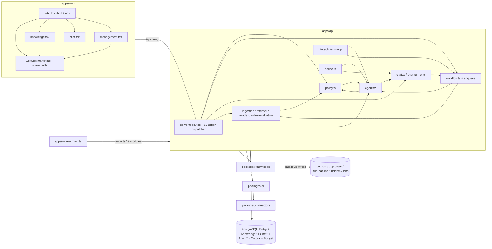

# 01 — Current architecture (as-is)

**Status:** Analysis, 2026-10-13. Based on `main` at `1da4cdb` (PR #89). No code, schema or deployment was changed.
**Legend:** **[Fact]** = observed in code, schema or configuration, with a reference. **[Inference]** = conclusion drawn from facts. **[Open]** = not determinable from the repository.

All paths are relative to the repository root. `file:line` references point to the inspected commit and may drift.

---

## 1. Summary

**[Fact]** EDS Orbit is a single TypeScript monorepo:

- A Fastify 5 API (`apps/api`), a BullMQ worker (`apps/worker`) and a Next.js 16 web client (`apps/web`).
- Shared packages in `packages/*`.
- PostgreSQL 17 with pgvector and Redis 7.4.
- Deployed as one Docker Compose stack through Coolify (`docker-compose.yml`).

The product is a marketing workspace. Around it sit a hybrid-RAG knowledge layer, a conversational operator ("Orbit Core"/Jarvis mode) and a background multi-specialist pipeline ("Orbit Agents").

**[Inference]** The system is a *monolith with good internal safety mechanisms but no enforced module boundaries*:

- **Good mechanisms:** row-level security, separate DB roles, a budget ledger, action approvals, an outbox, run telemetry and an agent runtime port.
- **Monolithic structure:**
  - About 48 entity kinds share one generic `Entity` table.
  - One 2,323-line `server.ts` holds all ~73 routes and a dispatcher for ~65 actions.
  - Flat `apps/api/src/modules/*` import each other freely, with several cycles.
  - The worker imports 19 API modules directly.
  - The web shell hard-codes navigation for 13 views.

The safety mechanisms are largely domain-neutral and reusable. The coupling problems are concentrated in a few hubs: `policy.ts`, `workflow.ts`, `lifecycle.ts`, `chat.ts`, `packages/knowledge` `invalidate()` and the tool/action registries.

---

## 2. Technology stack

| Concern | Technology | Reference |
|---|---|---|
| Runtime | Node.js 24.18.0, pnpm 11.19.0; TypeScript executed with `tsx` at runtime (no compile step for API or worker) | `package.json`, `infra/Dockerfile:34` |
| API | Fastify 5.12.5, `@fastify/helmet`, `@fastify/rate-limit`, `@fastify/swagger`, zod 4 | `apps/api/src/server.ts:278-405` |
| Auth | Better Auth 1.7.5 (email + password, DB sessions) | `apps/api/src/auth.ts` |
| DB access | Prisma 7.10 with the `pg` driver adapter. Parameterized raw SQL for vectors and FTS. | `packages/db/src/index.ts` |
| Database | PostgreSQL 17 + pgvector 0.8.6, FORCE RLS, two non-privileged roles | `packages/db/prisma/security.sql`, `scripts/db-deploy.ts` |
| Queue | BullMQ 6.3.6 on Redis 7.4.7, 14 queue classes | `apps/worker/src/main.ts:101-128` |
| Web | Next.js 16 App Router (single catch-all route), Tailwind 4 plus a 3,800-line semantic stylesheet, lucide icons | `apps/web/src/app/[[...route]]/page.tsx`, `apps/web/src/app/globals.css` |
| AI | `openai` SDK 7.25: Responses API, embeddings, images. OpenAI is the only provider. | `packages/ai/src/index.ts`, `docs/MODEL_ROUTING.md:3` |
| Documents | mammoth (docx), pdfjs-dist in a child process, sanitize-html | `packages/knowledge/src/extract.ts` |
| Tests | Vitest 5 (~1,110 cases in ~127 files), Playwright (Chromium), 12 Python governance tests | `vitest.config.ts`, `playwright.config.ts` |
| Deployment | Coolify Docker Compose build pack, branch `main`, domain `orbit.eds-labs.io` | `docs/deployment/COOLIFY.md` |

## 3. Repository and code structure

```
apps/
  api/src/server.ts           2,323 lines: every route inline in buildServer()
  api/src/auth.ts             Better Auth + scopeFor()
  api/src/shared.ts           Entity helpers, encrypt/decrypt, audit, exceptions
  api/src/modules/*.ts        ~60 flat modules, ~16k lines (marketing, knowledge orchestration, connectors, chat, budget …)
  api/src/modules/agents/**   ~15k lines: assignments, runs, specialists, tools, veto, notifications, runtime port
  worker/src/main.ts          690 lines: 14 BullMQ workers, outbox drain, workDueAt pump
  web/src/components/*.tsx    ~20 large view files (work.tsx 2,338, management.tsx 2,227, knowledge.tsx 1,696 …)
packages/
  db/          Prisma schema, migrations, scoped() transaction helper           (@orbit/db)
  knowledge/   extraction, chunking, hybrid retrieval, index generations, facts (@orbit/knowledge)
  ai/          OpenAI calls, routing, cost                                       (no package.json)
  connectors/  Postiz, Matomo, Slack, Telegram, CSV, blog export, bounded HTTP   (@orbit/connectors)
  creative/    raster/banner rendering                                          (@orbit/creative)
  schemas/     zod schemas, Scope type, collection allowlist                     (no package.json)
  config/      env schema and defaults                                           (no package.json)
  api-client/  generated OpenAPI types + 4-line fetch transport                  (@orbit/api-client)
```

**[Fact]** Imports between apps and packages use relative source paths such as `../../../packages/db/src/index.ts`. Counted in API and worker sources: schemas 91, db 82, knowledge 19, ai 14, config 13, connectors 12, creative 7. Workspace package names appear only in `apps/web/src/lib/api.ts:46-47` and inside `packages/knowledge`.

**[Fact]** There are no TypeScript path aliases (`tsconfig.json`). `apps/api` and `apps/worker` have no `package.json`.

**[Fact]** `scripts/source-check.mjs` only flags `eval(` and `dangerouslySetInnerHTML`. **No import-boundary rules exist.**

## 4. Backend

### 4.1 HTTP surface (`apps/api/src/server.ts`)

**[Fact]** `buildServer()` (`server.ts:278-2323`) registers about 73 routes inline. There are no per-module Fastify plugins. The groups:

| Group | Paths | Delegates to |
|---|---|---|
| Public / webhooks | `POST /api/slack/:ws/:project/interactions` (406), `POST /api/telegram/:projectId/:connectionId` (434), `/health`, `/api/health/ready`, `/api/health/postiz` (463-482), `GET/POST /api/setup` (483-521) | `slack.ts`, `telegram.ts`, `runtime.ts` |
| Auth passthrough | `/api/auth/*`. Only sign-in, sign-out and get-session are allowed; everything else returns `AUTH_ENDPOINT_DISABLED` (522-557). | Better Auth |
| User level (`authDb`) | `GET /api/me` (558), `GET/POST /api/projects` (590, 607), `POST /api/workspaces/:id/pause` (816) | inline |
| Project read views | dashboard, operations, knowledge-health, documents, export, content export (647-814); agent-runs, spans, ai-cost (704-721) | inline, `ai-usage.ts` |
| Settings | openai-configuration (722), members (848), indexes (858), marketing-profile (865-879) | `openai-configuration.ts`, `marketing-profile.ts` |
| Orbit Agents | telegram ×3, assignments ×3, assignment-posts, agent-activity, veto, assignment drafts (881-1021). Routes return 404 when `ORBIT_AGENTS` is off (`AGENT_ROUTES` 258-271). | `modules/agents/*` |
| Google Drive | ~11 routes (1022-1148) | `google-drive.ts` |
| Assets / images | upload, content, generate (1149-1208) | `assets.ts`, `image-generation.ts` |
| Chat | 11 routes incl. SSE (1209-1341) | `chat.ts`, `agents/content-packages.ts` |
| Action requests | list, decide (1343-1367) | `action-requests.ts` |
| Generic collections | `GET /:collection` (1368); `POST /:collection` (1380-1465) writes only sources, facts, missions, content, policies, metrics, preferences, experiments | `shared.ts`, `packages/knowledge` |
| **Action dispatcher** | `POST /api/projects/:projectId/actions/:action` (1488-2315): one if-chain over ~65 action names. ~38 are owner-only, listed inline at 1490-1537. | many modules |

**[Fact]** Error handling is centralized (`server.ts:372-405`) and returns `{error:{code,message}}`. OpenAPI is generated from the routes (`apps/api/src/openapi.ts`), but responses are mostly untyped, and the web client does not use the generated types.

### 4.2 Module inventory and domain assignment

**[Fact]** for each module's purpose; **[Inference]** for the domain column.

| Domain | Modules (`apps/api/src/modules/…`) |
|---|---|
| **Marketing: content pipeline** | `workflow.ts` (mission→draft→review→publish→analyze, **also hosts generic `enqueue` 31-64**), `generation.ts`, `editorial.ts`, `planning.ts`, `calendar.ts`, `posting-slots.ts`, `draft-batch.ts`, `draft-cleanup.ts`, `draft-similarity.ts`, `draft-statuses.ts`, `content-export.ts`, `content-invalidation.ts`, `content-provenance.ts`, `mission-archive.ts`, `mission-evidence.ts`, `paused-posts.ts`, `autopilot.ts` |
| **Marketing: publishing / channels** | `publisher.ts`, `postiz-assignment.ts`, `postiz-draft.ts`, `postiz-verification.ts`, `postiz-queue-watch.ts`, `channel-rules.ts`, `slack.ts` (approval digest) |
| **Marketing: brand / creative** | `marketing-profile.ts`, `image-generation.ts`, `image-requests.ts`, `render-asset.ts`, `asset-tools.ts`, `fact-claims.ts`, `fact-placeholders.ts` |
| **Marketing: analytics / memory** | `matomo.ts`, `matomo-schedule.ts`, parts of `lifecycle.ts` (experiments, metric correction) |
| **Marketing: Orbit Agents** | `agents/*` (assignments, assignment-runs, specialists, veto, owner-release, notifications, notification-sender, draft-delivery, content-packages, shared-posts, banner …) |
| **Knowledge orchestration** | `ingestion.ts`, `retrieval.ts`, `reindex.ts`, `index-evaluation.ts`, `knowledge-import.ts` |
| **Policy / governance (mixed)** | `policy.ts` (generic mandate + marketing preflight + claims), `readiness.ts`, `action-readiness.ts`, `pause.ts` |
| **Generic / platform candidates** | `budget.ts`, `telemetry.ts`, `ai-usage.ts`, `openai-configuration.ts`, `action-requests.ts`, `member-scope.ts`, `runtime.ts`, `assets.ts`, `agents/runtime/*`, `agents/tools/registry.ts` |
| **Chat / operator** | `chat.ts`, `chat-runner.ts`, `chat-tools.ts`, `agents/tools/*` |
| **Integrations** | `google-drive.ts` (asset/draft storage, not knowledge), `drive-readiness.ts`, `telegram.ts` (owner bot) |

### 4.3 Dependency hubs and cycles

**[Fact]** Most-imported modules within `modules/**`. These are approximate counts of importers.

| Module | Importers | Why it is imported |
|---|---|---|
| `policy.ts` | ~30 | `activePolicy` (budget source), `preflight`, `checkClaims`, `approve` |
| `workflow.ts` | ~19 | mostly `enqueue` |
| `agents/assignments.ts` | ~18 | `agentsEnabled()` and assignment state |
| `postiz-assignment.ts` | ~16 | assigned channels |
| `marketing-profile.ts` | ~14 | profile, guardrails, CTA |
| `telemetry.ts` | ~14 | runs and spans |
| `chat.ts` | ~12 | mostly `chatScoped()` as a transaction helper |

**[Fact]** Import cycles, from import statements:

1. `policy.ts:14-17` → `agents/assignments.ts` → `policy.ts`. Also `policy.ts:13` → `agents/agent-review.ts` → `policy.ts`.
2. `workflow.ts:3` → `agents/notifications.ts:4` → `workflow.ts`.
3. `chat.ts:26` → `workflow.ts` → `agents/notifications.ts` → `agents/assignments.ts:18` → `chat.ts`.
4. `agents/assignments` ⇄ `agents/assignment-runs`, `agents/assignments` ⇄ `agents/veto`, `agents/assignments` → `postiz-draft.ts:25` → `agents/draft-delivery` → `agents/assignments`.
5. `action-requests.ts` uses lazy `import()` of `agents/*` to avoid a cycle (99, 116, 137).

**[Fact]** Knowledge orchestration depends on marketing through the policy:

- `retrieval.ts:13`, `ingestion.ts:14`, `reindex.ts:11` and `index-evaluation.ts:10` import `activePolicy` from `policy.ts`, which imports the marketing profile, channels, calendar and agents (`policy.ts:1-30`).
- `ingestion.ts:18`, `reindex.ts` and `index-evaluation.ts` also import `enqueue` from the marketing `workflow.ts`.

**[Inference]** Loading any knowledge operation transitively loads the entire marketing and agents graph.

**[Fact]** `lifecycle.ts` is the scheduler hub. It imports autopilot, paused-posts, planning, workflow and five agents modules, and it also owns the knowledge source-sync schedule (`lifecycle.ts:199-283`, `288-332`).

**[Fact]** `pause.ts` imports `agents/assignment-runs`, `agents/notifications` and `chat.stopChatRunForPause`.

## 5. Data model and migrations

### 5.1 Physical tables (`packages/db/prisma/schema.prisma`, 9 migrations)

| Group | Tables | Notes |
|---|---|---|
| Auth (Better Auth) | `user`, `session`, `account`, `verification` | `orbit_auth` role only |
| Tenancy | `Workspace`, `WorkspaceMember(role)`, `Project(timezone, language, mode, paused, generation, workDueAt)`, `ProjectMember(role)` | Roles `owner \| editor \| viewer` (CHECK in `security.sql:4-5`). **There is no Organization entity; Workspace is the top level.** |
| Generic domain store | `Entity(kind, version, data Json)`, `EntityVersion` (full snapshot per version) | Only index is `(workspaceId, projectId, kind)`. No JSON indexes. |
| Infrastructure | `Outbox`, `BudgetReservation`, `AuditEvent` (append-only for the app role) | |
| Telemetry | `AgentRun`, `AgentSpan` | migration `202609300001_agent_telemetry` |
| Chat | `ChatConversation`, `ChatMessage`, `ChatRun`, `ChatProposal` | RLS also requires `userId = app.user_id` (`202609250001_chat_operator:78-86`) |
| Marketing | `ProjectMarketingProfile`, `ProjectMarketingProfileVersion` | `202609180003_project_marketing_profile` |
| Knowledge | `KnowledgeDocument` (`sourceId` → `Entity`), `DocumentVersion`, `KnowledgeChunk` (tsvector ×2), `ChunkEmbedding` (vector), `KnowledgeIndex` (generations) | `202609170001_foundation:179-247`, `202609170002_index_generations`. Exact vector search; no HNSW or IVFFlat. |

**[Fact]** Every business table carries `workspaceId` and `projectId` with composite foreign keys to `Project(workspaceId, id)`.

### 5.2 Entity kinds (logical tables in `Entity`)

**[Fact]** About 48 kinds are written through `create()`, `apps/api/src/shared.ts:91`. The generic GET exposes 31 of them (`packages/schemas/src/index.ts:6-40`). Domain assignment:

| Proposed owner | Kinds |
|---|---|
| Marketing | `missions`, `content`, `publications`, `approvals`, `assignments`, `assignment_runs`, `agent_tasks`, `content_packages`, `channel_posts`, `channel_post_sync`, `postiz_drafts`, `postiz_queue_watch`, `connector_verifications`, `autopilot_settings`, `metrics`, `insights`, `experiments`, `preferences`, `calendar_blocks`, `work_packages`, `followup_plans`, `community_questions`, `community_groups`, `matomo_schedules`, `slack_actions`, `slack_messages`, `postiz_analytics_posts`, `postiz_analytics_cache` |
| Knowledge | `sources`, `facts`, `evidence`, `revocations`, `sync_requests`, `retrieval_runs`, `index_evaluations`, `knowledge_imports` |
| Platform | `jobs`, `exceptions`, `action_requests`, `budget_runs`, `openai_configuration`, `chat_archives`, `connectors`, `telegram_connections`, `drive_connection`, `drive_storage`, `drive_oauth_state` |
| Ambiguous | `assets` (brand assets with approval, Drive sync; future support attachments), `policies` (marketing mandate **and** AI spend limits) |

**[Inference]** Because domain state is stored by `kind`, separating Marketing and Knowledge **does not require moving data**. Ownership can be assigned in code. This is the most important enabler of a low-risk migration (see `08-risks-and-decisions.md`, AD-03).

**[Fact]** About 86 Prisma JSON-path filters exist across 31 files (for example `generation.ts:281`, `notification-sender.ts:345-381`). Many callers load a whole kind with `list()` (no limit) and filter in JavaScript. **[Inference]** Cost grows linearly with entity count per kind.

### 5.3 Migrations

**[Fact]** Nine forward-only SQL migrations, 730 lines in total. `scripts/db-deploy.ts`:

- runs `prisma migrate deploy`;
- verifies role attributes;
- applies a **hard-coded grant list of 17 business tables** to `orbit_app` (`db-deploy.ts:144-165`);
- checks that an unscoped `SELECT count(*) FROM "Entity"` returns 0 (`:197-201`).

Every new physical table needs a grant edit, an RLS policy and a role check.

## 6. Authentication, authorization, tenancy

- **[Fact] Sessions.** Email and password only, 8 h sliding session with `updateAge` of 30 min, no cookie cache. Public sign-up is closed: users are created only by `/api/setup` (first owner, `ORBIT_SETUP_TOKEN`) or by the `add-member` action (`server.ts:1614-1652`). There are no API keys or service tokens. The worker uses a synthetic scope `{userId:"worker", role:"owner"}` (`apps/worker/src/main.ts:158-163`).
- **[Fact] Request scope.** `scopeFor(auth, req, projectId, write, owner)` (`apps/api/src/auth.ts:57-76`) resolves membership through `projectMembership()` (`member-scope.ts:8-29`). It derives `workspaceId` from the DB, never from the client. A workspace owner is owner of every project. Other users need a `ProjectMember` row.
- **[Fact] Authorization is scattered across three layers:**
  - (a) `scopeFor(write, owner)` booleans per route;
  - (b) hard-coded owner lists, for actions (`server.ts:1490-1537`) and collections (`:1382`);
  - (c) about 59 role checks inside ~30 modules.
  
  There is no permission catalogue.
- **[Fact] Database tenancy.** `scoped(workspaceId, projectId, fn)` (`packages/db/src/index.ts:37-57`) opens a transaction, sets `app.workspace_id` and `app.project_id`, and **takes `pg_advisory_xact_lock` per project for every call, reads included**. It is used ~150 times. RLS policies:

  | Policy | Tables |
  |---|---|
  | `project_scope` | all business tables |
  | `chat_owner_scope` | chat tables |
  | `audit_read` / `audit_append` | `AuditEvent` |
  | `auth_control USING(true)` for `orbit_auth` | Workspace, WorkspaceMember, Project, ProjectMember |

**[Inference] Implications for modularization:**

1. The project-wide advisory lock serializes all work in a project. Chat SSE polling, for example, calls `getRun` every 700 ms (`server.ts:1275-1301`). More modules and more users per project will contend for this lock.
2. Workspace-level features (organization settings, cross-project views) currently run only through `authDb`, whose RLS is unrestricted on `Project` and `ProjectMember`. They therefore rely on application WHERE clauses.

## 7. AI integration and model management

- **[Fact] Calls.** `packages/ai/src/index.ts` provides:
  - `generate()` (marketing draft prompt and schema hard-coded, :183, :15-55);
  - `streamChat()`, `respond()`, `embed()`, `generateImage*()`.
  
  Every paid call requires a `reservationId` (`PAID_CALL_NOT_AUTHORIZED`). Clients use `maxRetries: 0`.
- **[Fact] Routing.** `packages/ai/src/routing.ts` defines a **closed** task-class enum (`chat_operator`, `draft_social`, `draft_blog`, `agent_strategy`, `agent_research`, `agent_analytics`, `agent_review`) and legacy tiers. `resolveRoute()` fails closed for unverified models.
- **[Fact] Configuration.** Per project as `Entity(kind="openai_configuration")`, with encrypted keys and a route version equal to the entity version (`openai-configuration.ts:201-268`). Falls back to environment variables.
- **[Fact] Budget.** `budget.ts` provides `reserve`, `markTransmitted` and `settle` on `BudgetReservation`. **`reserve()` takes the marketing `PolicyInput` as its budget source** (`budget.ts:20`). The marketing `policy` schema mixes mode, channels, content types, origins and quiet hours with `daily/monthly/perRunBudgetMicros` and `approvedPaidTests` (`packages/schemas/src/index.ts:134-154`).
- **[Fact] Telemetry.** `AgentRun`/`AgentSpan` with a closed `RunKind` union (`telemetry.ts:6-15`). Spans carry tokens, cost and hashes, never text.

## 8. Agents, tools, approvals

- **[Fact] Runtime port.** `agents/runtime/port.ts` is provider-neutral (`BudgetedModel`, `ToolHost`, `AgentRuntime`). It has a single adapter, `legacy-responses.ts`, and contract tests in `contract.ts`. Two consumers: `chat-runner.ts:567` and `specialists/runner.ts:658`. The Agents SDK spike was a no-go (ADR 0005 addendum).
- **[Fact] Tool registry.** `agents/tools/registry.ts:12-48` defines `OrbitTool` with namespace, risk (`R0_read | W0_internal | P_proposal`), roles, feature and `deferLoading`. **Namespaces, features and card types are closed unions.** The chat tool set is a static list (`tools/index.ts:8-14`). Tool search is client-executed and active in production (`ORBIT_TOOL_SEARCH`).
- **[Fact] Tool inventory.** 15 chat tools plus 3 specialist-only tools. Apart from `project_status` and `knowledge_search`, all of them are marketing (campaign, packages, schedule, assignments, channel history, analytics).
- **[Fact] Chat.** `chat-runner.ts` limits:

  | Limit | Value |
  |---|---|
  | Model calls | 6 |
  | Tool calls | 8 |
  | `MAX_INPUT_BYTES` | 64,000 (raised from 32 KB in PR #87 because the tools grew) |

  **The system prompt is hard-coded as "a project-specific marketing operator"** (`chat-runner.ts:69-93`). `ChatProposal` confirmation creates marketing `missions` (`chat.ts:540-715`).
- **[Fact] Approvals.** `action-requests.ts` (ADR 0008) defines four action types as code constants: `image.generate`, `content_package.start`, `content.schedule`, `assignment.confirm` (`:62-150`). They are hash-bound, single-use and audited. Only `approval_required` is implemented of the six modes in ADR 0008. Older approval flavours remain: `ChatProposal`, package-hash `approvals`, Slack decisions, owner release.
- **[Fact] Orbit Agents.** `lifecycle.sweepProject` → `planAssignmentRuns` builds a **hard-coded DAG** (analytics/research → strategy → copywriter → visual → review; `assignment-runs.ts:143-204`). Tasks run on the `agent` queue through `runAgentTask` (`specialists/runner.ts:787`). Budget is pooled per run.
- **[Fact] MCP.** No MCP server or client code exists. ADR 0007 keeps the registry "MCP-shaped", and a read-only Orbit MCP server is an explicit non-goal.

## 9. Knowledge, RAG and facts

- **[Fact] `packages/knowledge` (engine).** Imports only `@orbit/db`. It provides:
  - extraction (txt, md, html, pdf, docx);
  - SSRF-safe fetch;
  - structure-aware chunking;
  - hybrid retrieval with PostgreSQL FTS, exact pgvector cosine and RRF (k=60);
  - index generations with an evaluation gate;
  - fact versioning with rights, conflicts and supersession;
  - evidence packs, revocation and tombstones.
  
  Public API: `packages/knowledge/src/index.ts:29-1167`, `indexes.ts`.
- **[Fact] Data-level coupling.** The private `invalidate()` (`packages/knowledge/src/index.ts:101-279`) loads all `evidence`, `content`, `approvals`, `publications`, `insights` and `jobs` entities. It then **sets marketing statuses directly** (content `needs_review`, approvals `invalidated`, insights `retracted`, publications `reconciliation_required`), purges marketing text fields, and creates reconciliation jobs and outbox rows.
- **[Fact] Consumers.**
  - `retrieveHybrid` (`retrieval.ts`) is called by `generation.ts:358`, the chat tool `knowledge_search` (`chat-tools.ts:219`), the agent variant (`agent-tools.ts:412`) and `server.ts:1558`.
  - `validateEvidence` is called from 10 marketing sites.
  - `agents/content-packages.ts:73-121` (`usableFact`) **re-implements a weaker subset** of the fact rules.
- **[Fact] Marketing-specific fact consumers.**
  - `fact-claims.ts` contains **tenant vocabulary** ("uliquid", "uliq", "desk"; `:51-53`).
  - `fact-placeholders.ts` and `mission-evidence.ts`.
  - `policy.checkClaims` and the `LIVE_RAG_EVAL_REQUIRED` gate.
- **[Fact] Google Drive** is used for brand assets and draft storage, not as a knowledge source (`google-drive.ts:561-613`, `:770`).
- **[Fact] Gaps:**
  - Embedding is triggered manually per document.
  - The document embedding profile is pinned to the small profile (`ingestion.ts:80`).
  - Every ingest invalidates the live evaluation (`INDEX_EVALUATION_CORPUS_CHANGED`).
  - Imported facts are auto-verified (`knowledge-import.ts:84`).
  - The website source requires a weekly re-sync to stay fresh (`maxAgeHours` 168).

## 10. Channels and integrations

| Integration | Role today | Code | Credential storage |
|---|---|---|---|
| Postiz | Publishing to X and Telegram channels, drafts, analytics. Capability `configured → read_verified → write_verified`. | `packages/connectors/src/postiz.ts`, `publisher.ts`, `postiz-*.ts` | `Entity(kind="connectors").encryptedCredential` |
| Matomo | Analytics import every 12 h | `connectors/matomo.ts`, `matomo*.ts` | `connectors` |
| Slack | Content-approval digest and interactive approve | `connectors/slack.ts`, `modules/slack.ts` | `connectors` (JSON bundle) |
| Telegram (owner bot) | Notifications, veto/stop callbacks, `/pause` for Orbit Agents | `connectors/telegram.ts`, `modules/telegram.ts`, `agents/notification-sender.ts` | `telegram_connections` (token encrypted, secrets hashed) |
| Google Drive | OAuth, asset import, generated asset and draft save | `google-drive.ts` | `drive_connection` (refresh token encrypted) |
| OpenAI | Text, embeddings, images | `packages/ai` | `openai_configuration` (two keys encrypted) |
| CSV / blog | Metric import; portable blog/newsletter bundle | `connectors/csv.ts`, `blog.ts` | — |
| **Chatwoot** | **No code.** Exists only as a co-resident service on the services VPS (`docs/VPS_INVENTORY.md:22`, `docs/HOSTING_DECISION.md:7`). | — | — |
| Desk / FamilyPlan / Forecast | **No data access.** The master spec forbids Desk keys and dependencies (`docs/EDS_ORBIT_UNIFIED_CODEX_MASTER_v3.md:310, 441, 502`). | — | — |

**[Fact]** All credentials are encrypted with one `CREDENTIAL_KEY` using AES-256-GCM (`shared.ts:44-72`), with no key ID and no AAD. The encrypted values also persist in `EntityVersion` snapshots. `CREDENTIAL_KEY` is read raw from `process.env` in about 13 places.

## 11. Background jobs and scheduling

- **[Fact] Outbox.** `workflow.enqueue` writes a `jobs` entity and an `Outbox` row in one transaction (`workflow.ts:31-64`). The worker drains due outbox rows, up to 40, into BullMQ with `jobId = outbox.id` (`main.ts:464-509`). Leases and crash recovery: an expired `publishing` lease becomes `outcome_unknown`; other jobs are re-outboxed (`main.ts:407-462`).
- **[Fact] Scheduling.** There is no cron library. Postgres triggers move `Project.workDueAt` earlier on Entity, Outbox and Project changes (`202609300001_project_work_due`). `pump()` runs every 1.5 s, claims due projects through `authDb` (`main.ts:619-675`, `due-marker.ts`), runs `sweepProject` and then sets the next due time. That time is the minimum of:
  - `nextSweepAt`;
  - Matomo (12 h);
  - Postiz queue check (10 min);
  - outbox;
  - Drive retry;
  - 5 min idle.
- **[Fact] Queues.** 14 queues: publishing, reconciliation, generation, analytics, slack_notification, image, agent, postiz_draft, telegram_notification, ingestion, embedding, reindex, index_evaluation, chat. One worker per class. Concurrency is 1, except publishing at 2.
- **[Inference]** The queue and job mechanism is domain-neutral and reusable. Its registrations, the sweep logic and `enqueue`'s location are marketing-bound.

## 12. Frontend

- **[Fact] Routing.** One catch-all route renders `<Orbit/>`. A hard-coded `navigation` array (`apps/web/src/components/orbit.tsx:57-71`) and a ternary chain (`:236-262`) map 13 paths to views: `/`, `/missions`, `/chat`, `/content`, `/calendar`, `/knowledge`, `/assets`, `/approvals`, `/analytics`, `/memory`, `/connectors`, `/operations`, `/settings`. Tabs are local state and cannot be deep-linked. Unknown paths silently render Overview.
- **[Fact] Workspace and project selection.**
  - There is no organization selection.
  - The project is chosen with a `<select>` and stored in `localStorage` (`orbit.tsx:141-145`).
  - URLs carry no project ID.
  - Chat is a full-page view only, not a global panel.
- **[Fact] Domain mixing.**
  - `work.tsx` is both the marketing views and the shared utility module: `useCollection`, `PageHead`, `ResourceError`, `EntityRows` and `EvidenceItems` are imported by knowledge, management, advanced, operator-tools, editorial and chat.
  - `advanced.tsx` ⇄ `work.tsx` is a circular import.
  - `management.tsx` mixes analytics, memory, connectors, operations, settings and admin.
  - `operator-tools.tsx`, `lifecycle.tsx` and `advanced.tsx` are grab-bags.
  - Settings are split between Settings → Integrations (Drive, OpenAI) and `/connectors` (Telegram, Slack, Postiz, Matomo).
- **[Fact] Data and state.**
  - A hand-rolled `useResource`/`useMutation` (`apps/web/src/lib/api.ts`). No caching library.
  - i18n EN/DE: a small dictionary plus many inline `locale === "de"` ternaries.
  - Design tokens in `globals.css`; primitives in `components/ui/primitives.tsx` (shadcn-style, new-york).

## 13. Configuration, secrets, feature flags

- **[Fact]** `packages/config/src/index.ts:16-48` validates:
  - DB and Redis URLs;
  - `AUTH_SECRET`, `APP_ORIGIN`, `EXECUTION_MODE`, `ENABLE_EXTERNAL_WRITES`;
  - `OPENAI_API_KEY`, `CREDENTIAL_KEY`, Google OAuth settings;
  - the flags `ORBIT_CONTENT_PACKAGES`, `ORBIT_TOOL_SEARCH`, `ORBIT_AGENTS`, `ORBIT_IMAGE_REFERENCES`, `ORBIT_AGENT_REVIEW_AUTHORITY`.
- **[Fact]** These are read directly from `process.env` and not validated: `ENABLE_POSTIZ_DRAFTS`, `OPENAI_IMAGE_*`, `OPENAI_VERIFIED_MODELS`, `OPENAI_RATE_CARD_JSON`, `WORKER_*`. `ENABLE_EXTERNAL_WRITES` is checked with mixed polarity in 7 places.
- **[Inference]** Feature flags are global environment variables, so they apply to every project. Module activation per project does not exist.

## 14. Deployment, CI, monitoring

- **[Fact] Compose services.** `migrate` (one-shot, needs `ORBIT_RELEASE_APPROVAL`), `api`, `worker`, `web`, `postgres`, `redis`, `backup` (age-encrypted `pg_dump` to R2/S3). Hardening: read-only root filesystem and `cap_drop ALL`. Networks `frontend`/`database` (internal) and `egress`. Only `web` is routed through Coolify's Traefik.
- **[Fact] External services.** Postiz, Matomo and Chatwoot run on a separate services VPS.
- **[Fact] CI.** `.github/workflows/orbit-ci.yml` runs install, local setup with Docker, OpenAPI generation, lint, typecheck, test, build, secret scan, dependency inventory, audit and Playwright. **Not in CI:** the migration-profile test, the compose test, evals and image builds.
- **[Fact] Monitoring.**
  - pino logging in the API; `console.*` in the worker.
  - Health endpoints `/health`, `/api/health/ready`, `/api/health/postiz`, polled by Uptime Kuma.
  - `AgentRun`/`AgentSpan` cost views.
  - No metrics exporter, tracing backend or error tracker.
  - External alerting (H08) is open.
- **[Fact] Stale documents.** Several planning documents dated 2026-09-17 (`HOSTING_DECISION.md`, `CONSOLIDATION_RECOMMENDATION.md`, `DEPLOYMENT_BOOTSTRAP.md`) still describe Orbit as "not deployed". It is deployed (`IMPLEMENTATION_STATUS.md:34-44`).

## 15. Tests and gaps

**[Fact] Coverage.** About 830 cases in 54 API integration files, grouped by domain:

| Domain | Files |
|---|---|
| Assignments / agents | 20 |
| Chat / packages | 16 |
| Publishing | 10 |
| Auth | 3 |
| Ops | 5 |

Additional coverage:

| Area | Files | Cases |
|---|---|---|
| Co-located module tests | 29 | — |
| Knowledge package | 3 | 48 |
| Worker | 6 | 23 |
| Web component tests | 14 | — |
| Playwright | 2 specs | 15 |
| Offline evals (agents, generation, operator, knowledge) | — | — |

**[Fact] Gaps relevant to modularization** (from the test inventory):

1. **No RLS matrix.** Cross-project checks are scattered. Forced RLS is asserted only in `scripts/test-marketing-profile-migration.ts`, which is not in CI.
2. **No route × role permission matrix.** Only ~8 files assert 403.
3. **Integration tests skip silently without a database.** 69 files use `describe.skipIf(!enabled)`.
4. **No direct worker tests** for the ingestion, embedding, reindex, index_evaluation, analytics, reconciliation and slack_notification queues.
5. **No frontend navigation or shell tests.**
6. **No contract test** for the API/worker boundary.

## 16. Dependency overview (condensed)



**[Inference] Most problematic dependencies,** ranked by how much they block modularization:

1. **`policy.ts` as the budget source** for all paid operations. It fuses the AI spend mandate with the marketing publishing mandate (C9/C10).
2. **`packages/knowledge` `invalidate()` writing marketing state directly.** This is a data-level inverse dependency.
3. **`enqueue` and the scheduler living in marketing code** (`workflow.ts`, `lifecycle.ts`), and the worker importing API internals.
4. **Closed registries:** tool namespaces, card types, action types, task classes and run kinds. Plus the hard-coded marketing system prompt and `ChatProposal → missions`.
5. **Monolithic composition roots:** `server.ts` (the action dispatcher), `worker/main.ts` and `orbit.tsx`.
6. **Import cycles** between policy, chat and workflow on one side and `agents/*` on the other.
