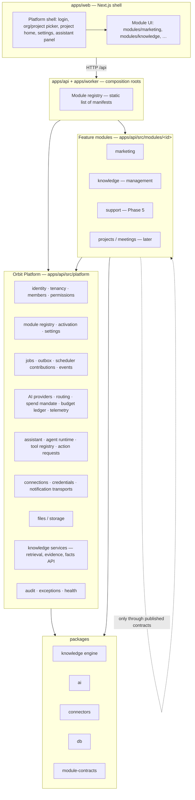
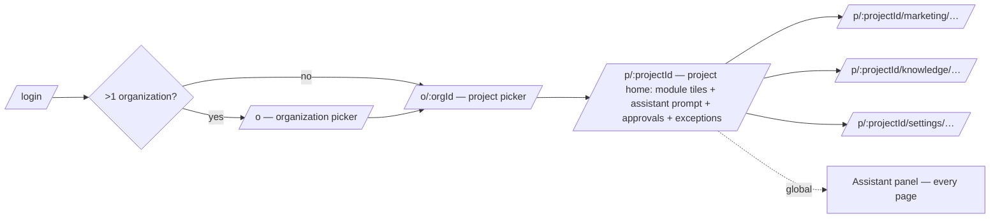
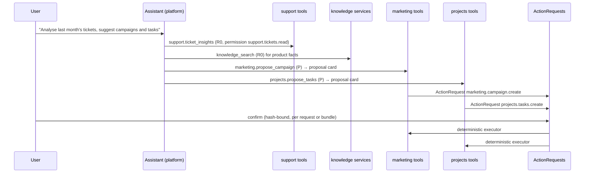

# 02 — Target architecture: Orbit Platform + modules

**Status:** Accepted design baseline ([ADR 0009](../../docs/adr/0009-modular-platform.md), 2026-10-13); not implemented. Written 2026-10-13. Nothing in this document is implemented. Decisions referenced as AD-xx are listed in `08-risks-and-decisions.md`.
**Legend:** **[Fact]** observed today · **[Proposal]** target design · **[Open]** needs a decision.

---

## 1. Naming

**[Fact]** The name "Orbit Core" is already in use. It covers the conversational operator, content packages and Orbit Agents (`docs/plans/ORBIT_CORE_JARVIS_PLAN.md`, `docs/IMPLEMENTATION_STATUS.md` (line 34), ADR 0005, feature flags).

**[Proposal] (AD-02)**

| Term | Meaning |
|---|---|
| **Orbit Platform** | The domain-neutral kernel that this assignment calls "Orbit Core". Used throughout the planning documents. |
| **Orbit Assistant** | The cross-module main agent. It is the evolution of the existing operator chat. |
| **Module** | A functional area: Marketing, Knowledge, later Support, Projects, Meetings. |
| **Knowledge engine** | The central knowledge infrastructure (`packages/knowledge` plus platform knowledge services). |

Existing documents keep their historical "Orbit Core" wording. New code uses `platform`.

## 2. Architectural style

**[Proposal] (AD-01)** Orbit stays a **modular monolith**:

- one repository, one deployable image, one database;
- the same three processes: api, worker, web.

Modules are **statically registered TypeScript modules** with a typed manifest. There is no runtime plugin loading, no separate deployables and no module marketplace.

**Static registry versus a dynamic plugin system:**

| Criterion | Static registry (recommended) | Dynamic plugin system |
|---|---|---|
| Fit with today's code | High: the existing registries (tools, actions, specialists) are already static maps that only need opening. | Low: requires a loader, isolation and versioned ABI. |
| Security | All code is reviewed and in one build. RLS, roles and budget wrap every module identically. | Third-party code in-process would bypass the trust model (ADR 0007 §5 already rejects hosted MCP for this reason). |
| Operating cost | No change to Docker, Coolify or CI. | New artifact lifecycle and compatibility matrix. |
| Who builds modules | EDS Labs only (one team). | Only pays off with external authors. |
| Activation per project | Supported through a DB activation table. | Same. |
| Upgrade path | Can later expose a stable manifest API if external modules ever matter. | — |

**Conclusion:** A static registry fully covers the requirements: activation and deactivation per project, dependencies, routes, tools, jobs and settings. Revisit a dynamic system only if third parties must ship modules. Today that is a non-goal.

## 3. Layering



**[Proposal] Dependency rules.** These are enforced by a boundary checker (WP0.3).

1. `platform/**` never imports `modules/**`. Modules plug into the platform through manifests, hooks and registries.
2. `modules/<a>/**` imports `modules/<b>/**` **only** through `modules/<b>/contract.ts`, the module's public service interface. It does so only if `b` is a declared dependency of `a`.
3. Packages never import apps.
4. `apps/worker` imports only the module registry and platform job infrastructure, never individual module files.
5. Web module folders import only `platform/ui`, `platform/lib` and their own files. Cross-module UI goes through registered slots, such as card renderers or home tiles.

## 4. Orbit Platform: what belongs in it

The hypothesis from the assignment, checked against the code. Rule: centralize only what at least two modules need today or what the assistant needs.

| Capability | Verdict | Evidence / reasoning |
|---|---|---|
| Authentication, users | **Platform** (as is) | Better Auth, `auth.ts`. Module-neutral. |
| Organizations, projects | **Platform**. `Workspace` is presented as *Organization* (AD-06). | `Workspace`, `Project` tables. No separate org entity is needed. |
| Roles and permissions | **Platform**: role → permission catalogue, contributed by modules (AD-07) | Today scattered over three layers (`01` §6). |
| Module registry and activation | **Platform (new)** | Does not exist. |
| Navigation, workspace selection | **Platform (web shell)** | `orbit.tsx`. |
| General settings | **Platform**: organization and project settings. Module settings belong to modules. | `ProjectSettings` mixes project, policy and brand today. |
| AI providers, routing | **Platform**, with an open task-class registry. The marketing prompt moves out of `packages/ai`. | `packages/ai/src/routing.ts:5-14`, `index.ts:183`. |
| AI spend mandate, budget ledger | **Platform**, split from the marketing publishing policy (AD-10) | `budget.ts:20` consumes the marketing `PolicyInput`. |
| Agent orchestration, tool execution | **Platform**: runtime port, tool registry, assistant loop, specialist runner core | `agents/runtime/*`, `registry.ts`, `chat-runner.ts`. |
| Action approvals | **Platform**: `ActionRequest` mechanics with an open action-type registry | `action-requests.ts`. |
| Integrations and connections | **Platform**: credential vault, capability states, connection registry. Provider-specific **semantics** (publishing, analytics) stay in modules. | `connectors` entity, `encrypt()`. |
| Channels and communication basics | **Platform**: notification transports (Telegram owner bot, e-mail, in-app), the e-mail connection, public ingress (webhooks, public API, CORS, per-client rate limits) and real-time fan-out, plus an inbound-callback router. **Not** customer channel semantics: those belong to the Support module. | `telegram.ts` is generic transport with marketing payloads. |
| Notifications | **Platform** transport. Notification kinds are registered by modules. | `agents/notifications.ts:22-50` `NOTIFY_KINDS` are marketing. |
| Files, storage basics | **Platform (Phase 4, WP4.6)**: encrypted object storage, authorized download, limits; later the Drive storage adapter. Needed by Support attachments and raw e-mail. The brand-asset library stays marketing-owned with its current base64 storage until a separate decision (Q-06). | `assets.ts:6-15` (base64 in `Entity.data`, 1–5 MB limits) |
| Background jobs, automation | **Platform**: `enqueue`, outbox, queue registry, lease/recovery, scheduler contributions | `workflow.ts:31-64`, `worker/main.ts`, `lifecycle.ts`. |
| Audit, monitoring | **Platform** (as is) | `AuditEvent`, `exceptions`, health endpoints, `AgentRun`/`AgentSpan`. |
| API and MCP infrastructure | **Platform**: route mounting, permission guard, error mapping, OpenAPI, public API pattern (WP4.2). **Central MCP gateway** (`09`, Track M): Orbit acts as the OAuth 2.1 authorization server (Better Auth OAuth provider, CIMD, PKCE, resource-bound tokens). The gateway runs as its own `mcp` service from the same image and is a pure protocol adapter over the tool registry, permissions, ActionRequests and knowledge services. It contains no business logic. | `server.ts`, `openapi.ts`, `agents/tools/registry.ts`, ADR 0007 (non-goal lifted by Mario on 2026-10-13) |
| Knowledge infrastructure | **Platform service** on top of `packages/knowledge` (AD-08) | `retrieval.ts`, `ingestion.ts`, `reindex.ts`, `index-evaluation.ts`. Needed by marketing, the assistant and future support. |
| Project pause / generation fence | **Platform**, with module hooks | `pause.ts`, `Project.paused/generation`. |
| Readiness | **Platform** aggregator with module contributors | `readiness.ts`, `action-readiness.ts`. |
| Owner-mode `observe/assisted/autopilot` | **Marketing** module setting, *not* platform | Only the publishing pipeline interprets it (`policy.ts:443-471`). `Project.mode` becomes a deprecated mirror. |
| Approvals inbox UI | **Platform** shell slot, filled by `ActionRequest` plus module-provided legacy items | `work.tsx:2116-2200` aggregates across domains. |

**Deliberately *not* in the platform:**

- Facts claims ledger, CTA/official link, channel rules, posting slots, calendar.
- Postiz and Matomo semantics, Slack digest content.
- Banner and creative rendering, the brand profile.
- The assignment DAG.

All of these are marketing-only.

## 5. Feature modules

### 5.1 Module catalogue (target)

| Module | Status | Depends on | Owns |
|---|---|---|---|
| `knowledge` | Phase 3 | platform (knowledge services) | Sources, imports, facts admin, index admin, documents UI |
| `marketing` | Phase 2 | `knowledge` (facts must be maintainable), platform | Missions, content, publications, assignments, channels/publishing, brand, analytics, memory |
| `support` | Phase 5 MVP, Phase 6 extensions (`06`) | platform (public ingress, real-time, files, e-mail, notifications, module roles), knowledge services. **Optional** dependency on `knowledge` (UI). | Own ticket system: inboxes, tickets, messages, internal notes, attachments, contacts, e-mail and livechat channel adapters, automations, support AI, statistics. **No Chatwoot dependency.** |
| `projects` | Later | platform | Tasks, milestones |
| `meetings` | Later | platform, optionally `projects` | Meetings, notes, action items |

### 5.2 What a module provides

The full contract is in `03-module-contracts.md`. A module provides a server manifest and a web manifest:

- **Identity:** `id`, `version`, `displayName`, `dependsOn`, `optionalDependsOn`.
- **Permissions:** permission keys and the default role mapping.
- **Data:** owned entity kinds (zod schema, collection visibility, public projection) and owned tables (Prisma models plus SQL migration in the shared migration chain).
- **HTTP:** routes and legacy action handlers.
- **Jobs:** queue classes with handlers, a scheduler contribution (`sweep` and `nextDueAt`) and a pause hook.
- **Agent capabilities:** tools, action types, task classes, assistant prompt fragment, card types.
- **Events:** in-transaction impact handlers and durable event subscriptions.
- **Operations:** readiness contributions, settings schema.
- **Web:** navigation entries, routes, home tile, settings panels, card renderers, approvals-inbox items.

### 5.3 Activation

**[Proposal] (AD-06)**

- Activation is stored **per project** in a new platform table `ProjectModule(workspaceId, projectId, moduleId, enabled, settings Json, enabledAt, enabledBy, version)` with FORCE RLS.
- Organization-level entitlement is deferred (Q-03): every module in the registry is available to every organization.
- Dependencies are validated on enable and on disable. Marketing cannot be enabled without Knowledge, and Knowledge cannot be disabled while Marketing is enabled.
- **Disabling never deletes data.** Effects:

  | Area | Behaviour when disabled |
  |---|---|
  | Routes | return `404 MODULE_DISABLED` |
  | Tools | hidden |
  | Jobs and sweeps | skipped and their due time ignored |
  | Navigation | hidden |
  | Pending ActionRequests | expire normally |

- Re-enabling restores the previous state.
- Backfill: all existing projects get `knowledge` and `marketing` enabled. Behaviour is unchanged.

### 5.4 Module data

**[Proposal] (AD-03, AD-04)**

- **Existing kinds stay in `Entity` with unchanged names.** Ownership is a registry mapping `kind → moduleId`. The generic collection routes check ownership and activation. Consequence: Marketing and Knowledge separation needs **no data migration**.
- **New modules with relational query needs get dedicated tables:** Support tickets with SLA queries, assignee filters and full-text search; project tasks. Each table needs:
  - composite tenant FKs;
  - FORCE RLS `project_scope`;
  - a grant entry in `scripts/db-deploy.ts`;
  - an RLS matrix test.
  
  The `Entity` envelope remains allowed for low-volume configuration records.
- Migrations stay in the single Prisma chain (`packages/db/prisma/migrations`), named `<timestamp>_<module>_<topic>`. Separate per-module schemas or databases are rejected: they would break composite tenant FKs and the single-role RLS model.

## 6. Target code layout

**[Proposal] (AD-05)** A minimal-move layout. The worker can keep importing from `apps/api` because both run from the root dependencies with `tsx`.

```
apps/api/src/
  main.ts                    composition root: buildServer(registry)
  platform/
    http/                    route mounting, permission guard, error mapping, openapi
    tenancy/                 scopeFor, membership, permissions catalogue, organizations
    modules/                 registry, activation service, settings service
    jobs/                    enqueue, outbox, queue registry, scheduler contributions, events
    ai/                      openai-configuration, spend mandate, budget, telemetry, ai-usage
    assistant/               chat, chat-runner, prompt composition, tool registry, action-requests
    agents/                  runtime port + specialist runner core (generic part of agents/specialists/runner.ts)
    knowledge/               knowledge services: retrieval, ingestion, reindex, evaluation, facts API
    connections/             credential vault, connection registry, telegram transport, callback router
    files/                   object storage for attachments (WP4.6)
    ingress/                 webhook + public API patterns, CORS, rate limits (WP4.2)
    realtime/                Redis pub/sub fan-out, SSE resume (WP4.3)
    notifications/           in-app inbox, e-mail and Telegram channels, preferences (WP2.5, WP4.7)
    oauth/                   OAuth 2.1 authorization server, consent, grants (WP-M1)
    mcp/                     MCP gateway adapter: transport, token→grant→scope, registry adapter (WP-M2); entrypoint apps/api/src/mcp-main.ts
    governance/              pause, readiness aggregation, audit, exceptions
    shared.ts                (moved from src/shared.ts; old path re-exports)
  modules/
    marketing/
      manifest.ts  contract.ts  routes.ts  actions.ts  jobs.ts  tools/  …(existing files moved by subdomain)
    knowledge/
      manifest.ts  contract.ts  routes.ts  actions.ts
    registry.ts              static list: [knowledge, marketing]
apps/worker/src/main.ts      iterates registry.jobs; no direct module imports
apps/web/src/
  platform/                  shell, picker, home, settings, assistant panel, ui/, lib/
  modules/marketing/         views, components, manifest.ts
  modules/knowledge/         views, components, manifest.ts
  modules/registry.ts
packages/
  module-contracts/          manifest types (zod + TS only, no runtime deps) — shared by api, worker, web
  knowledge/                 engine (unchanged name)
  ai/  connectors/  db/  creative/  schemas/  config/  api-client/
```

**Alternative considered:** one workspace package per module (`packages/module-marketing`). It gives stronger isolation through package boundaries, but means a large file move, new manifests in `infra/Dockerfile:9-15` and package.json files for API and worker. It is not justified before the boundary checker proves insufficient. The in-app folder layout can be converted later without changing contracts.

## 7. API design

**[Proposal]**

- **Backward compatible:** every existing URL keeps working. Existing module routes are re-registered under the same paths by their module. `POST /api/projects/:projectId/actions/:action` stays, but the platform looks up `action` in an action-handler map contributed by modules. The handler declares its permission and module.
- **New routes** for new modules use `/api/projects/:projectId/<moduleId>/…`. Platform routes:
  - `/api/organizations`, `/api/organizations/:id/projects`;
  - `/api/projects/:id/modules` (GET; PUT for owners);
  - `/api/projects/:id/home` (aggregated tiles).
- **Generic collections** `GET/POST /:collection` keep their contract. The ownership lookup adds `MODULE_DISABLED`.
- **OpenAPI:** modules attach zod schemas to their routes. This improves the today mostly untyped spec as a side effect.

## 8. Central user interface

**[Proposal]** The flow follows the assignment:



**External AI clients.** ChatGPT, dots and other MCP clients reach the same capabilities through the MCP gateway (`09`). Users manage which clients may access which organizations and projects under **Settings → Connected apps**.

**URL scheme** (AD-12):

| Path | Content |
|---|---|
| `/p/:projectId` | Project home |
| `/p/:projectId/<module>/<view>[/<id>]` | Module view |
| `/p/:projectId/settings/{project,members,ai,modules,<module>}` | Project and module settings |
| `/o/:orgId/settings` | Organization settings |
| `/admin` | Platform settings |

Tabs become URL segments where they matter, such as knowledge tabs.

**Legacy redirects:** `/content` → `/p/<lastProject>/marketing/content`, and the same for the other 12 paths, so bookmarks and Telegram or Slack links keep working.

**Routing mechanics:** keep the existing catch-all route and client rendering (Next.js never reads the DB, ADR 0001). Replace the hard-coded `navigation` array and ternary chain (`orbit.tsx:57-71, 236-262`) with a route registry built from web module manifests and filtered by `GET /api/projects/:id/modules`. Alternative: App Router segments per module. That gives code splitting per route, but every view is a client component fed by the API, so the benefit is small. Revisit when bundle size matters.

**Settings separation:**

| Level | Content | Today |
|---|---|---|
| Platform (`/admin`) | Installation info, verified models list, global feature flags (read-only display) | Environment only |
| Organization | Name, members and roles, default AI provider config (Q-04) | — |
| Project | Name, timezone, language, members, AI configuration and spend mandate, module activation, retention, export | Mixed in `ProjectSettings` |
| Module | Marketing: publishing policy (mode, channels, quiet hours), brand profile, assignments/autopilot, Postiz/Matomo/Slack. Knowledge: source defaults, index management. | Mixed in Settings and Connectors |

**Assistant:** a slide-over panel available on every project page, bound to the current project and module context, plus the existing full-page view at `/p/:id/assistant`. It reuses `chat.tsx`. Cards render through module-registered renderers.

**Design system:** keep `globals.css` tokens and `components/ui/primitives.tsx`. As the first frontend step, move the shared helpers out of `work.tsx` into `platform/ui`. This also removes the `advanced.tsx` ⇄ `work.tsx` cycle.

## 9. Cross-module AI (Orbit Assistant)

**[Proposal]** Details are in `03-module-contracts.md` §6.

- **One assistant** (ADR 0005 §6 stays): one conversational agent, with module capabilities exposed as tools. Specialist pipelines stay inside modules (the marketing assignment DAG).
- **Tool registry:**
  - Tools are contributed by active modules. Names are namespaced (`marketing.propose_campaign`; legacy names stay as aliases).
  - Tools are filtered per run by module activation, permission, feature flag and connector capability.
  - Execution re-checks all of these (ADR 0007 §4).
  - With more than about 15 tools or about 7 KB of definitions, **tool search is mandatory**. Only a small platform core (`project_status`, `knowledge_search`, `tool_search`) is always loaded, which keeps `MAX_INPUT_BYTES` under control (PR #87 had to raise it to 64 KB).
- **Context:** the run context carries `{organization, project, user, role, permissions, activeModules, moduleContext?}`. Every tool executes inside `scoped()` with RLS.
- **Writes:** tools are `R0` (read), `W0` (internal), or `P` (proposal → `ActionRequest`). Side effects run only in deterministic executors after a decision (ADR 0008). Cross-module plans create several ActionRequests that are confirmed individually, or as one bundle (Q-11).
- **Cost:** the spend mandate is per project. Budget categories and the module ID are recorded on `AgentRun` and `BudgetReservation` (one nullable column, or encoded in `kind`/`category`). The assistant shows remaining budget per run.

**Example flow:** evaluate support tickets, then propose marketing measures and project tasks.



## 10. What stays unchanged

These components can be kept with no change, or only a move and re-export:

- `packages/knowledge` (engine; only `invalidate()` changes in Phase 3).
- `packages/connectors`, `packages/creative`, `packages/db/src/index.ts` (`scoped`).
- All existing tables and entity kinds.
- RLS policies.
- Better Auth configuration.
- Budget ledger mechanics (`reserve/markTransmitted/settle`).
- Telemetry tables.
- Runtime port and contract tests.
- `ActionRequest` mechanics.
- Outbox and lease semantics.
- Compose, Coolify and backup.
- The design tokens.

## 11. Non-goals

- Microservices, separate databases per module, a message broker beyond Redis/BullMQ.
- A dynamic plugin loader or module marketplace.
- Business logic inside the MCP gateway, MCP-only tools, or a second permission model for MCP. The gateway (`09`) only adapts the shared registry and services.
- Rewriting the marketing pipeline, the RAG engine or the approval model.
- Changing Desk, Forecast or Chatwoot hosting. Chatwoot is not a dependency of the target architecture; an optional data import is Support extension E10.
