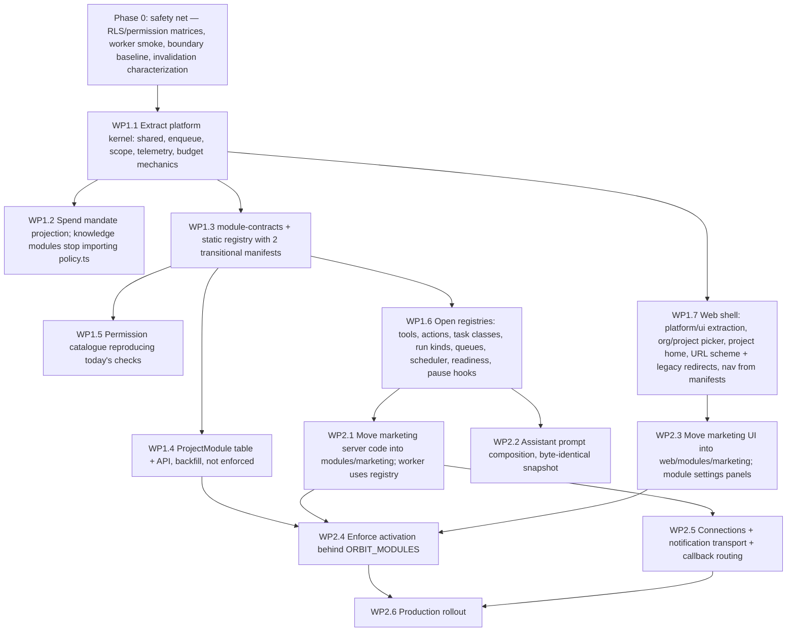

# 04 — Platform / Marketing separation

**Status:** Accepted design baseline ([ADR 0009](../../docs/adr/0009-modular-platform.md), 2026-10-13); not implemented. Written 2026-10-13. This document applies `02` and `03` to the current code. Work package IDs (WPx.y) refer to `07-roadmap.md`.

**Legend:**
- **[Fact]**: current code.
- **[Proposal]**: target.
- **[Open]**: decision needed.

---

## 1. Objective and invariants

The objective is that today's Orbit becomes the `marketing` module with no functional change, sitting on a domain-neutral Orbit Platform.

**Invariants that must hold after every PR:**

| # | Invariant | How it is checked |
|---|---|---|
| I1 | All existing URLs, request and response shapes, and error codes stay unchanged. | API integration suite (54 files), `apps/web` component tests, Playwright `workspace.spec.ts` and `chat.spec.ts` |
| I2 | No data migration of existing kinds or tables. The new `ProjectModule` table is purely additive. | `scripts/test-marketing-profile-migration.ts` extended (WP0.2) and `db-deploy` RLS checks |
| I3 | Approval, package and assignment hashes stay byte-identical. | Existing hash tests: `content-packages`, `assignments`, `package-*`, `assignment-*` integration tests |
| I4 | The assistant system prompt and tool definitions stay byte-identical for marketing+knowledge projects. | New snapshot test (WP2.2), plus `chat-runner-limits.test.ts` and `evals/operator` offline |
| I5 | Queue class names, job payloads, outbox topics and lease/`outcome_unknown` semantics stay unchanged. | `apps/worker/tests/*` plus new worker handler smoke tests (WP0.2) |
| I6 | Budget keys (`chat:<run>:<n>`, `agent:<task>:<n>`, `assignment-run:<run>`, `projectId:index:…`) stay unchanged. | `paid.integration.test.ts`, `assignment-run-budget`, `index-generations.integration` |
| I7 | Feature flags keep their meaning: `ORBIT_AGENTS`, `ORBIT_CONTENT_PACKAGES`, `ORBIT_TOOL_SEARCH`, `ORBIT_IMAGE_REFERENCES`, `ORBIT_AGENT_REVIEW_AUTHORITY`, `ENABLE_POSTIZ_DRAFTS`, `ENABLE_EXTERNAL_WRITES`, `EXECUTION_MODE`. | config tests, `rollout-phase0`, `autopilot-coexistence` |
| I8 | The production uLiquid assignment (64e8b9cc…, Postiz-draft delivery, Telegram bot) keeps running across deploys. | Post-deploy check per WP2.6 |

## 2. Classification of existing components

### 2.1 Platform (moved or extracted, behaviour unchanged)

| Today | Target | Notes |
|---|---|---|
| `apps/api/src/shared.ts` | `platform/shared.ts` (old path re-exports) | `entity/list/create/update`, `audit`, `exception`, `encrypt/decrypt`. `publicEntity` becomes a registry of public projections per kind. |
| `apps/api/src/auth.ts`, `modules/member-scope.ts` | `platform/tenancy/*` | Adds `can()` and `authorize()` (WP1.5). |
| `workflow.ts:31-64` `enqueue` | `platform/jobs/enqueue.ts` | `workflow.ts` re-exports it during the transition. This is the single most important cut: it breaks the knowledge → workflow dependency. |
| `budget.ts` | `platform/ai/budget.ts` | Signature change: takes `SpendMandate` instead of `PolicyInput` (WP1.2). |
| `telemetry.ts`, `ai-usage.ts`, `openai-configuration.ts` | `platform/ai/*` | `RunKind` is opened (WP1.6). |
| `agents/runtime/*` | `platform/agents/runtime/*` | Unchanged. |
| `agents/specialists/runner.ts`: claim, recovery, budgeted model, `runSpecialist` core | `platform/agents/runner.ts` | Marketing keeps `StepRole`, `buildWorkPlan`, `BASE_INSTRUCTIONS` and the specialists. |
| `agents/tools/registry.ts` | `platform/assistant/tool-registry.ts` | Namespaces, cards and features are opened (WP1.6). |
| `chat.ts` (conversation, runs, SSE, archive, `chatScoped`) | `platform/assistant/chat.ts` | `createProposal` and `confirmProposal` (mission creation, `chat.ts:485-715`) move to marketing. `chatScoped` moves to `platform/tenancy/scope.ts`. |
| `chat-runner.ts` | `platform/assistant/runner.ts` | Prompt composition from module contributions (WP2.2). `VALIDATION_CODES` are contributed by modules. |
| `chat-tools.ts` `runReadTool` switch | split | `project_status` becomes a platform tool with module sections. `knowledge_search` moves to platform knowledge services. `approved_assets` and `analytics_memory` move to marketing. |
| `action-requests.ts` mechanics | `platform/assistant/action-requests.ts` | The four definitions move to marketing (`image.generate`, `content_package.start`, `content.schedule`, `assignment.confirm`) and are registered through the manifest. The lazy `import()` workaround disappears. |
| `pause.ts` | `platform/governance/pause.ts` plus marketing hook | `blockPublications`, `resumeAgentTasks` and the notification move to `marketing.hooks.onProjectPause`. `stopChatRunForPause` stays in platform. |
| `readiness.ts`, `action-readiness.ts` | `platform/governance/readiness.ts` plus contributors | Marketing contributes Postiz, Matomo, Slack, publishing and mail. Knowledge contributes `CURRENT_PUBLIC_KNOWLEDGE_REQUIRED` and `LIVE_RAG_EVAL_REQUIRED`. Platform contributes the OpenAI configuration. |
| `runtime.ts` (worker heartbeat) | `platform/governance/health.ts` | The Postiz queue health read becomes a marketing health contributor. |
| `assets.ts` (bytes, normalize) | stays; becomes `platform/files` in Phase 4 (Q-06) | |
| Telegram transport (`connectors/telegram.ts`, connect/link/webhook parts of `modules/telegram.ts`) | `platform/connections/telegram.ts` | Callback data is routed by prefix to module callbacks. `stop:`/veto and `/pause` move to marketing callbacks (WP2.5). |
| Connector credential handling (`connectors` entity, `encryptedCredential`, capability states) | `platform/connections/*` | Postiz, Matomo and Slack *semantics* stay in marketing. |
| `google-drive.ts` OAuth, connection, storage | `platform/connections/google-drive.ts` | Brand-asset import and draft save (`importDriveFile`, `saveDraftDocument`) stay marketing until Q-06 is decided. |
| `lifecycle.ts` scheduling frame (`sweepProject`, `nextSweepAt`) | `platform/jobs/scheduler.ts` | Content is split into module contributions (WP1.6). |
| `apps/worker/src/main.ts` | stays the composition root | Iterates `registry.jobs` and `registry.scheduler`. The 19 direct module imports are removed (WP2.1). |

### 2.2 Marketing module (moved by subdomain, logic unchanged)

| Subfolder `modules/marketing/…` | Files today |
|---|---|
| `pipeline/` | `workflow.ts` (without `enqueue`), `generation.ts`, `editorial.ts`, `planning.ts`, `draft-batch.ts`, `draft-cleanup.ts`, `draft-similarity.ts`, `draft-statuses.ts`, `content-export.ts`, `content-invalidation.ts`, `content-provenance.ts`, `mission-archive.ts`, `mission-evidence.ts`, `paused-posts.ts`, `autopilot.ts` |
| `policy/` | `policy.ts` (publishing preflight, claims, approvals, modes), `fact-claims.ts`, `fact-placeholders.ts` |
| `publishing/` | `publisher.ts`, `postiz-assignment.ts`, `postiz-draft.ts`, `postiz-verification.ts`, `postiz-queue-watch.ts`, `channel-rules.ts`, `posting-slots.ts`, `calendar.ts`, `slack.ts` |
| `brand/` | `marketing-profile.ts`, `image-generation.ts`, `image-requests.ts`, `render-asset.ts`, `asset-tools.ts`, `drive-readiness.ts` |
| `analytics/` | `matomo.ts`, `matomo-schedule.ts`, the experiment and metric parts of `lifecycle.ts` |
| `agents/` | all of `modules/agents/*` except `runtime/`, `tools/registry.ts` and the runner core |
| `tools/` | `read-tools` (marketing part), `proposal-tools`, `package-tools`, `assignment-tools`, `channel-tools`, `agent-tools` (metrics, Postiz analytics) |
| root | `manifest.ts`, `contract.ts`, `routes.ts`, `actions.ts`, `jobs.ts`, `scheduler.ts`, `hooks.ts`, `impact.ts` (knowledge impact handler, Phase 3) |

**[Inference]** Inside the marketing module the existing intra-domain cycles may remain: `policy` ⇄ `agents/assignments`, `workflow` ⇄ `agents/notifications`, `assignments` ⇄ `runs` ⇄ `veto`. Resolving them is desirable but not required for modularization. They are listed as follow-up T-03.

### 2.3 Data ownership (no migration)

| Owner | Entity kinds | Physical tables |
|---|---|---|
| marketing | `missions`, `content`, `publications`, `approvals`, `assignments`, `assignment_runs`, `agent_tasks`, `content_packages`, `channel_posts`, `channel_post_sync`, `postiz_drafts`, `postiz_queue_watch`, `connector_verifications`, `autopilot_settings`, `policies`¹, `metrics`, `insights`, `experiments`, `preferences`, `calendar_blocks`, `work_packages`, `followup_plans`, `community_questions`, `community_groups`, `matomo_schedules`, `slack_actions`, `slack_messages`, `postiz_analytics_posts`, `postiz_analytics_cache`, `assets`² | `ProjectMarketingProfile`, `ProjectMarketingProfileVersion` |
| platform | `jobs`, `exceptions`, `action_requests`, `budget_runs`, `openai_configuration`, `chat_archives`, `connectors`, `telegram_connections`, `drive_connection`, `drive_storage`, `drive_oauth_state` | `user`, `session`, `account`, `verification`, `Workspace`, `WorkspaceMember`, `Project`, `ProjectMember`, `Entity`, `EntityVersion`, `Outbox`, `BudgetReservation`, `AuditEvent`, `AgentRun`, `AgentSpan`, `Chat*`, **new** `ProjectModule` |
| knowledge (Phase 3) | `sources`, `facts`, `evidence`, `revocations`, `sync_requests`, `retrieval_runs`, `index_evaluations`, `knowledge_imports` | `KnowledgeDocument`, `DocumentVersion`, `KnowledgeChunk`, `ChunkEmbedding`, `KnowledgeIndex` |

¹ `policies` is marketing-owned. The platform reads its spend projection (`03` §8.1).
² `assets` is marketing-owned until Q-06 is decided.

### 2.4 API assignment

- **Platform routes:** setup, auth, `me`, projects, workspace pause, members, OpenAI configuration, agent runs, spans and AI cost, chat (all 11 routes), action requests, health, OpenAPI, the new module and organization routes.
- **Platform actions:** `add-member`, `project-settings`, `openai-configure`, `pause`, `resolve-exception`, `retention`, `connector` (credential storage only), `connector-health`.
- **Knowledge actions (Phase 3):** `import`, `retrieve`, `revoke-source`, `source-pause`, `revoke-document`, `knowledge-import-preview`, `knowledge-import-commit`, `knowledge-import-retry`, `withdraw-fact`, `begin-index`, `build-index`, `evaluate-index`, `activate-index`, `rollback-index`, `embed-document`. Until Phase 3 they stay registered by a transitional `knowledge` manifest that wraps the existing code.
- **Marketing actions:** all remaining actions:
  - `publish`, `approve`, `approve-and-schedule`, `review`, `preflight`, `run-mission`, `analyze`, `reconcile`, `retry`
  - `archive-mission`, `archive-old-drafts`, `restore-draft-cleanup`, `adapt-content`, `editorial-propose-brief`
  - `community-import`, `community-link`, `calendar-block`, `calendar-unblock`
  - `configure-autopilot`, `configure-matomo-schedule`, `import-matomo`, `import-metrics`, `correct-metric`
  - `evaluate-experiment`, `stop-experiment`, `memory-lifecycle`, `preference-update`
  - `postiz-*`, `slack-configure`, `slack-digest`, `brand-approval`, `render`, `asset-status`
  - `start-approved-live-draft-batch`, `start-approved-live-draft-once`, `resume-live-draft-batch`, `resume-paused-publications`
- **Marketing routes:** marketing-profile, dashboard³, operations³, content export, Orbit Agents routes (telegram connect stays platform), Google Drive asset routes, assets and images, collections of owned kinds, `PATCH /content/:id`.

³ `dashboard` and `operations` aggregate across domains today (`server.ts:647-700`). They become a platform `home` endpoint with module sections. The old routes stay as compatibility wrappers.

`preflight` and `retrieve` are open to viewers today (`server.ts:1553`). That must be preserved through `defaultRoles`.

## 3. Interfaces between platform and marketing

| Direction | Interface | Purpose |
|---|---|---|
| Marketing → platform | `enqueue`, `JobDef`, `SchedulerContribution`, `ModuleHooks` | jobs and scheduling |
| Marketing → platform | `activeSpendMandate`, `reserve/markTransmitted/settle`, `startRun/recordSpan` | paid calls and telemetry |
| Marketing → platform | `respond/generate/embed/generateImage*` | AI calls (prompt supplied by marketing) |
| Marketing → platform | knowledge services: `retrieveHybrid`, `validateEvidence`, `usableFacts`, `onImpact` | evidence-bound generation, claim checks |
| Marketing → platform | connections: `getConnection`, `decryptCredential`, capability state | Postiz, Matomo, Slack, Drive |
| Marketing → platform | notifications: `notify(kind)`, callback registration | Telegram veto, preview, daily report |
| Marketing → platform | `ActionDefinition`, `OrbitTool`, `TaskClassDef`, `AssistantContribution`, `CardTypeDef` | assistant capabilities |
| Platform → marketing | manifest hooks only (`onProjectPause`, `sweep`, `nextDueAt`, readiness, impact handler) | inversion of control, with no platform import of marketing |
| Assistant → marketing | tools and `MarketingContract` (`campaignContext`, `recentContent`) | cross-module reads |

## 4. Migration strategy: strangler with shims

The approach is incremental and keeps production behaviour identical at each step. Every move PR follows the same pattern:

1. Move the file or function to its target location.
2. Leave a one-line re-export at the old path (`export * from "../platform/jobs/enqueue.ts"`).
3. Run the full suite. Only import paths change; behaviour does not.
4. In a follow-up PR, update the importers and delete the shim once the boundary checker shows zero users.

This keeps each PR reviewable and allows parallel feature work. Merge conflicts become trivial re-exports instead of logic conflicts.

**Sequence.** Details and acceptance criteria are in `07-roadmap.md`.

### 4.1 Step details for the critical cuts

**Cut 1: `enqueue` (WP1.1).**

- [Fact] `enqueue` is a pure function of `(tx, scope, kind, input)` (`workflow.ts:31-64`). It writes `jobs` and `Outbox`.
- Moving it has no behavioural effect.
- Knowledge (`ingestion`, `reindex`, `index-evaluation`), lifecycle, chat, publisher and agents then import it from the platform.

**Cut 2: Spend mandate (WP1.2).**

- [Fact] `budget.reserve(tx, scope, policy: PolicyInput, …)` reads only `startAt`, `endAt`, `approvedPaidTests`, `dailyBudgetMicros`, `monthlyBudgetMicros` and `perRunBudgetMicros` (`budget.ts:14-117`).
- [Proposal] Introduce `SpendMandate` with exactly these fields plus `policyVersion`, and `activeSpendMandate(tx, scope)`, which wraps `activePolicy` and projects.
- `reserve` accepts `SpendMandate`.
- Marketing callers pass `toSpendMandate(policy)`.
- `retrieval.ts`, `ingestion.ts`, `reindex.ts`, `index-evaluation.ts`, `chat-runner.ts` and `image-*` switch to `activeSpendMandate`.
- Error codes stay unchanged (`PAID_MANDATE_EXPIRED`, `BUDGET_NOT_APPROVED`).
- The chat cost wording in `project_status.policy.modelBudget` stays unchanged.

**Cut 3: Chat versus marketing (WP1.6, WP2.2).**

- [Fact] Chat imports `workflow.enqueue`, `policy.activePolicy`, `marketing-profile`, `asset-tools` and `postiz-assignment` (`chat.ts:26-34`), and creates missions (`chat.ts:679`).
- [Proposal] Proposals move into marketing (`modules/marketing/assistant/proposals.ts`). The routes `POST /chat/proposals/:id/confirm` stay registered at the same path by marketing.
- The `ChatProposal` table stays platform-owned (it is assistant storage). Its payload schema is owned by the proposing tool.
- The prompt is composed from fragments. A snapshot test asserts byte equality with today's `instructions + packageInstructions + assignmentInstructions` for every flag combination.

**Cut 4: Scheduler and worker (WP1.6, WP2.1).**

- [Fact] `sweepProject` runs these steps in order inside one transaction, all within `processProject` (`worker/main.ts:399-405`):
  1. pause check;
  2. missed slots;
  3. assignments or autopilot;
  4. missions;
  5. content packages;
  6. experiments;
  7. source sync.
- [Proposal] The platform scheduler calls `pause check → for module in registry order: module.scheduler.sweep()`. The order is knowledge, then marketing, with marketing's internal order unchanged. This reorders source sync to *before* the marketing steps. There is no data dependency between source sync (`sync_requests` + `ingestion` job) and the marketing steps within the same sweep: verified by reading `lifecycle.ts:199-283`; to be confirmed by a characterization test in WP0.4. If a dependency shows up, marketing is ordered first.
- `nextSweepAt` becomes the minimum over contributions.
- Matomo and Postiz queue checks (`main.ts:400-405, 517-530`) become marketing scheduler contributions with the same intervals.

**Cut 5: Pause (WP1.8).**

- [Fact] `pauseProject` bumps `generation`, blocks publications, resumes agent tasks as paused, notifies, and stops the chat run.
- [Proposal] The platform keeps the generation bump and the chat stop. Marketing's `onProjectPause` does the rest, in the same order and the same transaction. The `pause-*`, `chat-pause` and `paused-posts` integration tests are the oracle.

**Cut 6: Action dispatcher (WP2.1).**

- [Fact] One if-chain handles ~65 actions, with the owner list at `server.ts:1490-1537`.
- [Proposal] `actions: Record<string, ActionHandlerDef>` per manifest. The platform route looks up the handler, checks activation and permission, then calls it.
- Mechanical extraction: each `if (action === "x") {…}` block becomes a handler function. The block bodies are copied unchanged.
- The route × role matrix (WP0.2) guards the permission equivalence.

### 4.2 What must keep working unchanged

Each item has existing tests that must stay green:

- **Mission pipeline:** draft → review → approve → test publish → reconcile → analyze (`core`, `safety`, `paid`, `editorial` tests; Playwright `workspace.spec.ts:108`).
- **Content packages, image, schedule, reschedule** (`content-packages`, `package-*`).
- **Orbit Agents:** assignment confirm, runs, specialists, review authority, veto window, owner release, Postiz-draft delivery, shared posts, banners, Telegram notifications and callbacks (20 test files).
- **Chat:** streaming, cancel, paid-mandate block and resume, tool search, proposals, cards, archives (`chat*`, `tool-search`, Playwright `chat.spec.ts`).
- **Knowledge flows used by marketing:** retrieval, evidence validation, invalidation cascade (`knowledge.integration`, `core`).
- **Integrations:**
  - Postiz verification and queue watch;
  - Matomo import and schedule;
  - the Slack digest and interactive approve;
  - Drive connect, import and save.
- **Ops:** pause and resume, workspace pause, readiness, export, retention, budget ledger, telemetry views.

## 5. Frontend separation (marketing part)

| Today (`apps/web/src/components`) | Target |
|---|---|
| `work.tsx` shared helpers (`useCollection`, `PageHead`, `ResourceError`, `EntityRows`) | `platform/ui/` (WP1.7, first step; removes the `advanced.tsx` ⇄ `work.tsx` cycle) |
| `work.tsx` `EvidenceItems` | `platform/ui/evidence.tsx` (knowledge services UI, used by marketing and knowledge) |
| `work.tsx` Overview | Platform project home with a marketing home tile |
| `work.tsx` Missions, ContentStudio, CalendarView, ApprovalInbox (marketing items), PostizDraftSection | `modules/marketing/views/*` |
| `management.tsx` Analytics, Memory, PostizChannelAssignment, AutopilotSettings, PolicyEditor | `modules/marketing/views/*` and `modules/marketing/settings/*` |
| `management.tsx` Connectors, Operations, ProjectSettings, OpenAiConfiguration, RecordDetail | `platform/views/*` (connections list with module-contributed provider panels; operations; project settings; AI settings) |
| `advanced.tsx` | split: MarketingProfileConfiguration, BrandApproval, BrandAssetLibrary, CreativeRenderer, MetricCsvImport, PreferenceActions → marketing; ProjectAdministration → platform |
| `operator-tools.tsx` | MatomoImport, MatomoSchedule, PostizVerification → marketing; IndexManagement, FactWithdrawal → knowledge; WorkspacePause → platform |
| `lifecycle.tsx` | ExperimentControls, MetricCorrection, MemoryLifecycleControls → marketing; RetentionControl → platform |
| `assignments.tsx`, `assignment-card.tsx`, `agent-activity.tsx`, `editorial.tsx`, `calendar-blocks.tsx`, `draft-cleanup*`, `autopilot-approvals.ts`, `chat-package-card.tsx` | `modules/marketing/*` (`chat-package-card` and `assignment-card` as registered card renderers) |
| `chat.tsx`, `chat-markdown.tsx`, `chat-errors.ts`, `chat-resume.ts`, `action-request-inbox.tsx`, `agent-runs.tsx` | `platform/assistant/*`, `platform/views/*` |
| `telegram-connection.tsx`, `slack-connection.tsx`, `google-drive.tsx` | `platform/connections/*` (Slack panel contributed by marketing) |

The duplicated `decide` logic (`chat.tsx:426` and `action-request-inbox.tsx`) merges into one platform hook (WP2.3).

## 6. Test strategy for this separation

1. **Before any move (Phase 0):**
   - RLS table matrix;
   - route × role matrix generated from the registered routes;
   - worker handler smoke tests for all 14 queue classes;
   - characterization tests for `invalidate()` and `sweepProject` ordering;
   - a CI guard that fails when `TEST_DATABASE_URL` is missing instead of skipping silently.
2. **Each move PR:** full `pnpm check` and `pnpm test:e2e`, plus the boundary checker in report mode. Its violation count must not increase.
3. **Snapshot tests:**
   - assistant prompt and tool JSON definitions per flag combination;
   - the OpenAPI document. Path set and method set must be identical; schema improvements are allowed.
4. **Activation tests (WP2.4):**
   - With marketing disabled, all marketing routes, actions and collections return `MODULE_DISABLED`, and its tools, jobs and sweeps do not run. Re-enabling restores the state. No row is deleted.
   - Knowledge cannot be disabled while marketing is enabled.
5. **Production verification (WP2.6):**
   - the uLiquid assignment run produces Postiz drafts at the next slot;
   - the Telegram preview and veto still work;
   - chat answers with a package card;
   - AI cost views show attributed spend.

## 7. Rollback

- Every PR before WP2.4 is behaviour-neutral. Rollback means redeploying the previous image (`docs/deployment/COOLIFY.md` (lines 51-57)).
- The only schema change in Phases 1–2 is the additive `ProjectModule` table and an optional `AgentRun.module` column. Both are forward-compatible: older code ignores them. No down-migration is needed.
- Activation enforcement sits behind a new flag `ORBIT_MODULES` (default `false`). Rollback means setting the flag to false and redeploying.
- WP2.5 changes how Telegram callbacks are routed, so callback data formats must stay identical. Rollback is the previous image. Pending callbacks stay valid because the format is unchanged.

## 8. Effort

The breakdown is in `07-roadmap.md`. Summary for the platform/marketing separation:

| Phase | Effort |
|---|---|
| Phase 0 | 8–12 person-days |
| Phase 1 | 27–39 person-days |
| Phase 2 | 22–32 person-days |
| **Total** | **≈ 57–83 person-days** (about 3–4 months of full-time work for one developer; longer alongside ongoing feature work and operations) |

The largest items are the web shell and marketing UI move (WP1.7, WP2.3), opening the registries (WP1.6) and the marketing server move (WP2.1).
