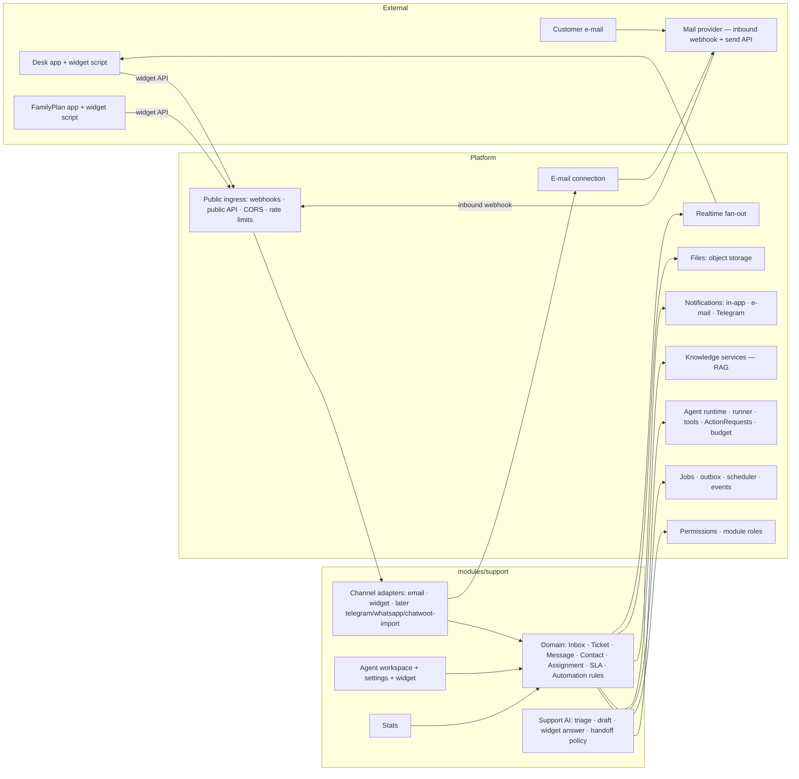

# 06 — Support module: own ticket and communication system

**Status:** Proposal, revised 2026-10-13. The revision follows Mario's addendum: Support gets its **own integrated ticket and communication system**, and **Chatwoot is not a dependency**. Migrating existing Chatwoot data is an optional later extension.

**Nothing in this document is implemented.** Support is planned as a functionally independent module inside the Orbit modular monolith (`02`), not as a separate application.

**Legend:**
- **[Fact]**: current code.
- **[Proposal]**: target.
- **[Open]**: decision needed.

Work package IDs refer to `07-roadmap.md`.

---

## 1. Starting point

### 1.1 What does not exist today

**[Fact]** The following support building blocks are missing from the codebase:

| Missing | Evidence |
|---|---|
| Support, ticket or customer-communication code | grep across `apps/` and `packages/` |
| Chatwoot integration (it runs only as a separate service on the services VPS) | `docs/VPS_INVENTORY.md:22` |
| E-mail sending or receiving (readiness even reports `MAIL_PROVIDER_NOT_CONFIGURED`) | `apps/api/src/modules/readiness.ts` |
| Public, unauthenticated API for customers. `@fastify/cors` is a dependency but is not registered. Only the Slack and Telegram webhooks are public. | `apps/api/src/server.ts:406, 434` |
| API tokens or service accounts: only browser sessions | `apps/api/src/auth.ts` |
| MCP server or client (ADR 0007 keeps a read-only MCP server as a non-goal) | `docs/adr/0007-tool-registry.md` §5 |
| File storage outside the database | see below |

**File storage detail.** Assets are stored as **base64 inside `Entity.data`**. Uploads are limited to 1 MB and generated images to 5 MB (`apps/api/src/modules/assets.ts:6-15`). That model is unsuitable for support attachments.

**Real-time detail.** Chat streaming uses SSE. The API polls the DB every 700 ms inside `scoped()`, which holds the project advisory lock (`server.ts:1258-1304`). The Next proxy aborts every request after 45 s (`apps/web/src/app/api/[...path]/route.ts:66`), so clients must reconnect.

**Product constraints.** Orbit holds no Desk or FamilyPlan keys, and Desk must never depend on Orbit (`docs/EDS_ORBIT_UNIFIED_CODEX_MASTER_v3.md:310, 441, 502`).

### 1.2 What can be reused

**[Fact]** Existing Orbit capabilities that Support can reuse, and how:

| Existing capability | Where | Reuse in Support | Change needed |
|---|---|---|---|
| Tenancy, RLS, separate DB roles, `scoped()` | `packages/db`, `security.sql` | All support tables are project-scoped with FORCE RLS. | Pattern only (AD-04). |
| Permission catalogue | planned WP1.5 | `support.*` permission keys | Module-level roles (WP4.5). |
| Outbox, `jobs`, leases, `outcome_unknown`, never resend after an ambiguous transmit | `workflow.ts:31-64`, `worker/main.ts:407-509` | Outbound e-mail and widget delivery, AI jobs, automations | Moved to the platform in WP1.1. Unchanged semantics. |
| Scheduler contributions (`workDueAt` triggers plus sweep) | `lifecycle.ts`, migration `202609300001_project_work_due` | SLA timers, auto-close, reminders, follow-ups | Opened in WP1.6. |
| Notify-in-transaction plus sender job pattern | `agents/notifications.ts` (`notify` queues a job that commits with the state change), `notification-sender.ts` | Agent notifications (new ticket, assignment, SLA risk, handoff) | Generalized in WP2.5. A per-user in-app and e-mail channel is added (WP4.7). |
| Telegram owner bot with inbound callback routing | `modules/telegram.ts`, `connectors/telegram.ts` | Owner escalation alerts. **Not** a customer channel in the MVP. | Callback router (WP2.5). |
| Agent runtime port and budgeted model | `agents/runtime/*`, `chat-runner.ts:425-565` | Support AI turns (triage, reply drafting) | None. Platform after WP1.1. |
| Specialist runner: claim, recovery, step budget, strict output, never retry a paid task | `agents/specialists/runner.ts:426-851` | `support.triage` and `support.reply` tasks | Runner core in the platform (WP1.6). |
| Tool registry with risk classes and tool search | `agents/tools/registry.ts` | Support tools for the support agent and the Orbit Assistant | Opened in WP1.6. |
| `ActionRequest`: hash-bound, single-use, audited approvals | `action-requests.ts` | "Send AI reply to customer" (W2) approval, bulk actions | Opened in WP1.6. |
| Agent review authority gated by an eval (`ORBIT_AGENT_REVIEW_AUTHORITY`, `evals/agents`) | `agents/agent-review.ts:75-127` | Pattern for **autonomous AI replies per category** once an eval passes | Re-implemented as a support setting (extension E1). |
| Veto window before an automatic external action | `agents/veto.ts:303` (`vetoMinutes`) | "AI reply goes out in N minutes unless an agent stops it" | Pattern reuse (E1). |
| Hybrid RAG, evidence packs, rights flags, `validateEvidence` | `packages/knowledge`, `retrieval.ts` | Grounded answers with citations. `publicUse` is required before quoting to customers. | Source audiences (WP3.5). |
| Budget ledger and telemetry | `budget.ts`, `AgentRun`/`AgentSpan` | Per-ticket and per-month AI cost, attributed to `module=support` | Spend mandate (WP1.2). |
| Bounded HTTP and SSRF guard, connector outcome taxonomy (`not_sent`/`rejected`/`unknown`) | `packages/connectors/src/http.ts` | E-mail provider adapter, later product data providers | None. |
| Credential vault (AES-256-GCM) | `shared.ts:44-72` | Mail provider keys, widget signing secrets | Key-ID hardening recommended (F-03). |
| Pause and generation fence | `pause.ts` | Pausing a project stops AI auto-replies and automations, but **not** human replies. | Hook (WP1.8). |
| Chat UI: streaming, cards, markdown | `apps/web/src/components/chat.tsx`, `chat-markdown.tsx` | Agent workspace conversation view, AI draft cards | Componentized in WP2.3. |
| Design system primitives, i18n EN/DE | `components/ui/primitives.tsx`, `lib/i18n.ts` | Ticket UI and widget theming | — |

**[Inference]** Orbit already has the hard parts of a safe AI support system:
- evidence-bound generation;
- approvals;
- budget control;
- crash-safe outbound delivery;
- an eval-gated autonomy switch.

What is missing is channel and ingress infrastructure: e-mail, a public widget API, real-time delivery, attachment storage, module-level roles and API tokens.

## 2. Scope: MVP versus extensions

### 2.1 MVP: a functioning support desk for one or more apps

| Area | MVP scope |
|---|---|
| **Tickets** | Statuses: `new`, `open`, `pending_customer`, `pending_internal`, `resolved`, `closed`. Priorities: `low`, `normal`, `high`, `urgent`. Project-defined categories. Tags. Assignment to one agent or to "unassigned". Reopen on customer reply. Simple merge (move messages, keep a reference). |
| **Contacts** | Per project: name, e-mail, locale, external app user ID (from widget identity), notes. Ticket history per contact. Manual merge of duplicates. |
| **Inboxes** | An inbox is one entry point: one e-mail address and/or one widget. Several per project, for example "Desk app" and "FamilyPlan app". Each inbox has a default category, a default assignee policy and a language. |
| **E-mail** | Inbound through a transactional mail provider's inbound webhook. Outbound through its API. Threading via `Message-ID`, `In-Reply-To`, `References` and a reply token in the address (`support+<token>@…`). Auto-acknowledgement. Attachments up to an inbox limit. Plain text plus sanitized HTML. |
| **Livechat widget** | Embeddable script for Desk, FamilyPlan and other apps. Anonymous visitors give their e-mail; identified users are verified with an HMAC signed by the host app. Text and attachments. Real-time while open. Falls back to e-mail when no agent is online. A "talk to a human" button. Conversation history for verified users. Theming (colours, logo, DE/EN). |
| **Conversation** | One timeline per ticket: customer messages, agent replies, **internal comments** (never visible to the customer), system events, AI drafts and notes. Attachments with authorized download only. |
| **Agent workspace** | Inbox views (mine, unassigned, all, by status, category or inbox), filter and search (subject, contact, full text over messages), ticket view, reply composer (e-mail or widget, depending on channel), internal comment, assign, change status and priority, contact panel. |
| **Notifications** | In-app notification list per user, plus e-mail notifications to agents: new ticket in the inbox, assigned to me, customer replied, SLA at risk, AI handoff. Owner escalation alerts through the existing Telegram bot (optional). |
| **Automations** (fixed rule set, configurable) | Auto-ack. Auto-assign (round robin over inbox agents, or fixed). Simple SLA targets (first response and resolution per priority, 24/7 clock). SLA-at-risk notification. Auto-close after N days in `pending_customer`. Reopen on reply. |
| **AI** | **Triage**: language, category, priority suggestion, summary, sentiment. **Draft reply**: grounded in support knowledge through shared RAG, with citations, inserted as an editable draft that an agent sends. **Widget first answer**: the AI may answer widget questions *only* when the answer is fully supported by `publicUse` evidence, and must otherwise hand off. This is configurable per inbox and **off by default** (Q-17). Budget per project and month. |
| **Handoff** | Explicit customer request, missing evidence, low confidence, sensitive category (billing, account security, legal, anything trading-related for Desk), negative sentiment, or N AI turns. The ticket moves to `open`, unassigned or by rule, and agents are notified. The widget tells the customer that a human will take over. |
| **Roles and isolation** | Permissions `support.tickets.read`, `support.tickets.reply`, `support.tickets.assign`, `support.notes.write`, `support.settings.manage`, `support.stats.read`, `support.contacts.manage`. Module-level roles so that a support agent has no access to marketing (WP4.5). All data is project-scoped with FORCE RLS. |
| **API** | Internal REST API for the UI. Public widget API. Inbound e-mail webhook. All documented in OpenAPI. |
| **Statistics** | Volume by channel, inbox and category; first response time; resolution time; backlog and age; reopen rate; SLA attainment; AI metrics (draft acceptance rate, drafts edited versus sent unchanged, handoff rate, widget questions answered by AI without handoff); cost per ticket. |
| **Privacy** | Retention per project. Contact export and deletion. No message text in telemetry or audit. AI processing only after Q-12 is decided. |

### 2.2 Extensions after the MVP

| ID | Extension | Builds on |
|---|---|---|
| E1 | **Autonomous AI replies per category or inbox.** Eval-gated (support eval set like `evals/agents`), optional veto window, kill switch, audit. | Agent review authority and veto pattern |
| E2 | **SLA policies** with business hours, holidays and escalation chains | Scheduler |
| E3 | **Macros and canned responses** with variables, plus AI "rewrite in tone" | Composer |
| E4 | **CSAT survey** after resolution and quality review (sample-based scoring, AI-assisted QA rubric) | Stats |
| E5 | **Product data providers** (read-only facades for Desk and FamilyPlan, `06` §6): account status and plan in the contact panel, plus AI tools | Connections, Q-09 |
| E6 | **API tokens, outbound webhooks** (`ticket.created`, `ticket.resolved`, …), **external REST API** | Platform API tokens (WP6.x) |
| E7 | **Support in MCP**: ticket, contact and stats tools and resources through the central Orbit MCP gateway (`09`, Track M). Mostly automatic through the registry (`exposure.mcp`). Customer PII only after Q-12 and only for grants that include the support module. | Track M |
| E8 | **Knowledge gap loop**: unanswered or handed-off questions become proposed knowledge articles or facts in the Knowledge module, with owner approval | Knowledge module, ActionRequests |
| E9 | **Additional channels**: Telegram, WhatsApp, in-app push. Each is one channel adapter. | Channel adapter contract |
| E10 | **Chatwoot import** (optional, one-off): contacts, conversations, messages, attachments through the Chatwoot API. Idempotent by external ID. | Channel adapter, importer job |
| E11 | **Public help center** generated from approved support knowledge | Knowledge module |
| E12 | **Generic automation rule builder** (trigger, condition, action) | Durable events |
| E13 | **Cross-module insights**: the assistant turns ticket trends into marketing measures and project tasks (`02` §9) | Assistant, module contracts |
| E14 | Agent collision detection, presence, ticket split, bulk actions, saved views | Workspace UI |

## 3. Module design



### 3.1 Data model (dedicated tables, AD-04)

All tables carry `workspaceId` and `projectId` with a composite FK to `Project`, FORCE RLS `project_scope` and grants in `scripts/db-deploy.ts`. Names are illustrative.

| Table | Key fields | Notes |
|---|---|---|
| `SupportInbox` | name, channels (`email`, `widget`), `emailAddress`, `widgetKey` (public), `widgetSecretRef` (vault), `allowedOrigins[]`, defaults (category, assignment policy, language), `aiMode` (`off`/`draft`/`widget_answer`) | Inbox settings are versioned for audit. |
| `SupportContact` | name, email, locale, notes, `deletedAt` (tombstone) | Unique `(projectId, lower(email))` when an e-mail is present. |
| `SupportContactIdentity` | contact, inbox, `externalUserId` (verified by HMAC), `channel` | Identity per app. |
| `SupportTicket` | number (per-project sequence), inbox, contact, subject, status, priority, category, tags[], `assigneeUserId`, `firstResponseDueAt`, `resolutionDueAt`, `firstRespondedAt`, `resolvedAt`, `aiState` (`none`/`ai_handling`/`handed_off`), `lastCustomerMessageAt` | Indexes: (project, status, assignee), (project, inbox, status), (project, contact), due times. |
| `SupportMessage` | ticket, `kind` (`customer`/`agent_reply`/`internal_note`/`ai_draft`/`ai_reply`/`system`), author (contact, user, AI run), body (text plus sanitized HTML), `channel`, external IDs (Message-ID), `deliveryState` (`pending`/`sent`/`not_sent`/`rejected`/`unknown`/`delivered`), `visibleToCustomer` | Full-text search via a `tsvector` column with a trigger, reusing the knowledge FTS pattern. |
| `SupportAttachment` | message, file reference (platform files), name, MIME type, size, `scanState` | Bytes live in object storage, never in JSON (WP4.6). |
| `SupportTicketEvent` | ticket, type (status, priority, assignee, category, merge, SLA breach, handoff), actor, before/after | Timeline and statistics source. |
| `SupportWidgetSession` | inbox, contact, hashed session token, `verified`, `expiresAt`, last-seen | Bearer tokens for the widget, stored hashed. |

Categories, SLA targets and automation settings are stored in `ProjectModule.settings` (versioned), which keeps the table count down.

**Statistics** are computed with SQL aggregation over `SupportTicket` and `SupportTicketEvent` on read in the MVP. They become materialized daily rollups only when measurements require it.

### 3.2 Channel adapter contract

The domain stays channel-agnostic. This is what keeps Chatwoot, or any provider, replaceable.

```ts
export interface SupportChannelAdapter {
  channel: "email" | "widget" | "telegram" | "whatsapp" | string;
  capabilities: { inbound: boolean; outbound: boolean; attachments: boolean; realtime: boolean; threading: "headers" | "session" | "external_id" };
  // Inbound: verified at the platform ingress, normalized here; idempotency key = provider message id.
  normalizeInbound(payload: unknown, inbox: SupportInbox): Promise<NormalizedInbound[]>;
  // Outbound: called by the deterministic executor job; never by a model.
  send(tx: DbTx, scope: Scope, msg: OutboundMessage): Promise<{ outcome: "sent" | "not_sent" | "rejected" | "unknown"; externalId?: string }>;
}
```

The e-mail adapter uses a **platform e-mail connection** (WP4.7), so the mail provider is replaceable without touching Support. Agent notifications use the same connection.

### 3.3 Livechat widget design

**Delivery**
- The widget is a small framework-free script, `/widget/v1.js`, served by `apps/web`. It mounts in a Shadow DOM inside the host app.
- The only network target is Orbit's public widget API, through the existing web proxy (only `web` is routed by Traefik).
- Desk and FamilyPlan only embed the script. **No Desk backend calls Orbit.** If Orbit is unreachable, the widget fails silently (master spec H05).

**Identity**
- *Anonymous* visitors give an e-mail. Their session token is bound to the ticket.
- *Verified* users: the host app's backend computes `HMAC_SHA256(widgetSecret, externalUserId)` and passes it to the widget. Orbit verifies it.
- Orbit gives Desk a secret. Desk never gives Orbit keys, which meets the master spec.

**Public API** (`/api/public/support/:widgetKey/...`):

| Endpoint | Purpose |
|---|---|
| `session` | create or resume a session |
| `messages` | GET and POST |
| `attachments` | POST |
| `events` | SSE stream |
| `handoff` | request a human |

Further rules:
- CORS restricted to `allowedOrigins` per inbox.
- Rate limits per session and per **client IP**. This depends on the F-02 fix (client IP forwarding).
- Size and type limits on uploads.
- Every message is persisted before an acknowledgement is sent.

**Real-time**
- SSE with `Last-Event-ID` resume. Reconnects are needed anyway because the proxy cuts at 45 s.
- Fan-out through **Redis pub/sub** with the existing Redis. Streams do not poll the DB under the project advisory lock (WP4.3).
- Agents' ticket views use the same mechanism.

### 3.4 E-mail design

- **Provider [Open] Q-16.** This is a new external provider, so it needs approval. Recommendation: one transactional provider with an EU region, an inbound parse webhook and a send API, used for both support and agent notifications. Alternative: IMAP/SMTP against an existing mailbox. It needs no new vendor but brings polling, fragile parsing and weaker deliverability tracking.
- **DNS.** SPF, DKIM and DMARC for the sending domain. This is a DNS change and requires approval.
- **Inbound flow.**
  1. Signed webhook to `/api/hooks/email/:connectionId` (platform ingress).
  2. Verify, store the raw MIME in platform files and enqueue `support_email_inbound`. The handler parses (headers, text, sanitized HTML, attachments) and threads.
  3. Loop and auto-responder protection: `Auto-Submitted` and `Precedence` headers, plus a sender rate cap.
- **Outbound flow.** The `support_email_outbound` job uses the existing `outcome_unknown` semantics: never resend after an ambiguous transmit. Bounces and complaints from provider events update `deliveryState`.

### 3.5 Support AI

| Capability | Risk (ADR 0008) | MVP default | Mechanics |
|---|---|---|---|
| Triage (language, category, priority, summary, sentiment) | W0 | auto | `support.triage` task on the platform runner. Strict output schema. The result is a suggestion stored on the ticket, which agents can override. |
| Draft reply | W0 (internal) | auto | `support.draft_reply`: RAG over sources with audience `support` and `publicUse`. The answer must cite evidence. `validateEvidence` runs before the draft is shown. Missing evidence produces a draft that says so, plus a handoff flag. |
| Send an AI-drafted reply after an agent edits or approves it | W2 | approval by an agent (the send click) | The human send path. No ActionRequest is needed because the agent is the actor. |
| Widget first answer without a human | W2 | **off by default**, per inbox (Q-17) | Allowed only with complete `publicUse` evidence, outside sensitive categories, and within N turns. Otherwise handoff. |
| Autonomous e-mail replies | W2 | not in the MVP (E1) | Eval gate plus optional veto window, as with `ORBIT_AGENT_REVIEW_AUTHORITY`. |
| Close, merge or tag tickets | W0 | suggestion only in the MVP | — |
| Delete contact data | D1/D2 | `ui_only` (hard floor) | — |

**Hard rules** (code constants, not prompt-only):
- Customer messages are untrusted data, which is the existing Orbit rule.
- The AI never promises refunds, account changes or legal statements.
- For Desk, the AI never gives trading or financial advice. Such a question triggers an immediate handoff.
- The AI never reveals internal notes.

**Budget:** the per-project spend mandate (AD-10), category `support_ai`. Task classes `support.triage`, `support.draft_reply` and `support.widget_answer` are registered in the routing registry.

**Orbit Assistant integration:** support tools join the shared registry (`support.ticket_search`, `support.ticket_insights`, `support.draft_reply` as P/W0), so the cross-module example in `02` §9 works.

### 3.6 Notifications and automations

- **Notifications** use the platform notification service (WP2.5, WP4.7). Per-user preferences per kind and channel: in-app (MVP), e-mail (MVP), Telegram owner bot (owner only, existing).
- **Support notification kinds:** `ticket_new`, `ticket_assigned`, `customer_replied`, `sla_at_risk`, `sla_breached`, `ai_handoff`, `mention_in_note`.
- **Automations** in the MVP form a fixed, configurable rule set implemented as a scheduler contribution (SLA timers, auto-close, reminders) and as event subscriptions (auto-ack, auto-assign, reopen). A generic rule builder comes later (E12).

### 3.7 Roles, permissions, isolation

- **Isolation:** project-level, as everywhere. Each project holds its own inboxes, contacts and tickets.
  - Recommendation for Q-13: run support for an app in the same project as the app's other work (for example uLiquid), with **module roles** separating staff.
  - A separate "Support" project is the alternative when support staff must never be project members.
- **Module-level roles (WP4.5).** `ProjectMemberModuleRole(projectId, userId, moduleId, role)` overrides the project role for one module. The value `none` hides the module. A support agent then has `support: editor` and `marketing: none`.
- **Customers are not Orbit users.** They authenticate only through widget sessions, e-mail threading tokens or a future customer portal.

## 4. API and MCP

| Interface | MVP | Later |
|---|---|---|
| Internal REST (`/api/projects/:id/support/...`) | yes, session auth, OpenAPI | — |
| Public widget API (`/api/public/support/:widgetKey/...`) | yes | versioned `v1` |
| Inbound webhooks (`/api/hooks/:provider/:connectionId`) | yes (e-mail) | further channels |
| External REST with **API tokens** (project-bound, scoped to permission keys, hashed, expiring, audited) | no | E6. The OAuth authorization server from Track M (`09`) can issue these tokens, so no separate token mechanism is needed. |
| Outbound webhooks | no | E6 |
| **MCP** | through the central gateway once Track M is live (`09`) | E7: support-specific tools and resources |

## 5. Platform prerequisites (now mandatory for Support)

| # | Prerequisite | WP |
|---|---|---|
| S-R1 | Module manifests, dedicated tables with RLS and grants, migrations | WP1.3, WP1.4 pattern |
| S-R2 | Open registries: tools, action types, task classes, cards, queues, notification kinds | WP1.6 |
| S-R3 | Knowledge services without the knowledge module, plus source audiences | WP3.2, WP3.5 |
| S-R4 | **Public ingress**: webhook route pattern, public API pattern, CORS per inbox, per-client rate limits, idempotency, no project lock on ingest | WP4.2 (+ F-02 fix) |
| S-R5 | **Real-time fan-out** (Redis pub/sub, SSE resume) and a lock-free read path | WP4.3 |
| S-R6 | **Module-level roles** | WP4.5 |
| S-R7 | **Platform files**: object storage, encryption, authorized download, limits | WP4.6 |
| S-R8 | **E-mail connection and notification channels**: in-app inbox, e-mail, preferences | WP4.7 |
| S-R9 | Connection registry and credential vault | WP2.5 |
| S-R10 | Durable events through the outbox | WP1.6 |
| S-R11 | Personal-data handling: export and deletion per contact, retention, no PII in telemetry | WP5.8 |

## 6. Product data access (extension E5)

The product data provider is a read-only facade:

```ts
export interface ProductDataProvider {
  product: "desk" | "familyplan" | string;
  lookupCustomer(conn: Connection, ref: { email?: string; externalUserId?: string }): Promise<CustomerSummary | null>;
  accountStatus?(conn: Connection, customerId: string): Promise<AccountStatus>;
}
```

**Constraints:**
- Read-only.
- An allowlist of fields.
- A dedicated, revocable service credential issued by the product, kept in the Orbit vault.
- Never trading, wallet or admin access.
- Graceful degradation when the product API is down.
- Desk never depends on Orbit.

The MVP needs none of this: the verified widget identity already links tickets to the app user.

## 7. Chatwoot

- **No dependency.** The support domain, data model and UI do not reference Chatwoot.
- **Coexistence.** During the pilot, Chatwoot can keep running for existing channels until the Orbit inboxes take over. Switching a channel means re-pointing the app's widget embed and the support e-mail address.
- **Optional import (E10).** A one-off, idempotent importer job (contacts, conversations as closed tickets, messages, attachments), run per inbox with owner approval. Decommissioning Chatwoot is an operations decision outside this program (`docs/SERVICE_MIGRATION_PLAN.md`).

## 8. Effort

| Block | PT |
|---|---|
| Platform prerequisites added for Support: WP4.2 (expanded), WP4.3 (now mandatory), WP4.5, WP4.6, WP4.7 | ≈ 18–27 |
| Support MVP (WP5.1–WP5.9) | ≈ 42–62 |
| Extensions E1–E14 | ≈ 50–80 (rough, sized individually when planned) |

## 9. Open questions specific to Support

| ID | Question |
|---|---|
| Q-09 | How is Desk and FamilyPlan product data provided? Only needed for E5. |
| Q-12 | What legal basis, retention and OpenAI data-processing terms apply to customer PII? This revisits decision D2 in `docs/OPENAI_AGENT_PLATFORM_ALIGNMENT_PLAN.md:31`, which assumed a single-user Orbit. **Blocks the MVP AI features.** |
| Q-13 | Should support live in the app's project with module roles (recommended), or in a separate support project? |
| Q-16 | Which e-mail provider (new external provider, approval needed), and which sending domain? |
| Q-17 | May the widget answer customers without a human in the MVP (evidence-only, per inbox, off by default)? |
| Q-18 | ~~Lift the ADR 0007 MCP non-goal?~~ Resolved 2026-10-13: a central MCP gateway is planned (`09`). |
| Q-19 | Which object storage for attachments: a separate R2 bucket next to the backup bucket (recommended), or a Docker volume? |
